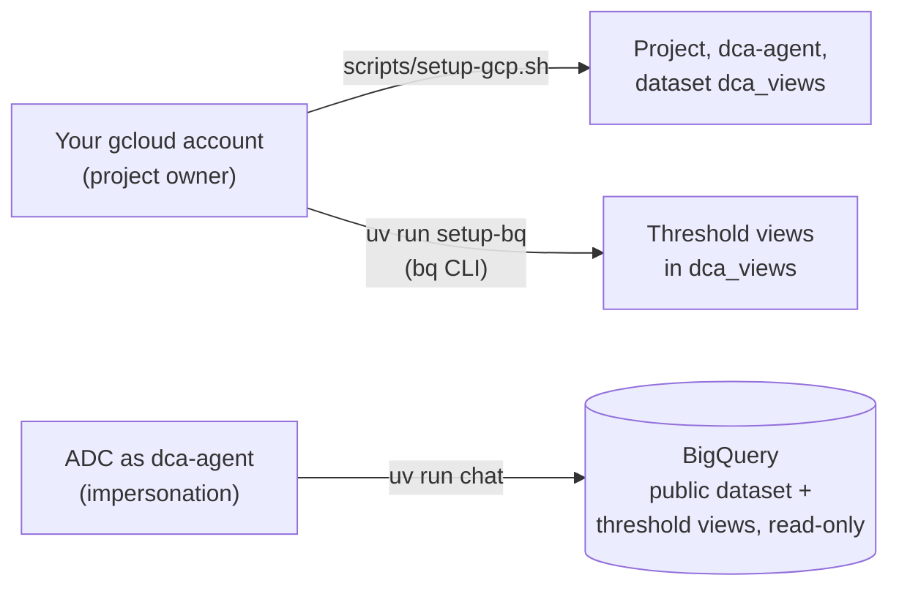

# Data Chat Assistant

A CLI chat agent for the Executives of a retail company. An Executive asks a question about the sales data in BigQuery in plain language. The agent writes the SQL at run time, runs it in the Brand scope of the Executive and gives an Answer with analysis and, on request, Action items. The prototype also has the four required features: safety and PII masking, a strict confirmation for deletes, resilience and observability.

## Setup

You need Python 3.12, [uv](https://docs.astral.sh/uv/), the [Google Cloud CLI](https://cloud.google.com/sdk/docs/install) (`gcloud` and `bq`) and a Gemini API key from [Google AI Studio](https://aistudio.google.com/apikey). The prototype uses the BigQuery sandbox and the Gemini API free tier, so it costs $0.

Two identities do the work. Your own `gcloud` account makes the GCP resources and the threshold views. The chat runs as the read-only service account `dca-agent`, through application default credentials (ADC) with impersonation. There is no key file.



1. Install the dependencies:

   ```bash
   uv sync
   ```

2. Copy the example settings, then put your API key and your project ID in `.env`:

   ```bash
   cp .env.example .env
   ```

3. Make the project, the service account `dca-agent` and the dataset `dca_views`. The script uses your `gcloud` account, and you can run it again:

   ```bash
   PROJECT_ID=<your-project-id> scripts/setup-gcp.sh
   ```

4. Let ADC impersonate `dca-agent`:

   ```bash
   gcloud auth application-default login --impersonate-service-account=dca-agent@<your-project-id>.iam.gserviceaccount.com
   ```

5. Make the threshold views ([ADR 0005](docs/adr/0005-aggregation-threshold-on-demographic-path.md)). This command uses your own `gcloud` account through the `bq` CLI, not `dca-agent`, because `dca-agent` can only read. In the BigQuery sandbox, the views expire after 60 days: run the command again. Until then, the agent uses a `HAVING COUNT(DISTINCT …) >= 5` fallback.

   ```bash
   uv run setup-bq
   ```

6. Start the chat:

   ```bash
   uv run chat --executive mgr_ana
   ```

**Without uv.** `requirements.txt` is made from `uv.lock`. It installs the project with pip:

```bash
python3.12 -m venv .venv && .venv/bin/pip install -r requirements.txt
```

```bash
.venv/bin/chat --executive mgr_ana
```

## Use

`executives.json` is the access mapping of the prototype. There is no sign-in: `--executive` selects the Executive.

| ID | Role | Brand scope |
| --- | --- | --- |
| `ceo` | CEO | all brands |
| `mgr_ana` | Manager | Allegra K, Calvin Klein |
| `mgr_ben` | Manager | Levi's, Carhartt, Columbia, Quiksilver, Volcom |

| Command | What it does |
| --- | --- |
| `/help` | Shows the commands. |
| `/scope` | Shows your Brand scope. |
| `/sql [all]` | Shows the SQL of the last Answer after the Brand scope rewrite. With `all`: each attempt and its error. |
| `/save [title]` | Saves the last Answer as a Saved Report. |
| `/list` | Lists your Saved Reports. |
| `/undo` | Restores the reports of your last delete, for 24 hours. |
| `/trace [id]` | Shows the steps of a Turn. With no ID: the last Turn. |
| `/exit` or `Ctrl+D` | Ends the session. `Ctrl+C` during a Turn cancels only the Turn. |

| Option | Effect |
| --- | --- |
| `--plain` | Plain text for screen readers and pipes. Tables are tab-separated values. |
| `--no-color` (or `NO_COLOR`) | No colors and no ANSI codes. |
| `--ascii` | ASCII symbols only. |
| `--no-animation` | Static status lines. |

The [demo scenarios](docs/demo.md) show each required feature step by step.

## Configuration

All starting values (budgets, retries, timeouts, the confirmation TTL, the Undo window, row limits, model IDs, prices for the cost metric) are in [`config/defaults.toml`](config/defaults.toml) (P17). An environment variable or `.env` overrides a value: `DCA_<SECTION>__<KEY>`, for example `DCA_BUDGET__LLM_CALLS=4`, or `DCA_MODEL` for the main model.

Chaos mode injects failures into the LLM and BigQuery adapters:

```bash
CHAOS=llm_429:0.3,bq_timeout:0.1 CHAOS_SEED=7 uv run chat --executive mgr_ana
```

The faults are `llm_429`, `llm_503`, `llm_timeout`, `bq_timeout` and `bq_5xx`.

## Tests and metrics

The offline tests use no network, no API key and no GCP project:

```bash
uv run pytest
```

The `live` tests use Gemini and your BigQuery project (the setup above). They check the Brand scope against a reference query, the threshold view and one real Turn:

```bash
uv run pytest --live tests/test_live.py
```

Each Turn writes its trace and its log lines to `dca_traces.jsonl`. This command computes the metrics of [HLD 16.2](docs/design/hld.md#162-metrics) from the file:

```bash
uv run dca-metrics dca_traces.jsonl
```

## Documentation

- [High-level design](docs/design/hld.md): the architecture of the whole solution.
- [CLI design](docs/design/cli.md): how the CLI shows Answers.
- [Requirements coverage](docs/requirements-coverage.md): each acceptance criterion with its design, code, tests and demo.
- [Demo scenarios](docs/demo.md)
- [Tech stack](docs/tech-stack.md)
- [Architecture decision records](docs/adr/)
- [Design principles](docs/design-principles.md)
- [Glossary](CONTEXT.md)

## Assumptions

These are our assumptions in addition to the [client decisions](docs/requirements/2026-11-12-client-decisions.md) (P3):

- "Client X" in "Delete all reports mentioning Client X" means a Customer. Each Saved Report records the IDs of the Customers in the result rows of its queries, and the delete matches on these IDs. For a name, the agent asks for the Customer ID.
- The prototype has no real login. The CLI selects the Executive with `--executive <id>`, from `executives.json`.
- The prototype keeps its state in one process and in local files: sessions in memory, Saved Reports and the audit log in SQLite (`dca_reports.sqlite`), traces in `dca_traces.jsonl`. Production keeps them in Firestore and Cloud Trace (P21). Each Turn still loads and saves its state through the ports.
- The prototype uses the Gemini API free tier. On the free tier, Google can use prompts and responses to improve its products. This is acceptable for the public synthetic dataset. Production uses Gemini on Vertex AI. Reviewers must use their own API key. On the free tier, `gemini-3.8-flash` often answers "high demand"; the agent then retries and uses the backup model.
- The prototype has no Metric catalog (the industry name is "semantic layer"). The LLM interprets terms such as "churn" from the schema description ([ADR 0007](docs/adr/0007-no-metric-catalog-in-prototype.md)). The Golden Bucket and Trio retrieval are bonus features and are not in the prototype.
- A row list of Customers that shows age, gender, state or city gets a refusal `pii`, also with no filter on these columns. A demographic aggregate is permitted.
- The conversation context keeps the earlier answered Turns in full and a handle for each earlier query, within 6 k tokens. There is no LLM summary of older Turns. A refused Turn does not come back into the context.
- After the second failed SQL correction, the Executive gets an error notice, not a refusal `budget`. The trace records it as a budget stop.
- When the intent classifier fails, the message goes on as an analysis question. The SQL guard and the Output guard still check each query and each Answer.
- The prices for the "cost for each Turn" metric are starting values in the configuration, not quotes.
