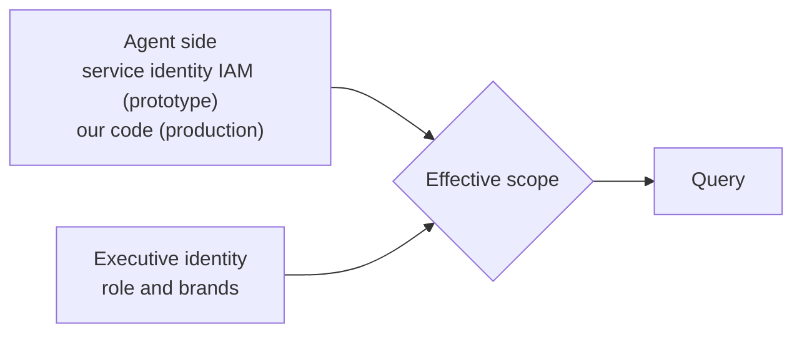

# Brand scope is enforced by a rewrite of scoped views, on the intersection of two identities

Scope: both

The LLM writes SQL only against logical scoped views (`scoped_order_items`, `scoped_orders`, `scoped_customers`). It never writes SQL against the raw tables. Our code parses the SQL with sqlglot and replaces each scoped view with a CTE that keeps only the Brand scope of the Executive, through the query parameter `UNNEST(@brands)`. Thus a query cannot go out of the scope, even if the LLM tries. The rights of a query are the Effective scope: the intersection of what the agent permits and the Brand scope of the Executive. In the prototype, the IAM rights of the service identity are the agent side. In production, our code is the agent side, and BigQuery enforces the Executive side, because each query runs as the Executive.

- **Prototype**: BigQuery IAM enforces the service side. Our rewrite enforces the Executive side, from `executives.json`. The CLI selects the Executive with `--executive <id>`. There is no real login.
- **Production**: the Executive signs in through IAP, and the query runs with the OAuth identity of the Executive. Thus BigQuery row access policies or authorized views apply the scope a second time. A bug in our rewrite cannot leak data. The combination of `SESSION_USER()` and a mapping table in one row access policy is not verified yet. Check it in a GCP project before you rely on it. BigQuery has no token that holds the intersection of two identities today: Credential Access Boundaries work only for Cloud Storage. A real intersection of the service identity and the Executive identity is a future target (see [What to revisit](../design/hld.md#26-what-to-revisit) in the HLD).

## Considered options

- **Service account only, scope only in code**: simpler, but one bug in the rewrite leaks data. Rejected for production.
- **Row access policies only**: not possible in the prototype, because we cannot put policies on a public dataset.
