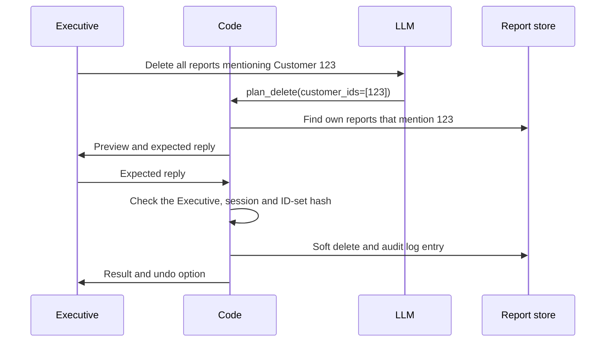

# The LLM has no delete tool, and code catches the confirmation

Scope: both

The LLM can only call `plan_delete`. This tool finds the Saved Reports that match the request, but it changes nothing. Our code shows the preview and the expected reply: "yes" for 1 report, and `delete n` for n reports when n is 2 or more. Our code binds the pending confirmation to the Executive, the session and a hash of the exact set of report IDs. The Executive does not type this binding. Our code reads the next message of the Executive *before* the LLM sees it. Only an exact match of the expected reply starts the soft delete and the audit log entry. Thus no prompt injection can make the LLM delete reports.

## Considered options

- **ADK `require_confirmation` on a delete tool**: less code, but the framework then makes a safety decision, and the LLM still holds a delete tool. This conflicts with P6 and P11.
