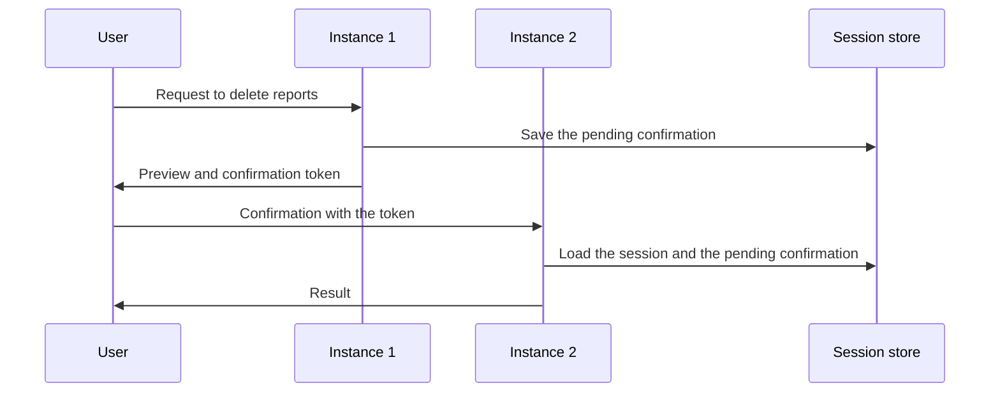
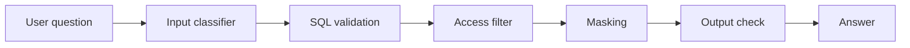
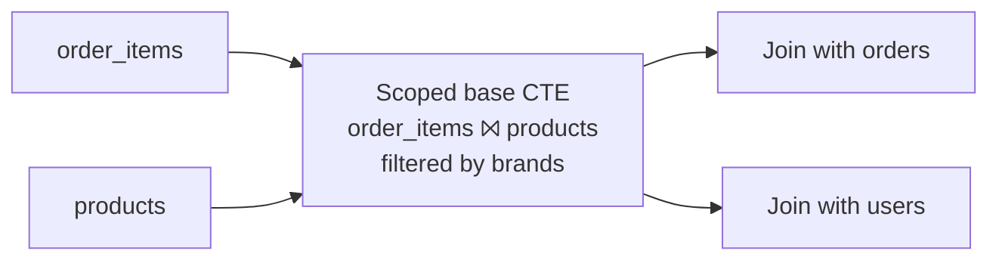
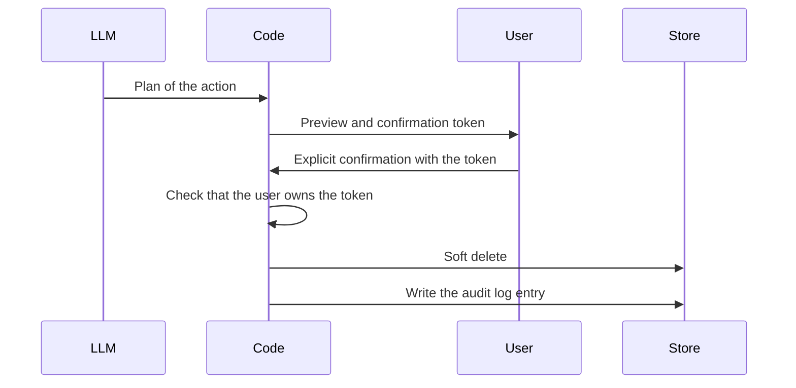
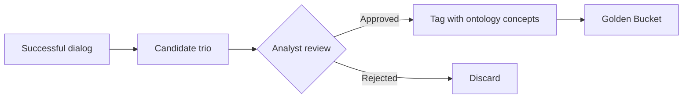

# Design principles

These are the default rules for this project. Follow them unless the user approves an exception.

## How to use this document

- Each principle has a stable ID. Use the ID when you refer to a principle (for example, "this conflicts with P9").
- If a change conflicts with a principle, stop. Name the principle and the conflict, and ask the user. Continue only after the user approves. Record the approved exception in [Exceptions](#exceptions).
- To add, change or retire a principle, get the user's approval first.
- Do not delete a retired principle. Set its status to **Retired** and give the reason. Do not use its ID again.
- Customer decisions are in [`docs/requirements/`](requirements/). If a principle and a customer requirement do not agree, the requirement is correct. Tell the user about the difference.

## Scope

### P1. The prototype has the four required features and a working chat

The prototype implements these features:

- Safety and PII protection.
- Confirmation of destructive operations.
- Resilience.
- Observability.

The prototype also has a CLI agent. The agent generates SQL for BigQuery at run time, keeps the conversation context and builds reports with action items. The design documents describe the other requirements. The prototype does not implement them.

### P2. Bonus features are cheap and come last

Do a bonus feature only when it is cheap and only after the required features are done. Possible bonus features: persona from YAML, a small Golden Bucket, user preferences in JSON, an eval script. The design and the documentation are more important than bonus features.

### P3. Mock what is missing, and say so

We create our own Golden Bucket, report library and manager-to-brand mapping. The customer decisions about access, PII and tools are in [client decisions](requirements/2026-11-12-client-decisions.md). Write all other assumptions in the README.

## Architecture

### P4. Two levels of architecture

- A logical architecture that does not name vendors.
- A physical architecture on GCP with specific services.

### P5. Managed services for commodity parts, our code for the core

Use managed services for infrastructure: compute, storage, secrets and monitoring. Write our own code for guardrails, SQL validation, the confirmation flow and context assembly.

### P6. Ports and adapters

The core uses shared interfaces: `LLMClient`, `Warehouse`, `ReportStore`, `KnowledgeStore`, `Tracer`. The prototype uses local adapters. Production uses GCP adapters. Thus the system is easy to extend, and it runs on any machine.

The agent framework is also an adapter. The framework runs the agent loop: LLM calls, tool calls, memory and pauses for confirmation. Our own functions make all safety decisions: SQL validation, the brand scope, masking and the check of the confirmation token. These functions do not import framework types.

### P7. Gemini is the default LLM

Other LLM providers are only optional adapters.

### P20. The CLI is a thin client

The core gives a turn API: one call takes a user message and returns the answer. The CLI only sends messages and shows answers. Other channels, such as a web chat or a chat bot, can use the same API. The prototype has only the CLI.

### P21. The turn service is stateless in production

In production, the service keeps no state in memory between turns. Each turn loads the session state from a store and then saves it: the conversation, the pending confirmations and the user preferences. Thus any instance can process the next turn, and a restart does not lose a confirmation.

The prototype is one CLI process, so it keeps the state in memory. The README lists this simplification.

## User experience

### P22. Answers are transparent

The user can see how the agent made each answer: the SQL, the brand scope that the agent applied, the assumptions and the `trace_id`.

## Security

### P8. Security is in the code and in the data layer, not in the prompt

Use more than one layer of protection:

SQL validation permits only `SELECT` and only the allowed tables and columns. It makes sure that each query has a `LIMIT` and does not scan more bytes than the limit.

### P9. The LLM never sees raw PII

- Do not select or show names, email addresses, street addresses, postal codes or exact coordinates.
- You can show a single customer by `user_id` or by a stable pseudonymous ID.
- A row-by-row list of customers with a filter on attributes such as age is a risk ("show all customers aged 25 from Boston"). These filters act as quasi-identifiers. Block such a list, or give an aggregate.
- The validator must identify the two cases:
  - Row-by-row output of customers with demographic filters: not permitted.
  - Aggregates on the same attributes: permitted.

### P10. Access is by brand only, and the mapping is in the configuration

- Each manager owns one or more brands and sees only these brands. The CEO sees all data. Categories do not control access.
- The manager-to-brand mapping is in a configuration file or in a separate access table. The dataset does not contain this mapping.
- Customer and order data are visible only through purchases of products in the scope. Metrics such as spend and churn use only the brands of the manager.
- Implementation:

- The agent does not query the raw tables directly. The agent can get `orders` and `users` only through a join with the scoped CTE.
- In an order with items from different brands, only the items in the scope count.
- In production, use BigQuery row-level security or authorized views.

### P11. The LLM only plans destructive actions, and the code does them

## Knowledge

### P12. Three knowledge sources with different roles

| Source | Role |
| --- | --- |
| Schema description | What the data contains. |
| Semantic layer (a light ontology in YAML) | Deterministic metric definitions, relations and synonyms. |
| Golden Bucket | Examples of how analysts interpreted questions, and the report style. |

### P13. Review adds entries to the Golden Bucket

A trio is Question → SQL query → Analyst report. The ontology tags make the search for similar trios accurate.

## Reliability and cost

### P14. Self-correction always has limits

- First, do a dry run. It is free.
- Then do not more than 2–3 correction attempts.
- If the result is empty, find the cause (for example, check the real values of the filter columns). Do not only try again.
- Set budgets for tokens and for bytes scanned.

### P15. External calls have retries and a fallback, and the interface does not stop

- Use backoff for 429 and 5xx responses.
- Use timeouts.
- Use a fallback model.
- An error handler wraps each turn of the conversation.

### P16. Observability from the first day

- A trace for each turn.
- Spans for LLM calls, tools and guardrails.
- Structured logs.
- Metrics that we define before we start.
- You can examine a dialog by its `trace_id`.

## Flexibility

### P17. Configuration, not code

The persona, the instructions and the access rights are in external files. The system reads them again at run time. A change does not need a new deployment.

## Quality

### P23. Tests prove the required features

Each of the four required features (P1) has automated tests. Examples:

- Safety: a red-team set of questions that try to get PII, data of other brands or answers that are not analysis.
- Confirmation: a delete without a valid token does nothing, and a user cannot delete the reports of a different user.

## Documentation and delivery

### P18. The rationale has different depths

- Production decisions: alternatives and trade-offs in a "Key decisions" table.
- Prototype: one line for each component, and an honest list of simplifications.
- Components outside GCP: why we do not use the native GCP equivalent, and where the component runs (inside the perimeter).
- Framework: why we selected it and how much experience we have with it. Be honest.

### P19. The project runs on a different machine

- uv is the main dependency manager, because the customer prefers it. Use `pyproject.toml` and `uv.lock`. Install with `uv sync`.
- Generate `requirements.txt` as a fallback for `pip`, because the assignment mentions `pip`.
- Supply `.env.example`, step-by-step instructions and an example run.
- Do not hardcode dates. The data is synthetic and it changes.

### P24. The documentation has one source

- `docs/` is the single source of the documentation. A GitHub Action publishes it to GitHub Pages.
- Each page must also read correctly on github.com, because a reviewer may not open the Pages site.
- Do not copy content between the README, the docs and the site. Use links.

### P25. Each requirement is traceable

A coverage table maps each requirement of the assignment to a design section, the code, a test and a demo scenario. For a requirement that is only in the design, the table says that there is no code.

## Exceptions

Record each approved deviation from a principle here. There are no exceptions at this time.

| Date | Principle | What changed | Why | Approved in |
| --- | --- | --- | --- | --- |
