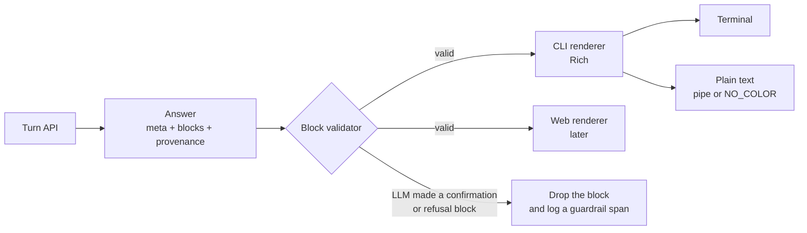
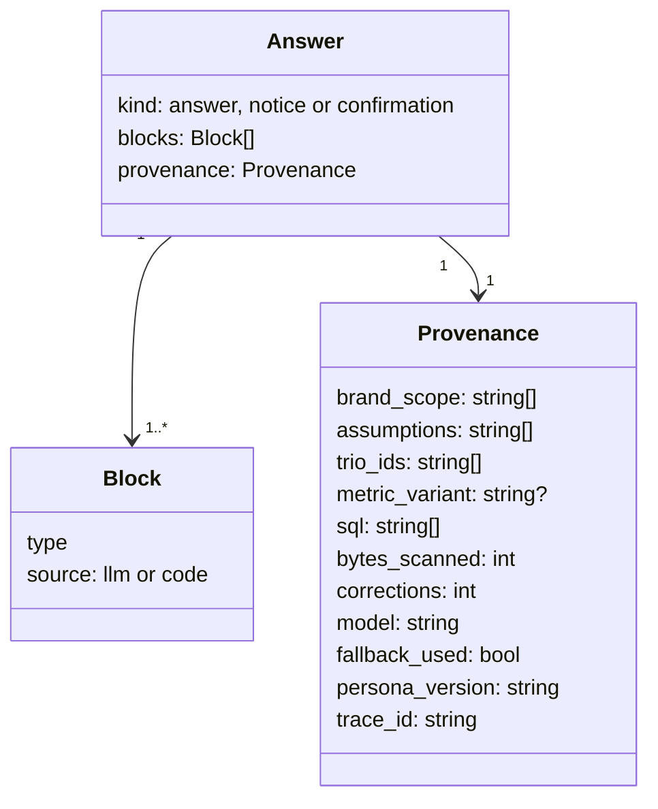
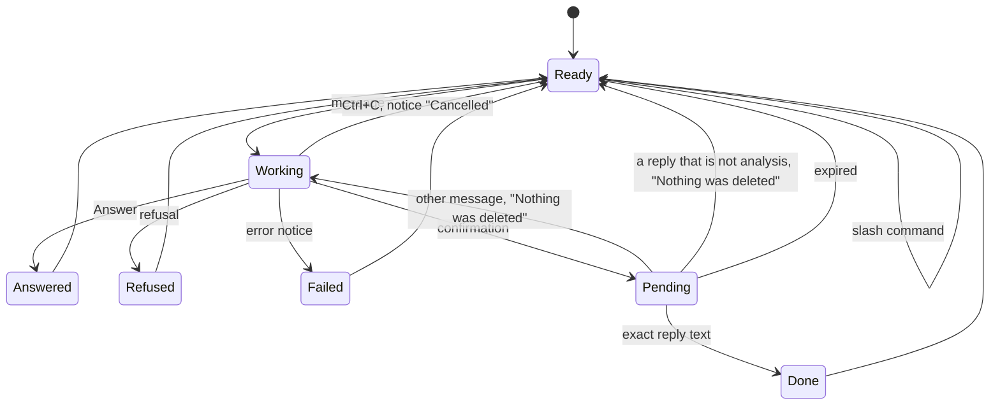
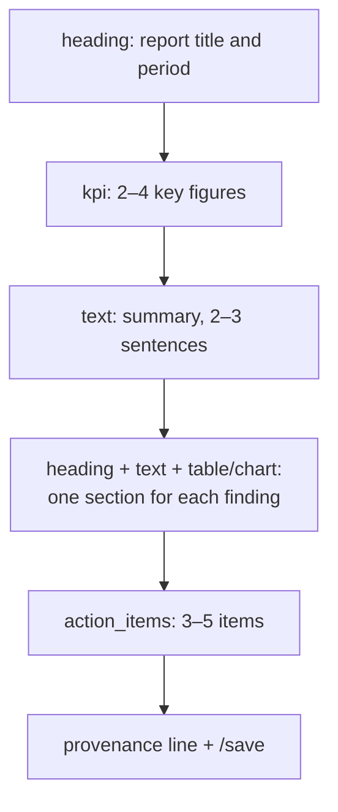
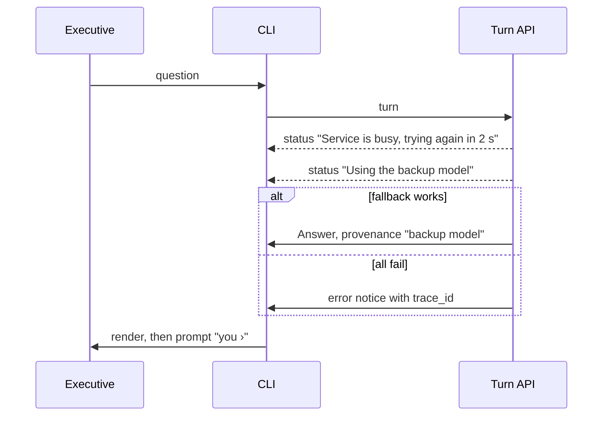

# CLI design

This page defines how the agent shows Answers to an Executive. It has two parts:

- A **channel-neutral Answer model**. The core makes it. Each channel renders it.
- The **CLI design**. It is the only channel in the prototype (P20). It uses Rich.

A later web chat or chat bot uses the same Answer model. It needs only a new renderer and its own tokens.

Related principles and decisions: P9 (no raw PII), P11 and [ADR 0002](../adr/0002-llm-has-no-delete-tool.md) (confirmation), P15 (errors), P16 (trace), P20 (thin client), P22 (transparent Answers). The acceptance criteria are in the [coverage table](../requirements-coverage.md). The system, the [Turn API](hld.md#5-turn-api) and the rules that this page shows are in the [high-level design](hld.md).

## Contents

1. [Rules](#rules)
2. [Answer model](#answer-model)
3. [Tokens](#tokens)
4. [Components](#components)
5. [Patterns](#patterns)
6. [Accessibility](#accessibility)
7. [Naming](#naming)
8. [Traceability](#traceability)
9. [Open questions](#open-questions)

## Rules

| ID | Rule | Why |
| --- | --- | --- |
| DS1 | The core decides the content and the format of an Answer. The renderer only draws it. | P20. The Executive profile (table or bullets, depth, length) applies in the core, so all channels show the same Answer. |
| DS2 | Each Answer has a provenance part: Brand scope, assumptions, Trio IDs, Metric variant, SQL and `trace_id`. | P22. |
| DS3 | Only our code makes `confirmation` and `refusal` blocks. The renderer refuses these block types from LLM output. | P11, ADR 0002. An LLM must not draw a false confirmation or hide a refusal. |
| DS4 | Color never carries meaning alone. Each status also has a label and a symbol. | Accessibility, `NO_COLOR` terminals, piped output. |
| DS5 | Use named tokens only. Do not write a raw Rich style, color, symbol or box in a component. | One change of the theme changes all components. |
| DS6 | A chart always has its numbers next to it, or a table below it. | A terminal chart is approximate. The Executive must see exact figures. |
| DS7 | The CLI does not stop on an error. An error is a `notice` block with the `trace_id`. | P15, AC-R5.2. |
| DS8 | A Customer appears only as `Customer <user_id>` or as a stable pseudonym. No component has a field for a name, an email address or an address. | P9, AC-R2.1. |

## Answer model

### Flow



### Structure



### Block types

| Type | Made by | Fields | CLI component |
| --- | --- | --- | --- |
| `heading` | LLM | `text` | [C5 Answer panel](#c5-answer-panel) title |
| `text` | LLM | `markdown` (no HTML, no links to outside hosts) | Rich Markdown |
| `bullets` | LLM | `items[]` | [C9 List](#c9-list) |
| `kpi` | LLM, from query results | `label`, `value`, `unit`, `delta?`, `period` | [C7 KPI row](#c7-kpi-row) |
| `table` | Code, from query results | `columns[]` (name, type, unit), `rows[]`, `total_rows`, `truncated` | [C6 Data table](#c6-data-table) |
| `chart` | Code, from a `table` | `kind` (bar, sparkline), `x`, `y`, `table_ref` | [C8 Chart](#c8-chart) |
| `action_items` | LLM | `items[]` (action, owner?, metric to watch) | [C9 List](#c9-list), numbered variant |
| `notice` | Code | `level` (info, warning, error), `title`, `body`, `trace_id` | [C11 Notice](#c11-notice) |
| `refusal` | Code (guardrails) | `reason` (pii, scope, not_analysis, threshold, budget), `body`, `suggestion?` | [C11 Notice](#c11-notice), refusal variant |
| `confirmation` | Code (confirmation module) | `action`, `items[]` (id, title, date), `count`, `reply_text`, `expires_at` | [C12 Confirmation panel](#c12-confirmation-panel) |
| `result` | Code | `action`, `count`, `undo_until?` | [C13 Result line](#c13-result-line) |

Figures in `table` and `chart` come from query results, not from LLM text. Thus a chart cannot show a number that the query did not return.

## Tokens

The tokens are Rich theme style names. The values use the 16 standard ANSI colors. Thus the terminal theme of the Executive (light or dark) controls the real color, and the text stays readable in both.

### Color roles

| Token | Rich style | Use |
| --- | --- | --- |
| `dca.text` | `default` | Body text. |
| `dca.muted` | `dim` | Provenance, hints, timestamps, secondary labels. |
| `dca.strong` | `bold` | Key figures, titles. |
| `dca.accent` | `cyan` | Agent name, panel titles, the prompt, links to commands (`/sql`). |
| `dca.success` | `green` | Done states, positive delta. |
| `dca.warning` | `yellow` | Warnings, truncated tables, fallback model, self-correction. |
| `dca.danger` | `bold red` | Destructive confirmation, errors. |
| `dca.refusal` | `magenta` | Guardrail refusals. Different from errors: a refusal is correct behavior. |
| `dca.scope` | `blue` | Brand scope labels. |
| `dca.code` | `default on default` plus the Rich `Syntax` theme `ansi_dark` or `ansi_light` | SQL. |
| `dca.delta.up` | `green` | Positive change. Always with `▲` and a sign. |
| `dca.delta.down` | `red` | Negative change. Always with `▼` and a sign. |

A positive delta is not always good (for example churn). The `kpi` block can set `good_direction: down`. Then the colors change places, and the symbols stay the same.

### Text styles

A terminal has one font size. Hierarchy comes from weight, color, case and space.

| Token | Style | Use |
| --- | --- | --- |
| `dca.title` | `bold` + `dca.accent` | Panel titles. |
| `dca.label` | `bold` | Table headers, KPI labels, field names. |
| `dca.body` | `dca.text` | Paragraphs and list items. |
| `dca.caption` | `dca.muted` | Provenance lines, footnotes. |
| `dca.mono` | Monospace (the terminal font) | IDs, codes, SQL, `trace_id`. |

Do not use italic. Many terminals do not show it.

### Symbols

| Token | Unicode | ASCII fallback | Meaning |
| --- | --- | --- | --- |
| `sym.agent` | `◆` | `*` | Agent turn |
| `sym.ok` | `✓` | `[ok]` | Done |
| `sym.warn` | `!` | `[!]` | Warning |
| `sym.error` | `✗` | `[x]` | Error |
| `sym.refusal` | `⊘` | `[no]` | Refusal |
| `sym.danger` | `⚠` | `[!!]` | Destructive action |
| `sym.up` / `sym.down` | `▲` / `▼` | `+` / `-` | Delta |
| `sym.bar` | `█` and `▏▎▍▌▋▊▉` | `#` | Bar chart |
| `sym.spark` | `▁▂▃▄▅▆▇█` | `_.-=+*#` | Sparkline |
| `sym.bullet` | `•` | `-` | List item |
| `sym.sep` | `·` | `\|` | Separator in one line |

The CLI uses the ASCII fallback when the output encoding is not UTF-8 or when the Executive uses `--ascii`.

### Space

| Token | Value | Use |
| --- | --- | --- |
| `space.block` | 1 empty line | Between blocks in an Answer. |
| `space.turn` | 1 empty line + a rule | Between turns. |
| `space.panel` | padding `(0, 1)` | Inside each panel. |
| `space.indent` | 2 columns | Nested list items, provenance lines. |

### Width

| Token | Value | Rule |
| --- | --- | --- |
| `width.max` | 100 columns | The Answer panel does not grow wider, also on a wide terminal. Long lines are hard to read. |
| `width.min` | 60 columns | Below this width, tables change to a key-value list ([C6](#c6-data-table)). |
| `width.chart` | 40 columns | The maximum bar length. |

### Borders

| Token | Rich box | Use |
| --- | --- | --- |
| `box.answer` | `ROUNDED` | Answer panel. |
| `box.table` | `SIMPLE_HEAD` | Data tables. Only the header line, so the numbers are easy to scan. |
| `box.danger` | `HEAVY` | Destructive confirmation. It must look different from all other panels. |
| `box.notice` | none, a left bar `▌` in the level color | Notices and refusals. |
| `box.ascii` | `ASCII` | All boxes in ASCII mode. |

### Motion

| Token | Value | Rule |
| --- | --- | --- |
| `motion.spinner` | Rich `dots` | Only on an interactive TTY. |
| `motion.refresh` | 8 per second | Status refresh rate. |
| `motion.none` | Static lines | When the output is not a TTY, when `NO_COLOR` is set, or with `--no-animation`. Each step prints one line. |

### Number and date format

| Token | Format | Example |
| --- | --- | --- |
| `fmt.int` | Thousands separator | `12,480` |
| `fmt.money` | Currency symbol, 0 decimals at 1,000 and more, else 2 | `$84,120` · `$37.50` |
| `fmt.compact` | K, M, B in KPI rows only | `$1.2M` |
| `fmt.pct` | 1 decimal | `4.3%` |
| `fmt.delta` | Sign, symbol, and the unit `pp` for percentage points | `▲ +1.2 pp` |
| `fmt.date` | ISO | `2026-10-31` |
| `fmt.period` | ISO month or quarter | `2026-10` · `2026-Q1` |
| `fmt.id` | Monospace, no change | `Customer 48213` · `trace 7f3a9c` |

Numbers in tables align to the right. Text aligns to the left.

## Components

Each component uses only tokens. The ASCII and plain-text variants follow the same layout.

### C1. Session header

Shows who chats and with which scope. It prints once at the start of a session.

```text
◆ Data Chat Assistant
  Executive mgr_ana · Manager · Brand scope: Allegra K, Calvin Klein
  Type a question, or /help for commands.
```

| Variant | Difference |
| --- | --- |
| Manager | Lists the brands. More than 3 brands: `Brand scope: 5 brands (/scope to list)`. |
| CEO | `Brand scope: all brands`. |
| Unknown Executive ID | No header. A `notice` (error) lists the valid IDs from `executives.json`. The CLI exits with code 2. |

Tokens: `dca.accent`, `dca.muted`, `dca.scope`, `sym.agent`.

### C2. Prompt

The input line of the Executive.

```text
you ›
```

| State | Look | Behavior |
| --- | --- | --- |
| Ready | `you ›` in `dca.accent` | Accepts a message or a `/` command. |
| Busy | Hidden | Input is not accepted during a turn. `Ctrl+C` cancels the turn, not the session. |
| Confirmation pending | `confirm ›` in `dca.danger` | The next message goes to the confirmation check first (ADR 0002). |

Keyboard: `Enter` sends. `Ctrl+C` during a turn cancels the turn. `Ctrl+C` at the prompt or `Ctrl+D` ends the session. Up and Down arrows show earlier messages of this session.

### C3. Turn status

Shows the step that the agent does now. It is the only animated component.

```text
⠋ Running the query · attempt 2 of 3 · 1.8 s
```

| State | Text | Token |
| --- | --- | --- |
| Thinking | `Reading the question` | `dca.muted` |
| Retrieval | `Finding similar analyses` | `dca.muted` |
| SQL | `Writing SQL` | `dca.muted` |
| Dry run | `Checking the query` | `dca.muted` |
| Query | `Running the query` | `dca.muted` |
| Correction | `Fixing the query · attempt n of 3` | `dca.warning` |
| Retry | `Service is busy, trying again in n s` | `dca.warning` |
| Fallback | `Using the backup model` | `dca.warning` |
| Writing | `Writing the answer` | `dca.muted` |

The status disappears when the Answer prints. In `motion.none` mode, each state prints as one static line in `dca.caption`. The status text never contains SQL or data.

### C4. Turn separator

A thin rule (`─`, in `dca.muted`) between turns, with the turn number at the right: `── 3`.

### C5. Answer panel

The container of one Answer.

```text
╭─ ◆ Revenue, last 3 months ─────────────────────────────────────╮
│ Revenue grew in each month. October is the best month.          │
│                                                                 │
│  Month     Revenue   Orders   vs prev.                          │
│ ──────────────────────────────────────                          │
│  2026-08   $71,300    1,912                                     │
│  2026-09   $76,950    2,044   ▲ +7.9%                           │
│  2026-10   $84,120    2,231   ▲ +9.3%                           │
│                                                                 │
╰─────────────────────────────────────────────────────────────────╯
  Scope: Allegra K, Calvin Klein · Trios: T-002 · trace 7f3a9c · /sql
```

| Part | Rule |
| --- | --- |
| Title | From the `heading` block. If there is no heading, the title is only `◆`. |
| Body | The blocks in their order, with `space.block` between them. |
| Footer | [C10 Provenance line](#c10-provenance-line), outside the panel. |

| Variant | Use when | Difference |
| --- | --- | --- |
| Default | A normal Answer. | `box.answer`. |
| Report | The Executive asks for a report. | Has sections (`heading` blocks inside the body), ends with `action_items`, and the footer adds `/save`. |
| Short | An answer of one or two sentences, or about the schema. | No panel border. Only `sym.agent` and the text. |

### C6. Data table

| Rule | Value |
| --- | --- |
| Header | `dca.label`. |
| Numbers | Right aligned, formatted with `fmt.*` by column type. |
| Maximum rows shown | 20. More rows: the first 20 and a line `Showing 20 of 312 rows. Ask to filter or group them.` in `dca.warning`. |
| Maximum columns | 6. More columns: the core makes two tables, or the renderer uses the key-value variant. |
| Empty cell | `—` in `dca.muted`. |
| Customer column | Shows `user_id` or the pseudonym (DS8). |

| Variant | Use when |
| --- | --- |
| Grid | Default. `box.table`. |
| Key-value | The terminal is narrower than `width.min`, or the table has one row. Each row is a group of `label: value` lines. |
| Ranked | The question asks for a top or bottom list. Adds a `#` column. |

Screen readers and piped output: the plain variant prints tab-separated values with a header line.

### C7. KPI row

One to four key figures in one line, for the start of a report.

```text
 Revenue $84.1K ▲ +9.3%    Orders 2,231 ▲ +9.2%    Churn 4.3% ▼ −0.4 pp
 2026-10 vs 2026-09
```

Label in `dca.label`, value in `dca.strong`, delta in `dca.delta.*` with `sym.up` or `sym.down`. The period line is `dca.caption`. On a narrow terminal, each KPI goes on its own line.

### C8. Chart

A terminal chart shows a shape. The exact figures are in a table (DS6).

| Variant | Use when | Limit |
| --- | --- | --- |
| Bar | Compare categories (brands, states). | 12 bars. More: table only. |
| Sparkline | A trend in one line, next to a KPI or a table row. | 8 to 60 points. |

```text
 California  ████████████████████████████████████████  $41,200
 Texas       ██████████████████████████▌               $27,450
 New York    ███████████████████▏                      $19,800
```

Rules:

- The bars start at zero. Do not cut the axis.
- Bars sort by value, from high to low, unless the x axis is time.
- One color (`dca.accent`) for all bars. A highlighted bar uses `dca.strong`, and its label also has `◂`.
- The value prints at the end of each bar.
- In ASCII mode, the bar is `#`.

A web renderer draws real charts from the same `chart` block.

### C9. List

| Variant | Symbol | Use |
| --- | --- | --- |
| Bullets | `sym.bullet` | `bullets` blocks. |
| Action items | `1.` `2.` `3.` | `action_items` blocks. Each item starts with a verb. An optional `Watch:` line in `dca.caption` names the metric. |

Maximum 7 items. Nested levels: 1.

### C10. Provenance line

One `dca.caption` line under each Answer (DS2, P22). It shows only the fields that have a value.

```text
  Scope: Allegra K, Calvin Klein · Variant: churn_90d · Trios: T-002, T-005 · 2 corrections · backup model · trace 7f3a9c · /sql
```

| Field | Shows when |
| --- | --- |
| Scope | Always. |
| Assumptions | The agent made an assumption. Printed as a second line: `Assumed: "last month" = 2026-10.` |
| Variant | The Answer uses a Metric variant (production). |
| Trios | The agent used Trios. |
| Corrections | The agent fixed the SQL one time or more (`dca.warning`). |
| Backup model | The fallback model made the Answer (`dca.warning`). |
| trace | Always. |
| `/sql` | The Answer ran SQL. The command prints the SQL of the last Answer with [C14](#c14-sql-view). |

### C11. Notice

A message that is not an analysis. It has a left bar `▌` in the level color, a symbol, a title and a body.

| Variant | Token | Symbol | Example title | Must have |
| --- | --- | --- | --- | --- |
| Info | `dca.accent` | `sym.agent` | `No orders match this filter` | A next step. |
| Warning | `dca.warning` | `sym.warn` | `Budget almost used` | What the agent did. |
| Error | `dca.danger` | `sym.error` | `The data service did not answer` | The `trace_id` and "Your session continues." |
| Refusal | `dca.refusal` | `sym.refusal` | `I can't show personal data` | The reason in plain words and a permitted alternative. |

```text
▌ ⊘ I can't show personal data
▌ Customer names and email addresses are protected. I can show
▌ Customers by ID, or give totals by state.
▌ trace 9b21e0
```

Refusal reasons and their text:

| `reason` | Title | Alternative |
| --- | --- | --- |
| `pii` | I can't show personal data | Show by Customer ID, or show an aggregate. |
| `scope` | This is outside your brands | Show the same analysis for your brands. |
| `not_analysis` | I can only help with sales analysis | Example questions. |
| `threshold` | This group is too small to show | Use a wider group (fewer than 5 Customers is hidden, ADR 0005). |
| `budget` | This question needs too much data | Use a shorter period or fewer columns. |

A refusal never says which rule or which word caused it. This gives no help to an attacker. The `trace_id` lets the team see the reason.

### C12. Confirmation panel

The only component for a destructive action (P11, ADR 0002, AC-R3.1). Only the confirmation module makes it (DS3).

```text
┏━ ⚠ Delete 7 Saved Reports? ━━━━━━━━━━━━━━━━━━━━━━━━━━━━━━━━━━━┓
┃ These reports mention Customer 48213:                           ┃
┃                                                                 ┃
┃  • Q3 churn review                          2026-10-02          ┃
┃  • Top customers, September                 2026-09-30          ┃
┃  • … and 5 more (/list to see all)                              ┃
┃                                                                 ┃
┃ To delete, type:  delete 7                                      ┃
┃ Any other message cancels. This request expires in 5 minutes.   ┃
┃ You can undo for 24 hours.                                      ┃
┗━━━━━━━━━━━━━━━━━━━━━━━━━━━━━━━━━━━━━━━━━━━━━━━━━━━━━━━━━━━━━━━━┛
```

| Part | Rule |
| --- | --- |
| Border | `box.danger` in `dca.danger`. No other component uses it. |
| Title | The verb, the count and the object. |
| Items | Title and date of each matched Saved Report. Maximum 5, then `… and n more`. |
| Reply text | In `dca.mono` and `dca.strong`. The friction grows with the count (see the table below). |
| Footer | Cancel rule, time to expiry, undo window. |

| Matched reports | Reply text | Notes |
| --- | --- | --- |
| 0 | No panel. An info notice: `No Saved Reports of yours mention Customer 48213.` | |
| 1 | `yes` | AC-R3.1. |
| 2–3 | `delete n` | AC-R3.1. The rules are in [HLD 10.3](hld.md#103-rules). |
| More than 3 | `delete n` | AC-R3.1. |

| State | Look | Behavior |
| --- | --- | --- |
| Pending | The panel, the prompt is `confirm ›` | The next message goes to the code check before the LLM. |
| Confirmed | [C13 Result line](#c13-result-line), success | Soft delete and audit log entry. |
| Cancelled | Info notice `Nothing was deleted.` | Then the agent handles the message as a normal question. A message that is not analysis, such as "no, keep them", gets only the notice. |
| Expired | Info notice `The delete request expired. Nothing was deleted.` | |
| Wrong owner | Not possible: the preview lists only own reports (AC-R3.2). | |

### C13. Result line

One line after an action.

```text
✓ Deleted 7 Saved Reports. Type /undo before 2026-11-17 14:05 to restore them.
```

Token `dca.success` for the symbol, `dca.text` for the text. After an undo: `✓ Restored 7 Saved Reports.`

### C14. SQL view

Printed by `/sql`. It shows the final SQL of the last Answer after the scope rewrite (ADR 0001), with Rich `Syntax` (BigQuery dialect, SQL lexer), line numbers and `box.answer`. The caption line shows bytes scanned and the number of rows. If the agent fixed the SQL, `/sql all` shows each attempt and its error.

### C15. Trace view

Printed by `/trace <id>` (AC-R7.3). It is a tree of the spans of one turn.

```text
trace 7f3a9c · 2026-11-16 14:02:11 · 4.2 s · ✓ answered
├─ input classifier       ✓ analysis                     12 ms
├─ trio retrieval         T-002 (0.81), T-005 (0.74)     88 ms
├─ llm gemini-3.8-flash   1,204 → 311 tokens            1.1 s
├─ sql validation         ✗ unknown column "revenu"      3 ms
├─ llm gemini-3.8-flash   correction 1                   0.9 s
├─ sql validation         ✓                              2 ms
├─ bigquery               12.4 MB · 3 rows               1.6 s
└─ output check           ✓                              5 ms
```

The status column uses `sym.ok`, `sym.error` and `sym.refusal` with their colors. The trace view never shows PII, because the trace has none (AC-R7.1).

### C16. Profile view

Printed by `/profile` (AC-R4.3, bonus). A key-value table of the Executive profile.

| Column | Content |
| --- | --- |
| Setting | `format`, `depth`, `length`, `charts`. |
| Value | The current value. |
| Source | `you set this` (`dca.strong`) or `learned` with a confidence (`dca.muted`). |

Edit with `/profile set format=table`. An explicit edit wins over a learned value (CONTEXT.md).

### C17. Help

Printed by `/help`. A two-column table: the command in `dca.accent` and `dca.mono`, the description in `dca.body`.

| Command | Description |
| --- | --- |
| `/help` | Show the commands. |
| `/scope` | Show your Brand scope. |
| `/sql [all]` | Show the SQL of the last Answer. |
| `/trace <id>` | Show the steps of a turn. |
| `/save [title]` | Save the last Answer as a Saved Report. |
| `/list` | List your Saved Reports. |
| `/undo` | Restore the reports of the last delete. |
| `/profile` | Show or edit your profile. |
| `/exit` | End the session. |

## Patterns

### P-TURN. Turn lifecycle



All end states go back to Ready. No state ends the session, except `/exit`, `Ctrl+D` and an unknown Executive at the start (DS7).

### P-FORMAT. Format from the Executive profile

The core selects the blocks. The renderer does not change them (DS1).

| Profile value | Blocks |
| --- | --- |
| `format: table` | `table` first, then one `text` sentence. |
| `format: bullets` | `bullets` with the key figures, then `table` only if the question asks for a list. |
| `charts: yes` | Adds a `chart` from the main `table`, when the data fits a bar or a sparkline. |
| `depth: short` | Up to 3 sentences, no `heading`. Renders as the Short variant of C5. |
| `depth: deep` | Sections, drivers and a comparison. |

### P-REPORT. Report with action items



### P-CORRECT. Self-correction and empty result

- During correction, C3 shows `Fixing the query · attempt n of 3` in `dca.warning` (AC-R5.1).
- The Answer does not explain the correction. The provenance line shows `n corrections`, and `/sql all` shows the details.
- For an empty result, the agent gives an info notice with the cause and a next step: `No orders from "Califronia". Did you mean California?`
- After the last failed attempt: an error notice with the `trace_id`.

### P-FAIL. Service failure and fallback



Error notice text: `The data service did not answer. Please try again in a minute. Your session continues. trace 7f3a9c`. Do not show a stack trace, an HTTP code or a vendor name.

### P-BUDGET. Budget limit

When a turn goes over its budget (AC-R5.3), a refusal with `reason: budget` tells what limit was hit in plain words and how to make the question smaller. It does not show the internal limit values.

## Accessibility

| Need | Rule |
| --- | --- |
| No color | Respect `NO_COLOR` and `--no-color`. All meaning stays in labels and symbols (DS4). |
| Screen reader | Respect `--plain` and non-TTY output: no spinner, no box lines, tables as tab-separated values, one block per paragraph. |
| No Unicode | ASCII symbols and `box.ascii` when the encoding is not UTF-8 or with `--ascii`. |
| Light and dark terminals | Only the 16 ANSI colors, so the terminal theme adapts them. Do not use `bright_black` for text, because it is unreadable on some dark themes. Use `dim`. |
| Narrow terminal | Below `width.min`, tables become key-value lists and KPI rows stack. |
| Motion | `--no-animation` or non-TTY makes C3 static. |
| Keyboard | All actions are commands or typed text. No action needs a mouse. |
| Language | All text that the code makes (notices, refusals, statuses) follows ASD-STE100 rules: short sentences, one meaning for each word. |

## Naming

| Thing | Pattern | Example |
| --- | --- | --- |
| Color and text tokens | `dca.<role>` | `dca.warning` |
| Symbols | `sym.<meaning>` | `sym.refusal` |
| Other tokens | `<category>.<name>` | `width.max`, `box.danger`, `fmt.money` |
| Components | `C<n>` and a noun | C12 Confirmation panel |
| Patterns | `P-<NAME>` | P-TURN |
| Block types | lower snake case | `action_items` |

The terms follow [CONTEXT.md](../../CONTEXT.md): Executive (not user), Answer (not response), Saved Report (not report), Customer (not client).

## Traceability

| Requirement | Components and patterns |
| --- | --- |
| AC-CORE.1 | C2, C5, P-REPORT |
| AC-R1.1, AC-R1.3 | C10 (Trio IDs) |
| AC-R2.1, AC-R2.2, AC-R2.3 | DS3, DS8, C1, C11 refusal variant |
| AC-R3.1, AC-R3.2, AC-R3.3 | C12, C13, P-TURN |
| AC-R4.3 | C16, P-FORMAT |
| AC-R5.1, AC-R5.2, AC-R5.3 | C3, C11, P-CORRECT, P-FAIL, P-BUDGET |
| AC-R7.1, AC-R7.3 | C10 (`trace_id`), C15 |
| P22 | DS2, C10, C14 |

## Open questions

These questions are decided:

- **Reply text for 2–3 reports**: `delete n`, the same as for more than 3 (AC-R3.1).
- **Confirmation code**: there is no random code. The reply text is the expected reply, and the pending confirmation is bound inside the system ([ADR 0002](../adr/0002-llm-has-no-delete-tool.md)).
- **Undo window and TTL**: 24 hours and 5 minutes. They are starting values in the configuration (P17). See [HLD 3](hld.md#3-assumptions-and-starting-values) and [HLD 10.3](hld.md#103-rules).

This question is still open:

1. **Default for charts.** Does the CLI show a bar chart by default when the data fits, or only when the Executive profile says `charts: yes`?
