# High-level design

| Item | Value |
| --- | --- |
| Status | Draft. It waits for approval. |
| Covers | The architecture of the full solution: the local prototype and production on GCP. |
| CLI display | The [CLI design](cli.md) owns the Answer model, the block types and the CLI components. This document links to it and does not repeat it. |
| Sources | [Technical assignment](../requirements/2026-11-12-client-technical-assignment.md), [Project client decisions](../requirements/2026-11-12-client-decisions.md), [design principles](../design-principles.md), [ADRs](../adr/), [tech stack](../tech-stack.md), [coverage table](../requirements-coverage.md), [glossary](../../CONTEXT.md) |

The terms in **bold** at their first use come from the [glossary](../../CONTEXT.md). Each number in this document is an assumption (A1, A2 ...) or a starting value (V1, V2 ...) from [section 3](#3-assumptions-and-starting-values), or it comes from a source.

## Contents

1. [Purpose](#1-purpose)
2. [Requirements and constraints](#2-requirements-and-constraints)
3. [Assumptions and starting values](#3-assumptions-and-starting-values)
4. [Logical architecture](#4-logical-architecture)
5. [Turn API](#5-turn-api)
6. [Turn lifecycle](#6-turn-lifecycle)
7. [Tools](#7-tools)
8. [Safety pipeline](#8-safety-pipeline)
9. [Context assembly](#9-context-assembly)
10. [Destructive operations](#10-destructive-operations)
11. [Data model and storage](#11-data-model-and-storage)
12. [Knowledge: Golden Bucket and Metric catalog](#12-knowledge-golden-bucket-and-metric-catalog)
13. [Learning loop](#13-learning-loop)
14. [Persona management](#14-persona-management)
15. [Resilience and error handling](#15-resilience-and-error-handling)
16. [Observability](#16-observability)
17. [Quality assurance](#17-quality-assurance)
18. [Physical architecture on GCP](#18-physical-architecture-on-gcp)
19. [Prototype architecture](#19-prototype-architecture)
20. [Deployment](#20-deployment)
21. [Security model](#21-security-model)
22. [Scale and capacity](#22-scale-and-capacity)
23. [Extension points](#23-extension-points)
24. [Key decisions](#24-key-decisions)
25. [Prototype simplifications](#25-prototype-simplifications)
26. [What to revisit](#26-what-to-revisit)
27. [Open questions](#27-open-questions)
28. [Requirement map](#28-requirement-map)

## 1. Purpose

The non-technical **Executives** of a retail company ask questions about sales data in a chat. The agent makes BigQuery SQL at run time. It runs the SQL in the **Effective scope** of the Executive. It gives an **Answer** with analysis and **Action items**. On request, it keeps an analysis as a **Saved Report**.

This document is deliverables 1 and 2 of the [technical assignment](../requirements/2026-11-12-client-technical-assignment.md): the architecture diagrams and the detailed technical explanation. It has two levels (P4):

- The **logical architecture** (sections 4–17) names no vendor. It is the same for the prototype and for production.
- The **physical architecture** (sections 18–20) names the GCP services for production and the local parts for the prototype.

The main design idea: **the LLM is not trusted**. It only proposes SQL and drafts. Our code makes all security decisions (P8).

## 2. Requirements and constraints

### 2.1 Functional requirements

| ID | Requirement | Prototype | Production design |
| --- | --- | --- | --- |
| Core | Chat in a CLI. Make SQL at run time. Keep the conversation context. Build an Answer with Action items on request. | Must | Yes |
| R1 | Hybrid Intelligence: use the **Golden Bucket** to interpret questions. Update it over time. | Bonus (2–3 **Trios**) | Yes |
| R2 | Safety and PII masking. **Brand scope**. Analysis questions only. | Must | Yes |
| R3 | A delete of Saved Reports needs a strict confirmation. | Must | Yes |
| R4 | Learning loop at the Executive level and at the system level. | Bonus (YAML profile) | Yes |
| R5 | Self-correction, resilience to failures of external services, cost limits. | Must | Yes |
| R6 | Evaluation before deployment, intent check, UX evaluation. | Bonus (eval script) | Yes |
| R7 | Agent metrics and deep-dive debugging. | Must | Yes |
| R8 | A non-developer changes the **Persona** with no deployment. | Bonus (`persona.yaml`) | Yes |
| Ext | Easy to extend: charts, Saved Reports by email, web search. | Design only | Yes |

The acceptance criteria (AC) are in the [coverage table](../requirements-coverage.md). [Section 28](#28-requirement-map) maps each requirement to this document.

### 2.2 Non-functional requirements

| Quality | Target | Source |
| --- | --- | --- |
| Correctness of the Brand scope | 0 rows outside the Effective scope | R2, AC-R2.2, ADR 0001 |
| PII | 0 PII values in the LLM context, the output, a trace or a log | R2, P9, AC-R7.1 |
| Latency | The first progress event, p50 and p95 of an analysis Answer, and the time of a report Answer | V1 |
| Availability | 99.5 % in working hours. The CLI never stops on an error (P15). | V2 |
| Cost | A budget for each **Turn**: LLM calls, LLM tokens, bytes scanned, wall time | AC-R5.3, V7 |
| Portability | The prototype runs on a different machine with `uv sync` | P19 |
| Change of tone | Live with no deployment | R8, P17 |

### 2.3 Constraints

- The data is `bigquery-public-data.thelook_ecommerce`, with the tables `orders`, `order_items`, `products` and `users`. The connection is read-only. We cannot put row access policies on a public dataset.
- OpsFleet prefers a recent Gemini model and tests with Gemini (P7). The prototype uses the Gemini API free tier, so the rate limits are low.
- The prototype has a CLI chat interface. It runs on a different machine with setup instructions.
- The assignment takes 6–12 hours. The design is more important than bonus code (P2).
- Google ADK runs the **Agent loop** as a thin adapter (ADR 0003). We have no earlier experience with ADK.
- The [Project client decisions](../requirements/2026-11-12-client-decisions.md) fix the access rule (brand only), the PII rule (`user_id` is permitted) and the tool preference (uv).

## 3. Assumptions and starting values

OpsFleet did not give the facts and the figures in this section. We selected them, and we say so (P3). The body of this document refers to them by ID. A row with "OpsFleet confirms" needs a confirmation before production. [Section 27](#27-open-questions) lists these confirmations.

### 3.1 Assumptions

| ID | Assumption | Basis | Owner |
| --- | --- | --- | --- |
| A1 | The access mapping is our decision: `executives.json` in the prototype, one BigQuery access table in production. | The dataset has no mapping. OpsFleet lets us select the form. | Design team |
| A2 | We make our own Golden Bucket: 2–3 Trios in the prototype, from the questions of the assignment. | The assignment calls the bucket "theoretical". | Design team |
| A3 | We make our own Saved Reports library. | The assignment supplies no library. | Design team |
| A4 | "Client X" in a delete request means a Customer. Each Saved Report records the IDs of the Customers that it mentions. | The dataset has Customers, not other parties. | Design team |
| A5 | The CLI is the channel for Executives also in production. It calls the Turn API through IAP. | The assignment asks for a CLI (P20). | OpsFleet confirms |
| A6 | The Executives have company Google identities, so IAP can sign them in. | IAP needs Google identities. OpsFleet did not name its identity provider. | OpsFleet confirms |
| A7 | Saved Reports by email go only to addresses in the company e-mail domain. | The assignment names email only as an extension, with no rule. | OpsFleet confirms |
| A8 | The **Undo window** is 24 hours. | AC-R3.3 asks for an Undo window, but gives no length. | Design team |
| A9 | The prototype has no real sign-in. `--executive <id>` selects the Executive from `executives.json`. | The prototype has no real Executives. | Design team |
| A10 | The prototype can use the Gemini API free tier. On the free tier, Google can use the prompts and the responses to improve its products. | The dataset is public and synthetic. | Design team |

### 3.2 Starting values

These values are configuration (P17), not requirements. Tune them with the eval results and the first weeks of traces.

| ID | Value | Basis |
| --- | --- | --- |
| V1 | First progress event in less than 2 s. Analysis Answer: p50 less than 15 s, p95 less than 45 s. Report Answer: not more than 90 s. | No target is given. OpsFleet confirms. |
| V2 | Availability 99.5 % in working hours | No target is given. OpsFleet confirms. |
| V3 | 10–50 Executives | No load figure is given. OpsFleet confirms. |
| V4 | 1 000 Turns each day | No load figure is given. OpsFleet confirms. |
| V5 | Peak: 10 Turns at the same time | Estimate from V3 and V4. |
| V6 | About 4 LLM calls and 25 k LLM tokens for each Turn | Estimate. Check it with traces. |
| V7 | Turn budget: 8 LLM calls, 60 k LLM tokens, 1 GB for each query, 2 GB for each Turn, 90 s wall time | AC-R5.3 asks for budgets with no values. |
| V8 | Retries: LLM 2, BigQuery 1. Backoff from 1 s to 8 s with full jitter. Use `Retry-After` when the service sends it. | P15 asks for backoff with no values. |
| V9 | Timeouts: LLM call 30 s, BigQuery job 60 s, request 120 s | P15. The request timeout is longer than the wall time of V7. |
| V10 | Circuit breaker: opens after 5 failures in 60 s, tries again after 30 s | EX.3 asks for a circuit breaker with no values. |
| V11 | Pending confirmation TTL: 5 minutes | AC-R3.1 asks for a TTL, but gives no length. |
| V12 | Purge of soft-deleted Saved Reports after 30 days | No retention rule is given. OpsFleet confirms. |
| V13 | Sessions kept 90 days | No retention rule is given. OpsFleet confirms. |
| V14 | Audit log kept 1 year | No retention rule is given. OpsFleet confirms. |
| V15 | Cloud Trace keeps spans 30 days. The BigQuery copy of the logs keeps 3 months. | Cloud Trace retention. OpsFleet confirms the log copy. |
| V16 | Executive profiles kept until the Executive leaves | Starting value. |
| V17 | Trio retrieval: top 3 Trios over a similarity threshold | AC-R1.1 asks for top-k. |
| V18 | Context limits: Persona 2 k, Executive profile 0.5 k, schema 2 k, Metric catalog 1 k, Trios 3 k and conversation 6 k LLM tokens. 50 result rows to the LLM. | Starting value. |
| V19 | The SQL guard adds `LIMIT 50`, or lowers a larger `LIMIT` to 50. | P8 asks for a `LIMIT`. |
| V20 | A trace keeps the first 20 result rows, after the Output guard. | Starting value. The same as the 20 rows of [cli.md C6](cli.md#c6-data-table). |
| V21 | Executive profile: in the prototype, an explicit edit wins (`/profile set`, bonus). The learning in production is open: no logic and no numbers are fixed. | Decision. [Section 27](#27-open-questions). |
| V22 | Human labels: 20–50 Answers each quarter, and again after a change of the rubric | Starting value. |
| V23 | Alert: Turn success rate less than 95 % in 1 hour | Starting value. |
| V24 | Alert: p95 latency more than 45 s in 1 hour | From V1. |
| V25 | The other alerts in the Alert column of [section 16.2](#162-metrics) | Starting value. |
| V26 | Cloud Run: concurrency 20, minimum 1 instance. The CPU allocation is open. | A Turn waits on I/O most of the time. [Section 27](#27-open-questions). |
| V27 | Default churn: 90 days with no order (`churn_90d`) | The dataset has no definition (ADR 0007). OpsFleet confirms. |
| V28 | The dataset is smaller than 1 GB. Most queries scan less than 100 MB. The data refreshes each day. | Secondary sources (about 539 MB as CSV). Not verified: check it with dry runs. |

## 4. Logical architecture

### 4.1 Overview

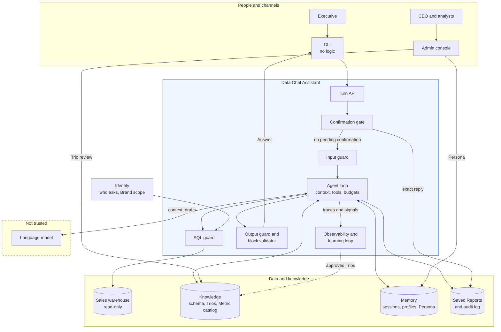

Our code makes four controls that the LLM cannot change:

- The Confirmation gate reads each message before the Input guard and the LLM (ADR 0002). Only the gate can delete.
- The SQL guard checks each query. It binds the Brand scope from the Identity, not from the LLM.
- The Output guard and the block validator check each Answer before the Executive sees it.
- In production, the warehouse applies the Brand scope a second time (ADR 0001).

### 4.2 Building blocks

| Building block | Responsibility | Principle |
| --- | --- | --- |
| CLI | Sends the input, shows the progress and renders the Answer. It has no logic. | P20, [cli.md](cli.md) |
| Admin console | The CEO edits the Persona. Analysts review candidate Trios and Metric variants. | R8, P13 |
| Turn API | Starts a session, takes a message and returns an Answer. It loads the state at the start of a Turn and saves it at the end. | P20, P21 |
| Confirmation gate | Reads each message before the LLM. Only an exact reply to a pending confirmation starts a delete. | P11, ADR 0002 |
| Input guard | Refuses input that is not analysis, and prompt injection. | P8 |
| Agent loop | Runs the LLM calls and the tool calls through the framework adapter (Google ADK). It makes no safety decision. | P6, ADR 0003 |
| Context assembler | Builds the LLM context from the prompt layers, the schema, the Trios and the conversation. | [Section 9](#9-context-assembly) |
| Tool registry | The tools that the LLM can call. Each tool has a **Side-effect class**. | [Section 7](#7-tools) |
| SQL guard | Validates the SQL AST, rewrites the scoped views to the Brand scope, routes demographic queries and does the dry run. | P8, P9, P10 |
| Output guard | Scans the Answer for PII. | P9 |
| Block validator | Refuses `confirmation` and `refusal` blocks from LLM output. It is in the core, next to the Output guard. | [cli.md DS3](cli.md#rules) |
| Budget and error handler | Wraps each Turn: budgets, retries, fallback model, friendly error notice. | P14, P15 |
| Language model | Understands the question, writes SQL and drafts the blocks. It is not trusted. | P7 |
| Identity | Tells the system who asks. The role and the Brand scope come from the access mapping (A1). | P10 |
| Sales warehouse | The read-only sales data. | — |
| Knowledge | The schema description, the Golden Bucket and the **Metric catalog**. | P12 |
| Memory | Sessions, pending confirmations, **Executive profiles** and Persona versions. | P21 |
| Saved Reports and audit log | The Saved Reports with the Customer IDs that they mention, and a record of each delete and each undo. | P11 |
| Observability and learning loop | Traces, logs and metrics for each Turn. Signals become reviewed Trios and tested changes. | P13, P16 |

### 4.3 Layers of the code

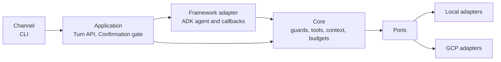

A dependency goes only to the right. The core does not import ADK, BigQuery or Firestore types. Thus a change of the framework or of a store changes only one adapter.

### 4.4 Ports

The core imports only the seven ports of P6. The safety code imports no framework types.

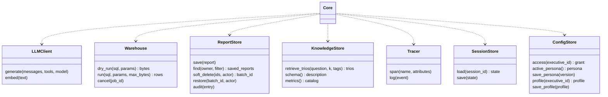

| Port | Building block | Prototype adapter | GCP adapter |
| --- | --- | --- | --- |
| `LLMClient` | Language model | Gemini API with an API key | Gemini on Vertex AI |
| `Warehouse` | Sales warehouse | BigQuery library with the application default credentials of the reviewer | BigQuery library with the OAuth token of the Executive |
| `ReportStore` | Saved Reports and audit log | SQLite | Firestore |
| `KnowledgeStore` | Knowledge | Trio YAML file and an in-memory cosine index (numpy) | Cloud Storage, BigQuery `VECTOR_SEARCH`, Metric catalog YAML |
| `Tracer` | Observability | OpenTelemetry SDK with a JSONL exporter | OpenTelemetry to Cloud Trace, structured logs to Cloud Logging |
| `SessionStore` | Sessions and pending confirmations | In memory | Firestore |
| `ConfigStore` | Access mapping, Persona, Executive profiles | `executives.json`, `persona.yaml`, one YAML file for each Executive | BigQuery access table; Firestore for the Persona and the profiles |

The agent framework is also an adapter (P6). A chaos wrapper can wrap any adapter. It injects failures from the `CHAOS` environment variable ([section 15.6](#156-chaos-mode)).

## 5. Turn API

The core gives one Turn API (P20). The prototype calls it in the same process. Production exposes it over HTTPS through IAP (design only). The CLI only sends input and renders the Answer.

### 5.1 Operations

| Operation | Prototype call | Production (HTTPS, design) | Result |
| --- | --- | --- | --- |
| Start session | `start_session(executive_id)` | `POST /v1/sessions` | `session_id`, role and Brand scope. The CLI shows them in [C1 Session header](cli.md#c1-session-header). An unknown Executive gets an error. |
| Send message | `send_message(session_id, text, on_progress)` | `POST /v1/sessions/{session_id}/turns`, with server-sent events | Progress events, then one Answer |
| Cancel | `cancel(session_id)` | `POST /v1/sessions/{session_id}/turns/{trace_id}/cancel` | The Turn stops. A notice "Cancelled". |
| Command | `command(session_id, name, args)` | `POST /v1/sessions/{session_id}/commands` | One Answer. No LLM call. |

The commands are the commands of [cli.md C17](cli.md#c17-help): `/scope`, `/sql [all]`, `/trace <id>`, `/save [title]`, `/list`, `/undo` and `/profile` (also `/profile set`). The CLI does `/help` and `/exit` itself. `/sql` shows the final SQL after the Brand scope rewrite ([cli.md C14](cli.md#c14-sql-view)).

### 5.2 Progress events

The progress events are the states of [cli.md C3 Turn status](cli.md#c3-turn-status). The prototype sends them through the `on_progress` callback. Production sends them as server-sent events. The first event comes in less than 2 s (V1). An event contains no SQL and no data.

| Event | C3 state | When |
| --- | --- | --- |
| `thinking` | Thinking | The Input guard and the plan |
| `retrieval` | Retrieval | Trio retrieval |
| `sql` | SQL | The LLM writes SQL |
| `dry_run` | Dry run | The SQL guard and the dry run |
| `query` | Query | The query runs |
| `correction` | Correction | A SQL correction, with the attempt number |
| `retry` | Retry | A backoff wait, with the seconds |
| `fallback` | Fallback | The fallback model takes the call |
| `writing` | Writing | The LLM writes the Answer |

### 5.3 Identity on each call

| Item | Prototype | Production |
| --- | --- | --- |
| Sign-in | None. `--executive <id>` (A9). | One desktop OAuth login in the CLI (ADR 0001). [Open question 1](#27-open-questions) checks that one login gives the IAP token and the BigQuery token. |
| IAP | None | The IAP token goes in the `Proxy-Authorization` header. IAP checks it. |
| BigQuery | Application default credentials of the reviewer | The BigQuery token of the Executive goes in the `Authorization` header. The Turn service uses it only for the queries of this Turn. It does not store it. |
| Role and Brand scope | `executives.json` | The access table, read on each Turn (A1) |

### 5.4 Answer

The Turn API returns the Answer of [cli.md Answer model](cli.md#answer-model). The [block types](cli.md#block-types) are also in cli.md. The core follows these rules:

- The Answer kind is `answer`, `notice` or `confirmation`.
- Only our code makes the `table`, `chart`, `notice`, `refusal`, `confirmation` and `result` blocks. The block validator refuses a `confirmation` or a `refusal` block from LLM output.
- The core applies the Executive profile (`format`, `depth`, `length`, `charts`) before the renderer ([cli.md DS1](cli.md#rules)).
- Each Answer has its **Provenance**: the Brand scope, the assumptions, the Trio IDs, the Metric variant, the final SQL after the Brand scope rewrite, the bytes, the corrections, the model, `fallback_used`, the Persona version and the `trace_id` (P22).

## 6. Turn lifecycle

The CLI states of a Turn are in [cli.md P-TURN](cli.md#p-turn-turn-lifecycle). This section shows the work of the core.

### 6.1 Sequence of one Turn

The sequence has two diagrams: the main path, and the failure paths.

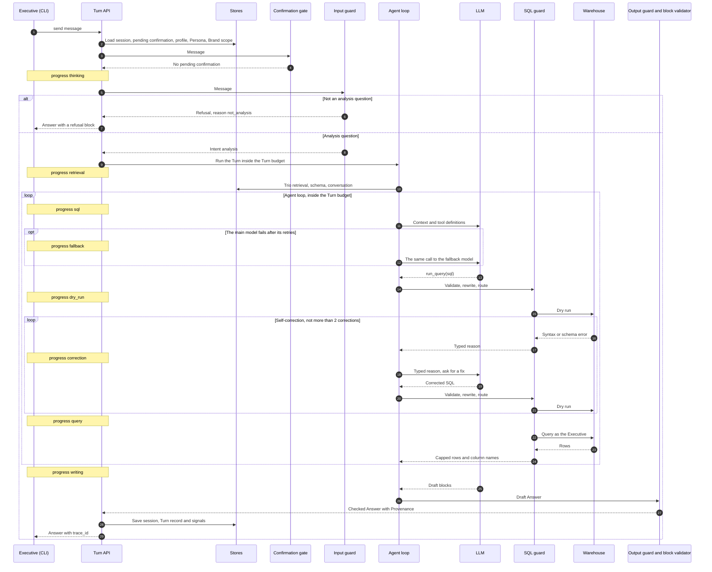

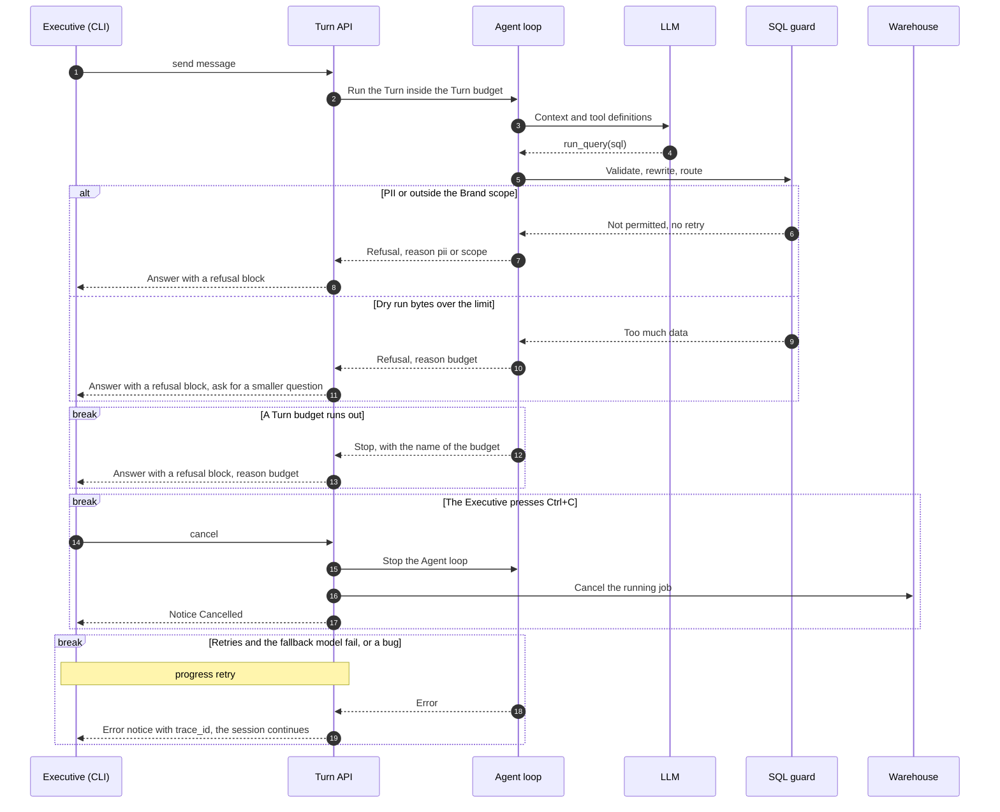

- The Turn API loads the state at the start of the Turn and saves it at the end (P21). Thus any instance can process the next Turn.
- Each step writes a span ([section 16](#16-observability)).
- The budget and error handler wraps the full Turn. A failure gives an error notice with the `trace_id`, and the session continues (P15).

### 6.2 Routing of input

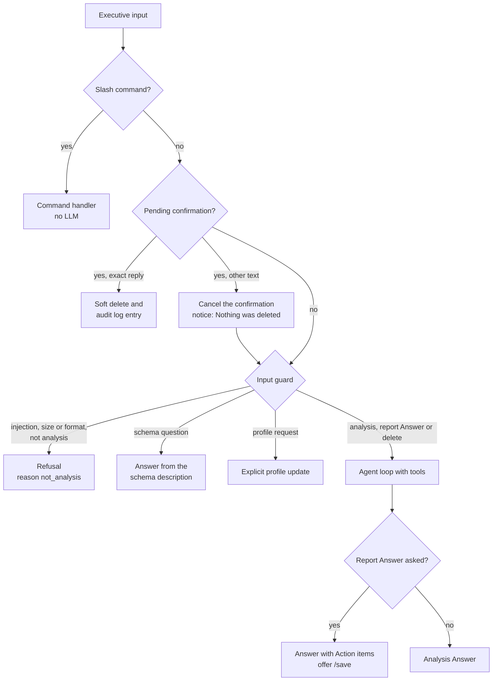

- A command goes to code, not to the LLM. Thus it is cheap and deterministic.
- A command does not cancel a pending confirmation. For example, `/list` shows all matched Saved Reports of a pending delete ([cli.md C12](cli.md#c12-confirmation-panel)). The TTL still applies.

## 7. Tools

Each tool has a Side-effect class. The class selects the guard.

| Tool | What it does | Side-effect class | Guard |
| --- | --- | --- | --- |
| `describe_schema` | Returns the description of the scoped views and their columns | read | None |
| `search_trios` | Returns the top-k Trios for a question | read | None |
| `lookup_metric` | Returns the definition of a Metric variant (production) | read | None |
| `run_query` | Runs SQL against the scoped views | read | SQL guard and budgets ([section 8](#8-safety-pipeline)) |
| `save_report` | Saves the current analysis as a Saved Report with its Customer IDs | write-own | The owner is the Executive of the Turn |
| `list_reports` | Lists the Saved Reports of the Executive | read-own | Owner filter in code |
| `plan_delete` | Finds the own Saved Reports that match a filter. It changes nothing. | plan | Confirmation gate ([section 10](#10-destructive-operations)) |

- The LLM has no delete tool (ADR 0002).
- The commands `/save` and `/list` call the same code as `save_report` and `list_reports`, with no LLM.
- Charts need no tool. The core makes a `chart` block from a `table` block ([cli.md block types](cli.md#block-types)).
- An `outward` class (for example, email) and a `destructive` class always go through the Confirmation gate ([section 23](#23-extension-points)).

## 8. Safety pipeline

Security is in the code and in the data layer, not in the prompt (P8). Each layer works alone. A failure of one layer does not leak data.

### 8.1 Layers

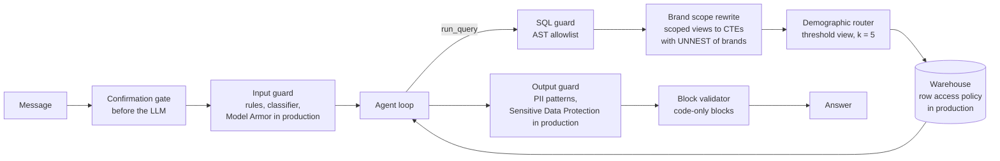

| Layer | Stops | Prototype | Production |
| --- | --- | --- | --- |
| 1 Input guard | Prompt injection, requests for the system prompt, tasks that are not analysis | Rules and a classifier call to the fallback model | Same, plus Model Armor |
| 2 SQL guard | DML, DDL, raw tables, PII columns, `SELECT *` over PII, row lists with demographic filters, no `LIMIT`, too many bytes | sqlglot, BigQuery dialect | Same |
| 3 Brand scope rewrite | Rows outside the Brand scope | Code, with `UNNEST(@brands)` | Same |
| 4 Data layer | A bug in layer 3; small demographic groups | BigQuery IAM of the service identity (read-only); threshold view over the public table | Executive identity with row access policies on the curated copy; threshold views over the copy |
| 5 Output guard and block validator | PII that got past all other layers; code-only blocks from the LLM | Patterns for email addresses, phone numbers, street addresses and coordinates | Same, plus Sensitive Data Protection and Model Armor |

### 8.2 Controls at the boundaries

| Boundary | What crosses it | Control |
| --- | --- | --- |
| People → our code | Messages, which can contain prompt injection | The Confirmation gate reads the message first. Then the Input guard and Model Armor. |
| Our code → LLM | The context | The context has no PII, because the SQL guard permits only allowlisted columns. The Brand scope is not a parameter that the LLM can change. |
| LLM → our code | Tool calls, SQL and draft blocks, which are not trusted | The SQL guard checks each query. The LLM has no delete tool. The Output guard and the block validator check each Answer. |
| Our code → warehouse | SQL | Our code binds the Brand scope from the Identity. In production, the warehouse applies it a second time. |
| Our code → Saved Reports | Deletes | Only the Confirmation gate deletes, after the exact reply of the owner. |
| Learning loop → knowledge | New Trios and changes | Only after analyst review and the eval gate. |

### 8.3 Input guard

| Check | Method | Result |
| --- | --- | --- |
| Size and format | Rules: maximum length, no binary content | Refusal `not_analysis` |
| Known injection patterns | Rules: "ignore previous instructions", requests for the system prompt | Refusal `not_analysis` |
| Intent | `gemini-3.5-flash-lite` with structured output: `analysis`, `schema_question`, `report`, `delete`, `profile`, `other`. The classifier also gets the last answered questions of the session (`limits.classifier_questions`, default 3), so that a follow-up such as "explain that in more detail" is `analysis`. A refused message does not come back. | `other` gets a refusal `not_analysis` |
| Prompt injection and jailbreak | Model Armor (production) | Refusal `not_analysis` |

The Input guard is only the first filter. The safety of the data does not depend on it, because the SQL guard and the warehouse apply the rules again.

### 8.4 SQL guard

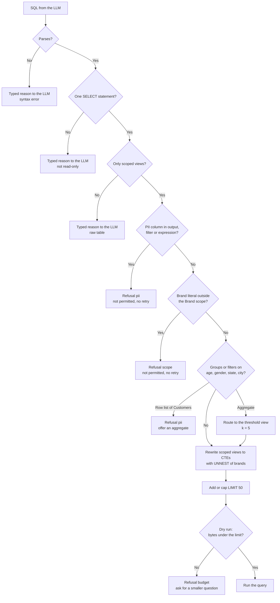

The validator parses the SQL with sqlglot into an AST. It uses an allowlist, not a denylist. Thus it also catches aliases, `SELECT *`, `CONCAT(first_name, ...)` and subqueries.

| Rule | Why | Result of a block |
| --- | --- | --- |
| The SQL must parse. | The other checks need the AST. | Typed reason to the LLM: syntax error |
| Only one `SELECT` statement. No DML, DDL, scripts or more than one statement. | The database is read-only, and we keep it so. | Typed reason to the LLM: not read-only |
| Only the three scoped views: `scoped_order_items`, `scoped_orders`, `scoped_customers`. No raw tables. | The Brand scope rewrite needs the scoped views. | Typed reason to the LLM: raw table |
| Only allowlisted columns. `SELECT *` expands to the allowlist before the check. Aliases and expressions resolve to their source columns. | Catches `SELECT *`, `CONCAT(first_name, ...)` and aliases. | Refusal `pii` for a PII column |
| No PII columns: `first_name`, `last_name`, `email`, `street_address`, `postal_code`, `latitude`, `longitude`, `user_geom`. They are not in the views. | Only `user_id` can identify a Customer (Project client decisions). | Refusal `pii` |
| A brand literal in a filter must be in the Brand scope. | A clear refusal, not a silent empty result. | Refusal `scope` |
| No row list of Customers with a filter or a group on age, gender, state or city. | These attributes act as quasi-identifiers (P9). | Refusal `pii`, with an aggregate as the alternative |
| The code adds `LIMIT 50` if it is missing, and lowers a larger `LIMIT` (V19). | Caps the rows to the LLM. | No block |
| The dry run must scan less than the bytes limit (V7). | Cost. | Refusal `budget` |

- A typed reason goes only to the LLM. The Executive does not see it. The LLM can make a safe query, and this counts as a correction ([section 15.1](#151-self-correction-of-sql)).
- A PII or Brand scope block is not an error to correct. The LLM gets only "not permitted", with no detail about the rule. Thus the LLM does not look for a way around it.
- Each block writes a `guard.sql` span with the reason.

### 8.5 Brand scope rewrite

The LLM writes SQL only against three logical views (ADR 0001). The rewrite replaces each view with a CTE that starts from the scoped base (P10).

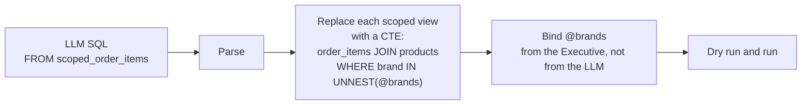

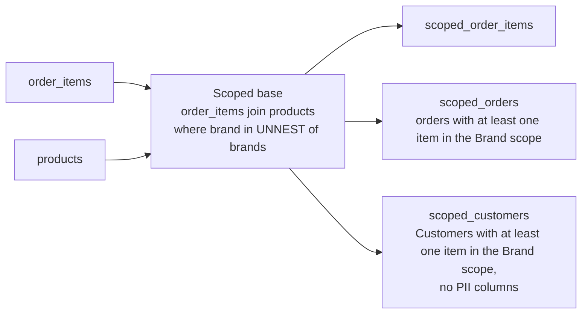

| Scoped view | Content |
| --- | --- |
| `scoped_order_items` | The order items whose product brand is in the Brand scope. Revenue comes from this view only. |
| `scoped_orders` | The orders with at least one item in the Brand scope. Order-level columns only: `order_id`, `user_id`, `status`, dates. No `num_of_item`, because a multi-brand order also counts items outside the Brand scope. |
| `scoped_customers` | The Customers with at least one purchase in the Brand scope: `id`, `age`, `gender`, `city`, `state`, `country`, `traffic_source`, `created_at`. |

- The brands come from the access mapping of the Executive, as a query parameter. The LLM never sees or writes the brand list in SQL.
- For the CEO, `@brands` is the list of all brands. The rewrite is the same, so the code has one path.
- Order totals use only the items in the Brand scope. An order with items of two brands counts only the items of the brands of the Manager.

### 8.6 Effective scope and identities

The Effective scope is the intersection of what the agent permits and the Brand scope of the Executive (ADR 0001).

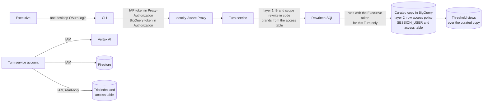

| Item | Prototype | Production |
| --- | --- | --- |
| Agent side | BigQuery IAM of the service identity: read-only on the public dataset | Layer 1: our code (the SQL guard and the Brand scope rewrite) |
| Executive side | Our rewrite, with the brands from `executives.json` | Layer 2: BigQuery runs the query as the Executive. A row access policy uses `SESSION_USER()` and a subquery on the access table. |
| Data | The public dataset | Our curated copy. A row access policy needs a table that we own. A scheduled copy refreshes it each day (V28). |
| Threshold view | Over the public table, in the reviewer's project (ADR 0005) | Over the curated copy |

- The service account has no read access to the curated sales tables. Thus a query cannot run without the identity of the Executive.
- The documented limits of this policy form apply: 100 MB for the subquery, and no data masking on the same table.
- [Open questions 2, 3 and 4](#27-open-questions) check the policy, the threshold view and the perimeter.
- A real intersection of the service identity and the Executive identity is a future target. BigQuery has no mechanism for it today. Credential Access Boundaries work only for Cloud Storage ([section 26](#26-what-to-revisit)).

### 8.7 Demographic router

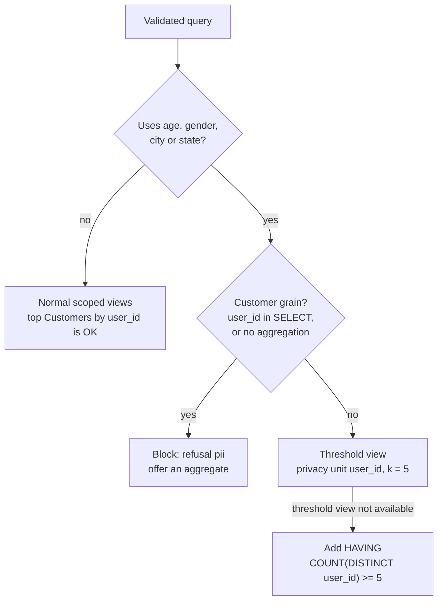

The router separates two cases (P9). "Show all customers aged 25 from Boston" gets a refusal. "Average spend by age group in Boston" is permitted. When the threshold hides all groups of a demographic query, the code gives a refusal with the reason `threshold`.

The router supports one shape: one aggregate SELECT over `scoped_customers`, optionally joined to `scoped_order_items`, with only the columns of the threshold view. The LLM instruction states this shape, and the code makes the text from the same column list as the router (`demographic.rules_text`). Thus the LLM does not learn the shape only from blocked queries.

### 8.8 Output guard and block validator

- Rules: patterns for email addresses, phone numbers, street addresses and coordinates.
- A table in the Answer with `user_id` must not have demographic columns.
- Production: Sensitive Data Protection inspects the final Answer, and Model Armor screens the LLM output.
- A hit replaces the Answer with a refusal with the reason `pii`. It writes a `guard.output` span and increments the block metric.
- The block validator drops a `confirmation` or a `refusal` block that the LLM made ([cli.md DS3](cli.md#rules)). It writes the drop in the `guard.output` span.

### 8.9 Refusal reasons

The Executive sees only the five refusal reasons of [cli.md C11 Notice](cli.md#c11-notice). A refusal never says which rule or which word caused it.

| Reason | Causes |
| --- | --- |
| `pii` | A PII column in the SQL. A row list of Customers with demographic filters. A replacement by the Output guard. |
| `scope` | A brand literal outside the Brand scope. |
| `not_analysis` | The intent `other`. Prompt injection. A size or format rule. A Model Armor block of the input. |
| `threshold` | The threshold hides all groups of a demographic query. |
| `budget` | The dry run is over the bytes limit. A Turn budget runs out. |
| None (internal) | Syntax error, not read-only, raw table. A typed reason goes to the LLM. The Executive does not see it. |

### 8.10 What the LLM sees

The LLM sees the schema of the scoped views, the Trios and the rows that the warehouse returns. Because of the allowlist, these rows contain no PII. A Customer is visible only as `user_id`.

## 9. Context assembly

### 9.1 Prompt layers

An upper layer wins on its own topic (AC-R8.3).

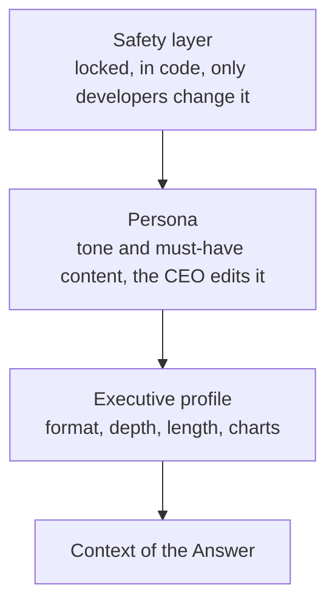

### 9.2 Parts of the context

| Part | Source | Size limit (V18) |
| --- | --- | --- |
| Safety layer and tool rules | Code | Fixed |
| Persona, active version | `ConfigStore`, read on each Turn | 2 k LLM tokens |
| Executive profile | `ConfigStore` | 0.5 k LLM tokens |
| Schema description of the scoped views | Made from the view definitions | 2 k LLM tokens |
| Metric catalog entries for the terms in the question (production) | `KnowledgeStore` | 1 k LLM tokens |
| Top 3 Trios (V17) | `KnowledgeStore`, Trio retrieval | 3 k LLM tokens |
| Conversation | `SessionStore` | 6 k LLM tokens |
| Results of the tools in this Turn | Tool calls | 50 rows to the LLM |

When the context gets near the LLM token budget (V7), the assembler cuts the parts with the lowest value first: first the older conversation, then the Trios.

### 9.3 Dates

The data is synthetic, and its date range changes (P19). The context assembler gives the LLM the date of today and the minimum and maximum order date in the data. A cached query gets these dates once each day. The Answer states the date range that it used as an assumption, for example `"last month" = 2026-10`.

### 9.4 Conversation memory

The session keeps all Turns. The context gets the last Turns in full, a rolling summary of the older Turns, and a handle for each earlier query (ID, SQL, columns, row count). Thus the Executive can ask "and how does it compare to state Y?", and the context stays small.

## 10. Destructive operations

The LLM only plans. Our code does the delete (P11, ADR 0002). The CLI shows the [C12 Confirmation panel](cli.md#c12-confirmation-panel) and the [C13 Result line](cli.md#c13-result-line).

### 10.1 Flow

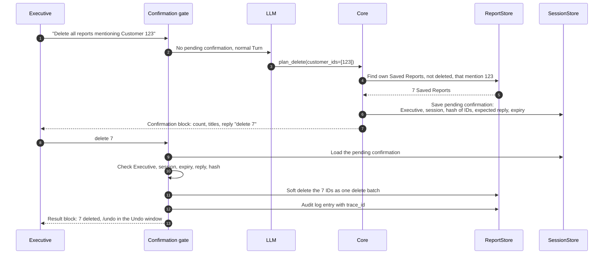

### 10.2 States of a pending confirmation

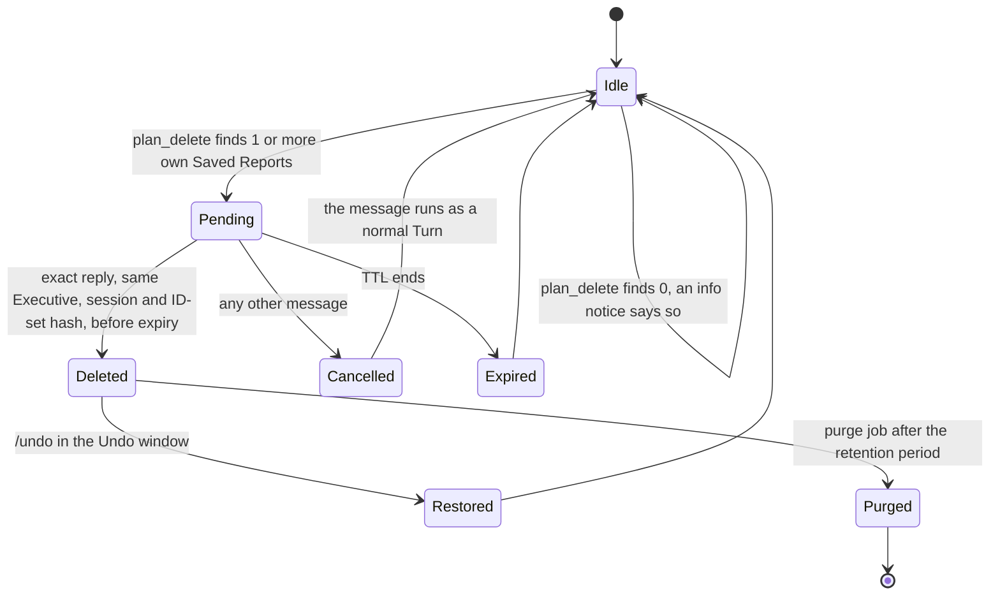

### 10.3 Rules

| Rule | Value |
| --- | --- |
| Who can delete | Only the owner of a Saved Report (AC-R3.2). `plan_delete` always filters on `owner_id` = the Executive of the Turn. The LLM cannot change this part. |
| Expected reply | 1 Saved Report: `yes`. 2 or more: `delete <count>`, for example `delete 7` (AC-R3.1). |
| Binding | The pending confirmation holds the Executive ID, the session ID and a hash of the sorted Saved Report IDs. This binding is internal: the Executive does not type it. A change of the set makes the confirmation invalid, and the code makes a new preview. |
| Expiry | 5 minutes (V11). |
| Cancel | Any other message cancels. Then the message runs as a normal Turn. A command does not cancel ([section 6.2](#62-routing-of-input)). |
| Delete | Soft delete: `deleted_at` and `delete_batch_id`. Nothing is removed. An audit log entry for each delete and each undo. |
| Undo | `/undo` restores the last delete batch of the Executive in the Undo window of 24 hours (A8, AC-R3.3). |
| Purge | A scheduled job removes the content 30 days after the soft delete (V12). The audit entry stays (V14). |
| Zero matches | An info notice says so. No confirmation is made. |

Because the gate reads the message before the LLM, an injected text cannot confirm a delete. Because the state is in the `SessionStore`, a different instance can process the confirmation (P21).

### 10.4 Request types

| Request | `plan_delete` filter |
| --- | --- |
| "Delete all reports mentioning Customer 4521" | `customer_ids = [4521]` on the recorded Customer mentions |
| "Delete all the reports we made in this conversation" | `created_session_id` = the current session |
| "Delete the reports about John Smith" | No match by name. The agent asks for the Customer ID, because no store holds names. |


### 10.5 How a Saved Report records Customers

When the agent saves a Saved Report, our code collects the `user_id` values from the result rows of the queries that the Saved Report uses. The LLM does not make this list. Thus the match "mentions Customer X" is exact, not a text search.

## 11. Data model and storage

### 11.1 Entities

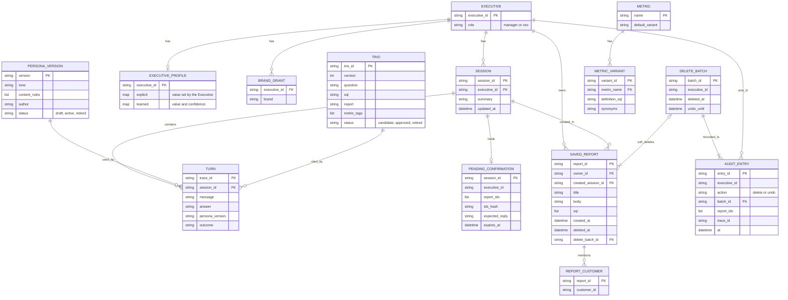

### 11.2 Where the data lives

No store holds PII from the warehouse. A Saved Report records only Customer IDs (`user_id`), which the Project client decisions permit.

| Data | Prototype | Production | Retention |
| --- | --- | --- | --- |
| Sales data | Public dataset, through the scoped views, and one threshold view in the reviewer's project | Curated copy in BigQuery with row access policies and threshold views | The source system |
| Access mapping (A1) | `executives.json` | One BigQuery access table, also read by the row access policies | Until changed |
| Sessions, Turns, pending confirmations | In memory, behind `SessionStore` | Firestore | Sessions 90 days (V13). A pending confirmation until it is confirmed, cancelled or expired (V11). |
| Saved Reports, Customer IDs, delete batches | SQLite | Firestore | Until deleted, then a purge after 30 days (V12) |
| Audit log | SQLite | Firestore | 1 year (V14) |
| Executive profiles | One YAML file for each Executive | Firestore | Until the Executive leaves (V16) |
| Persona | `persona.yaml` | Firestore: one document for each version and an `active` pointer | All versions |
| Golden Bucket | Trio YAML file and an in-memory index | Cloud Storage (source of truth, versioned) and a BigQuery Trio table | All versions; retired versions marked |
| Metric catalog | None (ADR 0007) | YAML in Git, published to Cloud Storage by CI | All versions in Git |
| Eval set | `eval/` in the repository | Same, larger | In Git |
| Traces and logs | JSONL file | Cloud Trace; structured logs in Cloud Logging, with a log sink to BigQuery | Cloud Trace 30 days; BigQuery copy 3 months (V15) |

## 12. Knowledge: Golden Bucket and Metric catalog

### 12.1 Three knowledge sources

The agent uses three knowledge sources. Each source has a different role (P12).

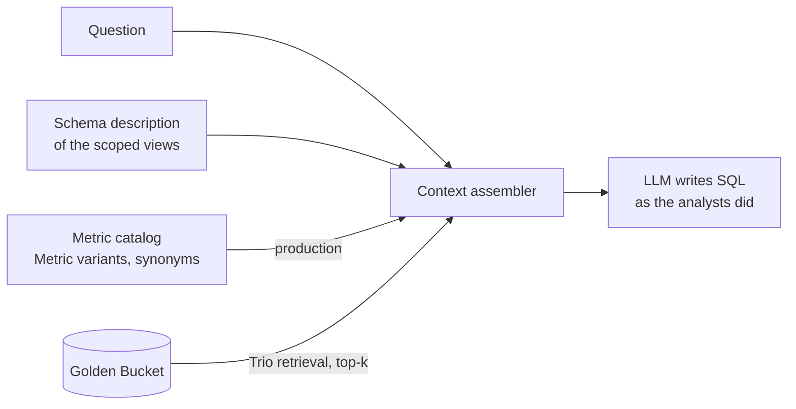

| Source | Role | When the agent uses it |
| --- | --- | --- |
| Schema description | What the data contains | Each Turn; also the Answer to "what data is there" |
| Metric catalog | The reviewed definition of each metric, with its **Metric variants** and synonyms | When the question names a metric (production) |
| Golden Bucket | How analysts interpreted similar questions, and the style of the analyst report | Each analysis Turn, through **Trio retrieval** |

### 12.2 Trio retrieval at query time

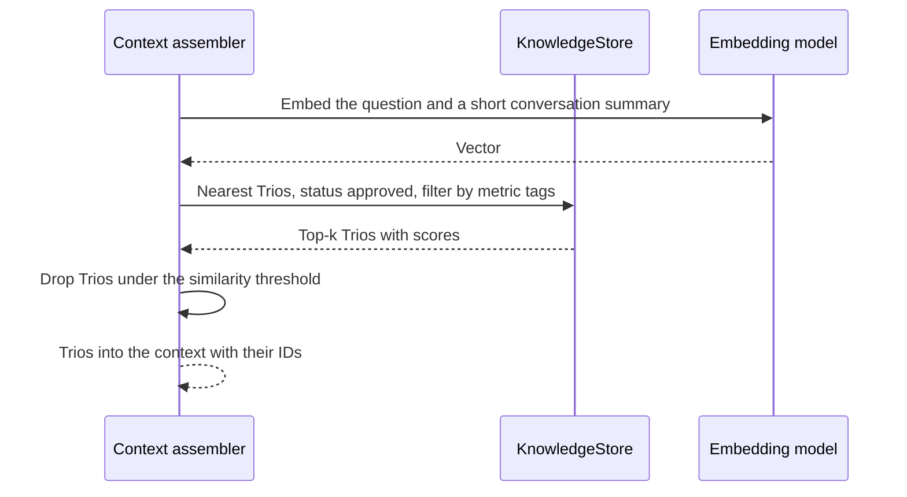

- k = 3, with a similarity threshold (V17). Both are configuration.
- The Trio SQL uses the scoped views, so a Trio does not depend on the Brand scope.
- A Trio shows how an analyst interpreted a question. It is not an answer: the agent always runs a new query on the live data.
- The Answer lists the IDs of the Trios that it used (AC-R1.1). If no Trio is over the threshold, the context has no Trio.
- Prototype: the Trios are in one YAML file with an in-memory index. Retrieval uses embeddings only (ADR 0007).
- Production: BigQuery `VECTOR_SEARCH` with an exact search while the Golden Bucket is small. Metric tags filter the Trios, so "churn" finds churn Trios also with different words.

### 12.3 How the Golden Bucket changes over time

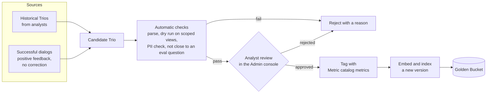

- **Status**: a Trio is `candidate`, `approved` or `retired`. Retrieval reads only `approved` Trios.
- **Versions**: an edit makes a new version of the Trio. The old version gets the status `retired`. Traces keep the Trio ID and the version.
- **No leakage into evaluation**: the automatic checks reject a candidate that is close to an eval question (ADR 0006).
- **On GCP**: a new file in Cloud Storage sends a Pub/Sub notification. The indexer job (Cloud Run Jobs) does the checks, embeds the Trio and writes it to the BigQuery Trio table.

### 12.4 Metric catalog

The Metric catalog is a YAML file in Git (production only, ADR 0007). Analysts change it with a pull request, and the eval gate runs on each change.

- Each metric has one organization default variant. For churn, the default is `churn_90d` (V27).
- An Executive can name a different variant in the question, for example "churn after 60 days".
- Each Answer names the variant that it used in its Provenance (P22).
- The Executive profile holds no default variant. Thus two Executives always get the same number for the same question.

The prototype has no Metric catalog. The Trio carries the interpretation.

## 13. Learning loop

### 13.1 Executive level: the Executive profile

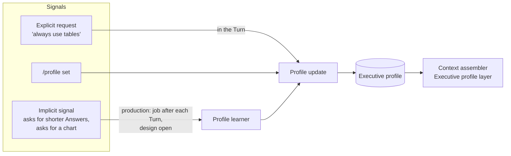

- The profile has the settings of [cli.md C16 Profile view](cli.md#c16-profile-view): `format`, `depth`, `length` and `charts`. The core maps them to blocks as in [cli.md P-FORMAT](cli.md#p-format-format-from-the-executive-profile).
- An explicit edit wins over a learned value. A learned value never replaces it.
- Prototype: only explicit edits with `/profile set` (V21, AC-R4.3, bonus).
- Production: a job updates the profile after each Turn, so the Turn is not slower. Learned values have a confidence and a decay (AC-R4.1). The learning logic and its numbers are open (V21, [section 27](#27-open-questions)).
- `/profile` shows each value with its source. The Executive can edit or remove each value.
- The profile holds presentation preferences only. It holds no metric definitions (ADR 0007).

### 13.2 System level

```mermaid
flowchart LR
    subgraph Signals
        F["Feedback: good or bad"]
        RQ[Rephrased question]
        SC[SQL self-correction]
        FT[Failed Turn]
    end
    Signals --> Q[Signal queue]
    Q --> CB["Candidate builder<br/>nightly job"]
    CB --> CT["Candidate Trio<br/>PII scrubbed"]
    CB --> CC["Candidate change<br/>Metric variant, schema note, instruction"]
    CT --> R{Analyst review}
    CC --> R
    R -->|Rejected| X[Discard]
    R -->|Approved| TAG[Tag with metrics]
    TAG --> EG{Eval gate}
    EG -->|"Score goes down"| X
    EG -->|Pass| REL["Release: new version,<br/>index the Trio"]
    REL --> KS["Golden Bucket and<br/>Metric catalog"]
```

- A good dialog (positive feedback, no correction) becomes a candidate Trio (P13).
- A failed or corrected Turn becomes a candidate change, for example a new synonym or a note in the schema description.
- The candidate builder removes Customer IDs and literal values that identify a person before the review.
- The system never changes itself without the analyst review and the eval gate (AC-R4.2). Each change has a version, and a trace records the versions that a Turn used. Thus a rollback is simple.

## 14. Persona management

The CEO changes the tone each week with no deployment (R8). The Persona controls only the tone and the must-have content. It cannot change the safety layer ([section 9.1](#91-prompt-layers)).

### 14.1 Persona lifecycle

```mermaid
stateDiagram-v2
    [*] --> Draft: CEO edits the form in the Admin console
    Draft --> Validated: schema check and safety lint pass
    Draft --> Draft: a check fails, the form shows why
    Validated --> Previewed: Answers to 3 fixed questions in the new tone
    Previewed --> Active: CEO publishes
    Previewed --> Draft: CEO edits again
    Active --> Retired: a newer version becomes active
    Retired --> Active: rollback
```

### 14.2 Publish and rollback

```mermaid
sequenceDiagram
    participant C as CEO
    participant A as Admin console
    participant V as Validator
    participant T as Turn service
    participant S as ConfigStore
    C->>A: Edit the Persona form
    A->>V: Validate
    V->>V: Schema check and safety lint
    V-->>A: Valid
    A->>T: Run 3 fixed questions with the old and the new Persona
    T-->>A: Old and new Answers side by side
    C->>A: Publish
    A->>S: Save version N+1, move the active pointer
    Note over T,S: Each Turn reads the active version. No cache.
    C->>A: Rollback
    A->>S: Move the active pointer to version N
```

| Step | Detail |
| --- | --- |
| Edit | A form in the Admin console with the fields: tone, must-have content rules, banned words, sections of a report Answer. No free-form system prompt. |
| Schema check | Pydantic model: field lengths, permitted values. |
| Safety lint | Rules and an LLM check reject a rule that touches the safety layer, for example "show Customer emails" or "ignore the brand limit". |
| Preview | The system runs 3 fixed questions with the new Persona. It shows the old and the new Answers side by side (AC-R8.2). |
| Publish | The new version becomes `active`. The old version becomes `retired`. Nothing is deleted. |
| Rollback | Set an earlier version to `active`. |
| Reload | The Turn service reads the active version at the start of each Turn. There is no cache (AC-R8.1). |
| Audit | Each trace records `persona_version` (AC-R8.2). |

The prototype reads `persona.yaml` at the start of each Turn (AC-R8.3).

## 15. Resilience and error handling

### 15.1 Self-correction of SQL

```mermaid
flowchart TB
    S[LLM SQL] --> V{SQL guard}
    V -->|"PII or Brand scope"| REF["Refusal pii or scope<br/>no retry"]
    V -->|"technical block:<br/>syntax, not read-only, raw table"| AT
    V -->|pass| DR{"Dry run<br/>free"}
    DR -->|"syntax or schema error"| AT{"Corrections left?<br/>not more than 2"}
    AT -->|yes| FIX["Typed reason and schema<br/>to the LLM for a fix"]
    FIX --> S
    AT -->|no| HON["Error notice<br/>with trace_id"]
    DR -->|"too many bytes"| BIG["Refusal budget<br/>ask the Executive for<br/>a smaller question"]
    DR -->|OK| RUN[Run]
    RUN -->|rows| OK[Capped rows to the LLM]
    RUN -->|"0 rows"| DIAG["Diagnostic query<br/>distinct values of the<br/>filter column, LIMIT 50"]
    DIAG --> EMPTY["Info notice made by code<br/>the cause and the real values"]
```

- The dry run is free, so it catches syntax errors with no cost (P14).
- The CLI shows `Fixing the query · attempt n of 3` during a correction. The Provenance shows the number of corrections ([cli.md P-CORRECT](cli.md#p-correct-self-correction-and-empty-result)).
- For an empty result, the agent finds the cause. It does not only try again. The code makes an info notice with the cause and a next step, for example `No orders from "Califronia". Did you mean California?`.
- After the last failed attempt, the Executive gets an error notice with the `trace_id`. If an earlier query of the Turn returned rows, the agent writes the Answer from those rows instead ([section 15.4](#154-turn-budget)).

### 15.2 External calls

```mermaid
flowchart LR
    C[Call] --> T{Result}
    T -->|OK| R[Return]
    T -->|"429, 5xx, timeout"| B["Backoff 1–8 s, full jitter,<br/>Retry-After if given<br/>LLM 2 retries, BigQuery 1 retry"]
    B --> C
    B -->|"retries used, LLM"| FM[Fallback model]
    FM -->|fails| MSG["Error notice<br/>with trace_id,<br/>the session continues"]
    B -->|"retries used, BigQuery"| MSG
    T -->|"other 4xx"| MSG
```

| Setting | Default | Note |
| --- | --- | --- |
| LLM call timeout | 30 s (V9) | — |
| BigQuery job timeout | 60 s (V9) | The code cancels the job after the timeout. |
| Retries | LLM 2, BigQuery 1 (V8) | — |
| Backoff | From 1 s to 8 s, full jitter, `Retry-After` when given (V8) | — |
| Fallback model | `gemini-3.5-flash-lite` | The Provenance has `fallback_used`. The CLI shows "backup model" ([cli.md P-FAIL](cli.md#p-fail-service-failure-and-fallback)). |
| Circuit breaker (production) | Opens after 5 failures in 60 s, tries again after 30 s (V10) | When it is open, the call goes to the fallback at once. |

The fallback model runs the Turn again from the start. Its BigQuery jobs get new job IDs, because BigQuery rejects a job ID that it has seen (409).

### 15.3 Failures and what the Executive sees

| Failure | Detection | Action | Executive sees |
| --- | --- | --- | --- |
| LLM 429, 5xx or timeout | HTTP status, timeout (V9) | Backoff, 2 retries (V8), then the fallback model | A slower Answer, with "backup model" in the Provenance |
| Both models down | Circuit breaker open (V10) | No LLM call | Error notice with the `trace_id`. The confirmation, `/undo`, `/profile` and `/trace` still work, because they need no LLM. |
| BigQuery 5xx or timeout | Exception, job timeout (V9) | Backoff, 1 retry (V8) | Error notice if the retry fails. Schema questions still work from the schema description. |
| BigQuery bytes over the limit | Dry run, `maximum_bytes_billed` | No retry | Refusal `budget` |
| Embedding or vector search down | Exception | Continue with no Trios | A normal Answer with no Trio IDs. The trace records the degradation. |
| State store write fails (production) | Exception | Retry. The Turn fails before the Answer if it cannot save the session. | Error notice |
| Trace exporter fails | Exception | Spans go to a local buffer. A trace failure never fails a Turn. | Nothing |
| The final Answer is JSON that does not parse | `json.loads` fails on text that starts with `{` | One repair call on the fallback model, with structured output. It counts in the Turn budget. | A normal Answer. If the repair fails: a short text that asks for a different wording. Never raw JSON. |
| Bug in our code | Any exception | The Turn error handler catches it | Error notice with the `trace_id`. The CLI does not stop. |

The error notice has no stack trace, no HTTP code and no vendor name ([cli.md P-FAIL](cli.md#p-fail-service-failure-and-fallback)).

### 15.4 Turn budget

| Budget | Default (V7) |
| --- | --- |
| LLM calls | 8 |
| LLM tokens (input and output) | 60 k |
| Bytes scanned | 1 GB for each query, through `maximum_bytes_billed`; 2 GB for each Turn |
| Wall time | 90 s |
| SQL corrections | 2 (AC-R5.1) |

- When a Turn goes over a budget, the agent stops. A refusal with the reason `budget` tells the Executive which limit stopped it, in plain words ([cli.md P-BUDGET](cli.md#p-budget-budget-limit)). It does not show the internal limit values.
- A Turn that already has query results does not end with no data. When it has used its SQL corrections, or when only one LLM call is left, the `run_query` result tells the LLM to stop the queries and write the Answer from the results that it has. The Answer tells which part of the question the results do not answer. A "why" question needs many queries, so this case is frequent.
- The classifier uses the cheap model, and a dry run is free. Thus a refusal or a bad query costs little.
- A result cache is a bonus (EX.1). Its key is the hash of the normalized SQL and the Effective scope. The key must hold the Effective scope, or a Manager could get a cached result of the CEO.

### 15.5 Cancel and the error handler

- `Ctrl+C` in the CLI calls the cancel operation ([section 5.1](#51-operations)). The Turn API stops the Agent loop and cancels a running BigQuery job. The Executive gets the notice "Cancelled", and the session continues.
- The Turn error handler catches all other exceptions. It writes the error to the trace and returns an error notice with the `trace_id`. The CLI never stops on a Turn error (P15).

### 15.6 Chaos mode

`CHAOS=llm_429:0.3,bq_timeout:0.1` makes the chaos wrapper fail 30 % of the LLM calls with 429 and 10 % of the BigQuery calls with a timeout (AC-R5.2). A test and a demo scenario use it to show that the session continues.

## 16. Observability

### 16.1 Trace of one Turn

```mermaid
flowchart TB
    T["turn<br/>trace_id, executive_id hash, role,<br/>session, persona_version, outcome, cost"] --> IG["guard.input<br/>intent, decision, reason"]
    T --> CX["context.assemble<br/>LLM tokens for each part"]
    CX --> KR["knowledge.retrieve_trios<br/>trio_ids, scores"]
    T --> L1["llm.generate<br/>model, LLM tokens in and out,<br/>latency, fallback_used, retries"]
    T --> TL["tool.run_query<br/>attempt"]
    TL --> SV["guard.sql<br/>decision, reason, route"]
    TL --> DR["bq.dry_run<br/>bytes estimate"]
    TL --> BQ["bq.query<br/>final SQL, bytes, rows, latency"]
    T --> L2[llm.generate]
    T --> OG["guard.output<br/>decision, reason, dropped blocks"]
    T --> CF["confirmation<br/>state change, count"]
```

- No PII goes into a trace (AC-R7.1). The trace keeps the final SQL, the row count, the column names and the first 20 result rows after the Output guard (V20). Prompts in the trace contain only data that passed the guards.
- The Executive ID is a hash in production.
- `turn.outcome` has the end states of [cli.md P-TURN](cli.md#p-turn-turn-lifecycle): `answered`, `refused`, `failed`, `pending`, `done` and `cancelled`.
- Each log line is structured JSON with the `trace_id`.

`/trace <id>` prints the span tree as [cli.md C15 Trace view](cli.md#c15-trace-view). The span names map to the C15 labels:

| Span | C15 label |
| --- | --- |
| `turn` | The header line: `trace_id`, time, duration, outcome |
| `guard.input` | `input classifier` |
| `knowledge.retrieve_trios` | `trio retrieval` |
| `llm.generate` | `llm <model>` |
| `guard.sql` | `sql validation` |
| `bq.query` | `bigquery` |
| `guard.output` | `output check` |

`context.assemble`, `tool.run_query` and `bq.dry_run` are parent or detail spans. They have no row of their own in C15.

### 16.2 Metrics

We define the metrics before the code (AC-R7.2). Each metric comes from a span attribute or a log field. "Extra" marks a metric that AC-R7.2 does not list.

| Metric | Definition | Source | Alert (production) |
| --- | --- | --- | --- |
| Turn success rate | Turns with outcome `answered` / all Turns | `turn.outcome` | Less than 95 % in 1 hour (V23) |
| Block rate for each reason | Blocks with reason R / all Turns | `guard.*` reason | Spike of 3× the 7-day average (V25) |
| Self-correction rate | Turns with at least one SQL correction / Turns with SQL | `tool.run_query.attempt` | More than 30 % in 1 day (V25) |
| Self-correction success rate (extra) | Corrected queries that ran / corrected queries | `tool.run_query.attempt` | — |
| Empty-result rate | Queries with 0 rows / all queries | `bq.query.rows` | More than 20 % in 1 day (V25) |
| LLM error rate and fallback rate | LLM calls with an error / all calls; calls to the fallback model / all calls | `llm.generate` | Fallback more than 10 % in 15 minutes (V25) |
| Latency | p50 and p95 of the Turn wall time | `turn` span | p95 more than 45 s in 1 hour (V24) |
| Cost for each Turn | LLM tokens × price, plus bytes × price | `turn.cost` | Daily total over the budget (V25) |
| Confirmation completion and abort rate | Done / pending; cancelled or expired / pending | `confirmation` span | Abort more than 50 % in 1 week (V25) |
| Budget stop rate (extra) | Turns stopped by a budget / all Turns | `turn.outcome`, reason `budget` | More than 5 % in 1 day (V25) |

An uptime check calls a health endpoint of the Turn service, and a Cloud Billing budget alert covers the total cost.

### 16.3 Where traces and logs go

| Item | Prototype | Production |
| --- | --- | --- |
| Spans | OpenTelemetry SDK with a JSONL exporter | OpenTelemetry to Cloud Trace, 30 days (V15) |
| Logs | The same JSONL file | Masked structured logs with the `trace_id` in Cloud Logging. A log sink copies them to BigQuery, kept 3 months (V15). |
| Dialog of one Turn | `/trace <id>` reads the JSONL file | `/trace <id>` and a saved query in BigQuery read the masked logs of the `trace_id` |
| Metrics and alerts | — | Cloud Monitoring dashboards and alerts |

We do not use trace sinks, because Google deprecated them. The log sink copies the structured logs, and they carry the same `trace_id` as the spans.

### 16.4 Deep dive

```mermaid
flowchart LR
    AL["Alert or complaint<br/>with trace_id"] --> D["Cloud Monitoring dashboard<br/>metric by reason, model, tool"]
    D --> TI["Saved query on the BigQuery log copy<br/>select the failing trace_ids"]
    TI --> TV["Span tree<br/>/trace in the CLI,<br/>Cloud Trace for timing"]
    TV --> RC["Root cause<br/>prompt, SQL, data, service"]
    RC --> FX["Fix or candidate change<br/>through the eval gate"]
```

## 17. Quality assurance

| Level | What it checks | When | Gate | Prototype |
| --- | --- | --- | --- | --- |
| Unit tests (pytest) | Each guard, the Brand scope rewrite, the router, the confirmation flow and the budgets | Each push | All pass | Yes (P23) |
| Red-team tests (pytest) | PII requests, other brands, prompt injection, poems, requests for the system prompt | Each push | All blocked | Yes (P23) |
| Eval set | Execution accuracy: the result set of the agent equals the result set of the reference SQL, with a tolerance for order and rounding | CI on changes to `src/` or `eval/`, and before each release | No drop against the last release | 5 questions (AC-R6.1, bonus) |
| LLM judge | The rubric: does the Answer reply to the question, are the numbers in the text the same as in the result, are the Action items specific | Before each release | Average score over the threshold | Design (AC-R6.2) |
| Human labels | 20–50 Answers labeled by analysts calibrate the judge: the agreement of the judge and the humans (V22) | Each quarter, and after a change of the rubric (V22) | Agreement over the threshold | Design |
| Pairwise UX test | An Executive sees two Answer variants and selects the better one | Before a change of format or Persona with a large effect | Win rate of the new variant | Design (AC-R6.3) |
| Online signals | Feedback, rephrase rate, abandoned Turns, confirmation abort rate | Always | Alerts ([section 16.2](#162-metrics)) | Trace attributes |

- The eval set is separate from the Golden Bucket (ADR 0006). Thus retrieval cannot find the answer of an eval question.
- The eval gate blocks a release when the execution accuracy or the judge score goes down, or when one red-team test fails.
- CI publishes the eval report to the documentation site (AC-R6.1).

How the judge checks that an Answer replies to the intent:

1. The judge gets the question, the SQL, the result rows and the Answer.
2. The judge checks that each number in the Answer is in the result rows.
3. The judge checks that the Answer replies to each part of a multi-part question ("why" and "how does it compare").
4. The judge checks that each Action item names an owner area, a metric and a direction.

## 18. Physical architecture on GCP

### 18.1 Why GCP

1. The data is already in BigQuery. We copy no data from one cloud to a different cloud.
2. OpsFleet prefers Gemini. Gemini on Vertex AI runs in the same project, inside the same security perimeter.
3. Google identities sign in at IAP, and the same identities run the queries in BigQuery. We write no login code.
4. Cloud Run and Firestore need no servers to operate. BigQuery `VECTOR_SEARCH` keeps the Trio index in the warehouse, so we need no separate vector database.

### 18.2 Services

A VPC Service Controls perimeter surrounds BigQuery, Firestore, Cloud Storage and Vertex AI. There is no web chat: the CLI is the channel for Executives (A5). The Admin console is the only browser page, for the CEO and the analysts.

```mermaid
flowchart TB
    subgraph EXM["Executive machine"]
        CLI[CLI]
    end
    STF["CEO and analysts<br/>browser"]
    subgraph GCP["GCP project, VPC Service Controls perimeter"]
        IAP[Identity-Aware Proxy]
        subgraph CRUN["Cloud Run"]
            TS["Turn service<br/>Turn API, core, adapters"]
            ADM[Admin console]
        end
        VX["Vertex AI<br/>Gemini main and fallback,<br/>embeddings"]
        MA[Model Armor]
        DLP[Sensitive Data Protection]
        subgraph BQ["BigQuery"]
            CUR["Curated copy<br/>row access policies,<br/>threshold views"]
            ACC[Access table]
            VEC[Trio table]
            LOGT[Log tables]
        end
        FS[("Firestore<br/>sessions, confirmations,<br/>Saved Reports, audit log,<br/>profiles, Persona")]
        GCS[("Cloud Storage<br/>raw Trios, Metric catalog")]
        SM[Secret Manager]
        OBS["Cloud Trace, Logging,<br/>Monitoring"]
        PS["Pub/Sub<br/>signals"]
        JOBS["Cloud Run Jobs<br/>candidate builder, indexer,<br/>profile learner, purge"]
        SCH[Cloud Scheduler]
    end
    SRC[("thelook_ecommerce<br/>public dataset")]
    CLI -->|"HTTPS, IAP token,<br/>Executive BigQuery token"| IAP
    STF -->|"HTTPS, Google sign-in"| IAP
    IAP --> TS
    IAP --> ADM
    TS -->|"prompt and LLM output screening"| MA
    TS -->|"Gemini main and fallback"| VX
    TS -->|"SQL as the Executive"| CUR
    TS -->|"role and brands"| ACC
    TS -->|VECTOR_SEARCH| VEC
    TS --> FS
    TS -->|"inspect the Answer"| DLP
    TS --> SM
    TS -->|"OpenTelemetry, structured logs"| OBS
    TS -->|signals| PS
    OBS -->|"log sink"| LOGT
    SRC -->|"scheduled copy each day"| CUR
    ACC -.->|"read by the policies"| CUR
    GCS -->|"object notification"| PS
    SCH --> JOBS
    PS --> JOBS
    JOBS --> VEC
    JOBS --> FS
    ADM --> FS
    ADM --> GCS
```

| Building block | GCP service | Why |
| --- | --- | --- |
| Turn service and Admin console | Cloud Run behind IAP | Stateless containers that scale to the load, with sign-in by Google identities. No cluster to operate (ADR 0004). |
| Identity | IAP | Google identities with no login code of our own (A6). |
| Language model and embeddings | Gemini on Vertex AI | Default LLM (P7). The paid Vertex AI does not use the data to improve Google products. |
| Sales warehouse and Brand scope | BigQuery curated copy with row access policies and threshold views, queried as the Executive | The second, independent Brand scope layer (ADR 0001). We cannot put policies on a public dataset. |
| Access mapping | One BigQuery access table (A1) | The row access policies and the Turn service read the same table. |
| Memory, Saved Reports and audit log | Firestore | A serverless document store for small, structured state. Transactions for the confirmation flow (ADR 0004). |
| Golden Bucket | Cloud Storage for the raw Trios, BigQuery `VECTOR_SEARCH` for retrieval | The analysts already use a data lake. The index stays in the governed warehouse. |
| Managed safety screening | Model Armor (input and output), Sensitive Data Protection (output) | A managed layer in addition to our own guards, not the only layer (P5). |
| Observability | Cloud Trace, Logging, Monitoring, log sink to BigQuery | Native OpenTelemetry export, inside the perimeter. SQL over the logs for metrics. |
| Learning loop jobs | Pub/Sub, Cloud Run Jobs, Cloud Scheduler | Asynchronous and scheduled batch work. The jobs do not slow the Turn. |
| Secrets | Secret Manager | No secret in code or in images. |

### 18.3 Turn service settings

| Setting | Value | Why |
| --- | --- | --- |
| Minimum instances | 1 (V26) | No cold start for the first question of the day |
| Concurrency | 20 requests for each instance (V26) | A Turn waits on I/O most of the time |
| Request timeout | 120 s (V9) | Longer than the wall time budget of a Turn (V7) |
| CPU allocation | Open ([section 27](#27-open-questions)) | Measure it with the server-sent events and the work after each Turn |

## 19. Prototype architecture

The prototype uses the same core with local adapters. It is one CLI process.

```mermaid
flowchart LR
    subgraph MACH["Reviewer machine, one process"]
        CLI["CLI<br/>Typer and Rich"] --> TA[Turn API]
        TA --> CORE[Core]
        CORE --> ADK[ADK adapter]
        CORE --> SQLITE[("SQLite<br/>Saved Reports, audit log")]
        CORE --> YAML[("YAML and JSON<br/>persona.yaml, profiles, executives.json")]
        CORE --> TRIOS[("Trio YAML file<br/>in-memory index")]
        CORE --> MEM[("In memory<br/>sessions")]
        CORE --> JSONL[("JSONL trace file")]
    end
    ADK --> GEM["Gemini API<br/>free tier"]
    CORE --> BQS["BigQuery sandbox<br/>public dataset,<br/>threshold view in own project"]
```

| Component | Prototype choice |
| --- | --- |
| Channel | Typer and Rich CLI, as in [cli.md](cli.md). |
| Agent loop | Google ADK, with a plain `google-genai` loop as the fallback (ADR 0003). |
| LLM | `gemini-3.8-flash`, fallback `gemini-3.5-flash-lite`, from the configuration. |
| Embeddings | `gemini-embedding-2` with an in-memory cosine search (numpy). |
| SQL guard | sqlglot with the BigQuery dialect. |
| Warehouse | The public dataset, plus a threshold view in the reviewer's project (`uv run setup-bq`). |
| Stores | The local adapters of [section 4.4](#44-ports). |
| Tracer | OpenTelemetry SDK with a JSONL exporter. `/trace` reads the file. |

Cost of the prototype: $0.

| Part | Free tier | Limit | Cost |
| --- | --- | --- | --- |
| LLM | Gemini API free tier, with a key from Google AI Studio | Low rate limits. Google can use the prompts and the responses to improve its products (A10). | $0 |
| Warehouse | BigQuery sandbox | 1 TB of free query compute each month (technical assignment). The dataset is smaller than 1 GB (V28). | $0 |
| Stores and traces | Local files: SQLite, YAML, JSON, JSONL | The disk of the reviewer's machine | $0 |

Setup: `uv sync`, copy `.env.example` to `.env`, `scripts/setup-gcp.sh` (a project in the BigQuery sandbox and the read-only service account `dca-agent`), `gcloud auth application-default login --impersonate-service-account=dca-agent@<project>.iam.gserviceaccount.com`, `uv run setup-bq`, `uv run chat --executive <id>` (P19). There is no service account key file.

## 20. Deployment

```mermaid
flowchart LR
    PR[Pull request] --> CI["GitHub Actions<br/>tests, red-team, lint"]
    CI --> B["Build the image<br/>push to Artifact Registry"]
    B --> EV{Eval gate}
    EV -->|fail| STOP[Stop]
    EV -->|pass| D["Deploy a new<br/>Cloud Run revision"]
```

- To roll back, deploy the previous revision again.
- A Persona, a Trio or a Metric catalog change is data, not code. It goes through its own gate ([sections 13](#13-learning-loop) and [14](#14-persona-management)), with no image build.
- CI uses Workload Identity Federation for BigQuery, so it has no long-lived key.
- A canary revision and separate projects for each environment are in [section 26](#26-what-to-revisit).

## 21. Security model

| Topic | Design |
| --- | --- |
| Sign-in | IAP with company Google identities (A6). One desktop OAuth login in the CLI. No local passwords. |
| Authorization | The role and the brands come from the access table (A1). The Turn service reads them on each Turn. |
| Data access | Two layers (ADR 0001): our Brand scope rewrite, and BigQuery row access policies with the identity of the Executive on the curated copy. The service account can read only its own stores, the Trio index and the access table. |
| Credentials | The BigQuery token of the Executive is used only in its Turn. The Turn service does not store it. |
| Perimeter | VPC Service Controls around BigQuery, Firestore, Cloud Storage and Vertex AI. |
| Secrets | Secret Manager. The prototype reads `.env`, which is not in Git. |
| PII | The guards of [section 8](#8-safety-pipeline). No PII in traces or logs. Saved Reports hold Customer IDs, not names. |
| Destructive actions | Only the Confirmation gate can delete ([section 10](#10-destructive-operations)). An audit log entry for each delete and each undo. |
| Prompt injection | The Confirmation gate before the LLM, the Input guard, Model Armor, no delete tool, code checks on each tool call, the block validator. Instructions in data (for example, in a Trio) are data. |

## 22. Scale and capacity

| Item | Estimate |
| --- | --- |
| Executives | 10–50 (V3) |
| Turns | 1 000 each day (V4) |
| Peak | 10 Turns at the same time (V5) |
| LLM load | About 4 LLM calls and 25 k LLM tokens for each Turn (V6). With V4: about 4 000 LLM calls and 25 M LLM tokens each day. |
| BigQuery | The dataset is smaller than 1 GB. Most queries scan less than 100 MB (V28). |
| Instances | With a concurrency of 20 (V26), one instance carries the peak of V5. |
| Trios | Hundreds to a few thousand. An exact `VECTOR_SEARCH` with no vector index is sufficient. |

The limits are the Gemini quota and the LLM latency, not the compute. Request a higher Vertex AI quota for the main model before the launch. Use provisioned throughput only if the p95 latency is too high at the peak. The free tier of the prototype has a lower quota, so the prototype uses backoff and the fallback model (P15).

| Part | Redundancy |
| --- | --- |
| Turn service | One or more instances in one region. Cloud Run adds instances for the load and restarts failed instances. The service is stateless, so any instance can process any Turn, also a confirmation. |
| LLM | Fallback model. |
| State | Firestore in a multi-region location. A restart does not lose a confirmation. |
| Warehouse | BigQuery is a managed regional service. |

## 23. Extension points

A new capability is a new tool, and sometimes a new port with an adapter. The core does not change (P6).

```mermaid
flowchart LR
    NT[New tool] --> RG["Register in the tool registry<br/>with a Side-effect class"]
    RG --> CL{Side-effect class}
    CL -->|read| DIR["Runs at once<br/>SQL guard and budgets"]
    CL -->|write-own| OWN[Owner check in code]
    CL -->|"outward or destructive"| CG["Confirmation gate<br/>preview, then exact reply"]
```

| Capability | Tool | Side-effect class | Note |
| --- | --- | --- | --- |
| Charts | None | — | The core already makes `chart` blocks from `table` blocks. A web renderer draws real charts from the same block ([cli.md C8](cli.md#c8-chart)). |
| Send a Saved Report by email | `plan_send_report` | outward | The gate shows the recipients and the content first. Recipients only in the company e-mail domain (A7). A new `Mailer` port. |
| Web search for trends | `web_search` | read | A new `WebSearch` port. A check of the query text stops internal figures from leaving the perimeter. The results are untrusted data: the Answer keeps them apart from the company data and names their source. |

A tool is a Python function with a typed signature and a Side-effect class. The framework adapter registers it.

## 24. Key decisions

The decisions that are hard to change have an ADR (P18).

| Decision | Choice | Alternatives | Trade-off | ADR |
| --- | --- | --- | --- | --- |
| Brand scope | Rewrite of logical scoped views, plus row access policies as the Executive on a curated copy in production | Brand scope only in code; row access policies only | Two layers cost more work, but one bug cannot leak data | [0001](../adr/0001-brand-scope-by-view-rewrite.md) |
| Delete safety | The LLM only plans; the Confirmation gate catches the reply | ADK `require_confirmation` on a delete tool | More code, but no prompt can make the LLM delete | [0002](../adr/0002-llm-has-no-delete-tool.md) |
| Delete reply | `yes` for 1, `delete n` for 2 or more; the binding is internal | A random confirmation code | Easy to type; the store binding gives the safety | [0002](../adr/0002-llm-has-no-delete-tool.md) |
| Agent framework | Google ADK as a thin adapter; the spike passed | LangGraph; plain `google-genai`; PydanticAI | Good GCP fit and callbacks; no team experience, so the core stays framework-free | [0003](../adr/0003-google-adk-framework.md) |
| Compute and state | Cloud Run and Firestore | Agent Platform Runtime with Sessions and Memory Bank | More code, but structured, editable state in our own store and less lock-in | [0004](../adr/0004-cloud-run-and-firestore.md) |
| Small groups | Aggregation threshold view only on the demographic path | Threshold on all Customer data; `HAVING` only | "Top customers" still works; the routing is our code | [0005](../adr/0005-aggregation-threshold-on-demographic-path.md) |
| Eval data | Eval set separate from the Golden Bucket | Leave-one-out on Trios | More data to keep, but an honest score | [0006](../adr/0006-eval-set-separate-from-golden-bucket.md) |
| Metrics in the prototype | No Metric catalog; Trios carry the interpretation | A small YAML catalog | Less work now; the catalog is the production target | [0007](../adr/0007-no-metric-catalog-in-prototype.md) |
| Main LLM | `gemini-3.8-flash` main, `gemini-3.5-flash-lite` fallback and classifier | A Pro model for all Turns | Low cost and latency. A Pro model for long report Answers is a later option, measured with the eval set. | — |
| Input guard | Rules, a cheap LLM classifier and managed screening | Managed screening only; LLM classifier only | More than one layer. The classifier also gives the intent for routing. | — |
| Output guard | Rules plus managed PII inspection | Rules only | Managed detection of more PII types, for a small cost for each Answer | — |
| Persona editing | A form in the Admin console, with versions in the state store | YAML in Git with a pull request; a shared document | A non-developer can edit with validation, preview and rollback | — |
| Access mapping | One BigQuery access table | A configuration file; a copy in Firestore | One source for the code and for the row access policies | — |
| Production channel | The CLI through IAP | A web chat | No new front end; a web chat can use the same Turn API later (P20) | — |
| Turn transport | HTTPS with server-sent events | WebSocket; polling | Simple, and works through IAP; one direction is sufficient | — |
| Vector search | BigQuery `VECTOR_SEARCH`, exact while small | Vertex AI Vector Search; a separate vector database | Fewer services for a small Golden Bucket; slower than a dedicated index at a large scale | — |
| Observability | Cloud Trace, and masked structured logs with a log sink to BigQuery | A self-hosted LLM trace tool; trace sinks | No extra service to operate; the dialog view is a saved query and `/trace` | — |
| Profile update | A job after each Turn | Inline in the Turn | The Turn stays fast; the profile is one Turn late | — |
| Other clouds | GCP now; the ports permit a move | AWS; Azure; own infrastructure | The data and the preferred LLM are on GCP. A move changes only the adapters, but the new warehouse must have its own row-level security. | — |

## 25. Prototype simplifications

| Production | Prototype | Why it is acceptable |
| --- | --- | --- |
| IAP sign-in and the BigQuery token of the Executive | `--executive <id>` from `executives.json` (A9) | No real Executives. The Brand scope logic is the same. |
| Row access policies as the Executive on a curated copy | Brand scope rewrite only; BigQuery IAM covers the service side | We cannot put policies on a public dataset. |
| Firestore, stateless instances | In memory and local files, behind the same ports | One CLI process. The ports keep the core the same (P21). |
| Gemini on Vertex AI | Gemini API free tier (A10) | The data is public and synthetic. Reviewers use their own key. |
| Model Armor and Sensitive Data Protection | Rules in our code | Our own layers are the main protection. The managed layers are extra. |
| Cloud Trace, Logging, Monitoring | JSONL file and `/trace` | The same spans and attributes. |
| Versioned Golden Bucket with review, `VECTOR_SEARCH` and metric tags | 2–3 Trios in YAML, embeddings only, in-memory search | Shows the idea. The update loop is design only. |
| Metric catalog with Metric variants | None | Trios carry the interpretation (ADR 0007). |
| Learned Executive profile | YAML profile, explicit edits only (V21, bonus) | Learning is design only. |
| Admin console and learning loop jobs | `persona.yaml`, read on each Turn; no jobs | A text edit needs no deployment. |
| Circuit breaker | Retries, timeouts and the fallback model only | One Executive, short sessions. |

## 26. What to revisit

| Trigger | Change |
| --- | --- |
| Many more tables, or a second data system | Grow the Metric catalog into an ontology (ADR 0007). |
| Many Executives | Move the access mapping to the company identity groups, and cache it. |
| Trio retrieval latency too high | Keep an in-memory copy of the Trio index in each instance, refreshed by the indexer. |
| Many thousands of Trios | Add a vector index or a dedicated vector search service, and a reranker. |
| Trios break after a schema change | A nightly dry run of each approved Trio. A Trio that fails, or that the agent often retrieves in failed Turns, goes back to review. |
| Long conversations | A better summary of older Turns, or retrieval over the conversation. |
| A web chat or a chat bot | The same Turn API (P20) and a new renderer ([cli.md](cli.md)). Charts become images. |
| Higher query cost | The result cache (EX.1), BI Engine, or materialized views for frequent metrics. A semantic cache of Answers, keyed by the Effective scope. |
| More Executives or strict latency targets | Provisioned throughput for Gemini, a second region. |
| Access by more than brand | Extend the scoped views and the access table. Keep one rewrite path. |
| Safer releases | A canary revision with a part of the traffic. Separate GCP projects for development, staging and production. |
| Delete by title and date ("Delete my Q1 report") | A `plan_delete` filter on the title and the date. The preview shows all matches. |
| BigQuery gets a mechanism for an intersection of identities | Replace the two layers with a real intersection of the service identity and the Executive identity. Today BigQuery has none, and Credential Access Boundaries work only for Cloud Storage. |

## 27. Open questions

| # | Question | Why it is open | Owner | Test or fallback |
| --- | --- | --- | --- | --- |
| 1 | Does one desktop OAuth login give both the IAP token and the BigQuery token? | IAP needs an identity token. BigQuery needs an access token. | Design team | Test in a GCP project. Fallback: two documented logins. |
| 2 | Does one row access policy with `SESSION_USER()` and a subquery on the access table work on the curated copy? | Not verified (ADR 0001). | Design team | Test in a GCP project. Fallback: one authorized view for each Manager group. |
| 3 | Does `SELECT WITH AGGREGATION_THRESHOLD` work on a view over the public table? | Answered on 2026-11-16: yes. The ADK spike checked it ([ADR 0005](../adr/0005-aggregation-threshold-on-demographic-path.md#spike-result)). | Design team | Closed. `HAVING COUNT(DISTINCT user_id) >= 5` stays for an expired view (ADR 0005). |
| 4 | Does VPC Service Controls block the read of the public dataset for the scheduled copy? | The perimeter can block a read of a dataset outside it. | Design team | Test: run the copy from a project inside a test perimeter. |
| 5 | Which Cloud Run CPU allocation do we need? | The server-sent events and the work after each Turn can need CPU outside a request. | Design team | Test: measure the latency and the cost at the peak of V5. |
| 6 | How does the Executive profile learn in production? | V21 fixes no logic and no numbers. | Design team | Test: a pairwise UX test and the online signals before the release. |
| 7 | When can a query run on a real intersection of two identities? | BigQuery has no mechanism today. | Design team | Fallback: the two layers of ADR 0001. |
| 8 | Does OpsFleet accept the latency, availability and load values? | V1–V4 are assumptions. | OpsFleet | Fallback: the starting values. |
| 9 | Does OpsFleet accept the retention periods? | V12–V15 are assumptions. | OpsFleet | Fallback: the starting values. |
| 10 | Is `churn_90d` the default churn? | V27 is an assumption. | OpsFleet | Fallback: `churn_90d`. |
| 11 | Do the Executives have Google identities for IAP? | A6 is an assumption. | OpsFleet | Test: sign in one Executive through IAP. |
| 12 | Which company e-mail domain can receive Saved Reports? | A7 is an assumption. | OpsFleet | Fallback: the email tool stays design only. |
| 13 | Is the CLI also the production channel? | A5 is an assumption. | OpsFleet | Fallback: a web chat on the same Turn API (P20). |

## 28. Requirement map

| Requirement | Mark | Short description | AC IDs | Sections |
| --- | --- | --- | --- | --- |
| Core chat | Must | CLI chat, SQL at run time, conversation context, Answer with Action items | AC-CORE.1 | [5](#5-turn-api), [6](#6-turn-lifecycle), [7](#7-tools), [9](#9-context-assembly) |
| R1 Hybrid Intelligence | Bonus, Design | Trio retrieval at query time; the Golden Bucket grows through review | AC-R1.1, AC-R1.3 (Bonus); AC-R1.2 (Design) | [9](#9-context-assembly), [12](#12-knowledge-golden-bucket-and-metric-catalog), [13.2](#132-system-level) |
| R2 Safety and PII | Must | Analysis questions only, no PII, Effective scope on each query | AC-R2.1, AC-R2.2, AC-R2.3 | [8](#8-safety-pipeline), [21](#21-security-model) |
| R3 Destructive operations | Must | Strict confirmation before a delete of own Saved Reports, soft delete, `/undo` | AC-R3.1, AC-R3.2, AC-R3.3 | [10](#10-destructive-operations), [11](#11-data-model-and-storage) |
| R4 Learning loop | Design, Bonus | Executive profile; signals become reviewed and tested changes | AC-R4.1, AC-R4.2 (Design); AC-R4.3 (Bonus) | [13](#13-learning-loop) |
| R5 Resilience | Must | Dry run, self-correction, empty-result diagnosis, retries, fallback, budgets | AC-R5.1, AC-R5.2, AC-R5.3 | [15](#15-resilience-and-error-handling) |
| R6 Quality assurance | Bonus, Design | Eval set, LLM judge, pairwise UX test, eval gate | AC-R6.1 (Bonus); AC-R6.2, AC-R6.3 (Design) | [17](#17-quality-assurance), [20](#20-deployment) |
| R7 Observability | Must | A trace for each Turn, metrics defined before the code, `/trace` | AC-R7.1, AC-R7.2, AC-R7.3 | [16](#16-observability) |
| R8 Persona | Design, Bonus | Versioned Persona, form editor, preview, rollback, read on each Turn | AC-R8.1, AC-R8.2 (Design); AC-R8.3 (Bonus) | [9.1](#91-prompt-layers), [14](#14-persona-management) |
| Extensibility | Design, Bonus | New tools with a Side-effect class; result cache; circuit breaker; production observability | EX.1 (Bonus); EX.3, EX.4 (Design) | [4.4](#44-ports), [15](#15-resilience-and-error-handling), [16](#16-observability), [23](#23-extension-points) |
