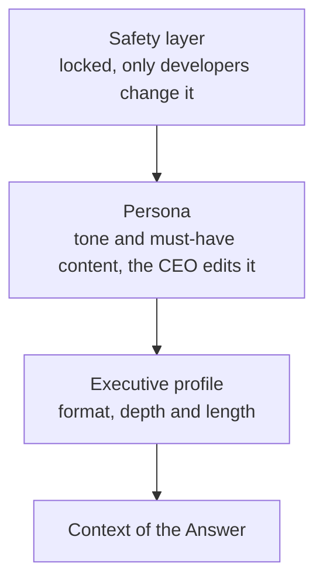

# Requirements coverage

This page maps each requirement of the [technical assignment](requirements/2026-11-12-client-technical-assignment.md) to its acceptance criteria (AC), the design section, the code, the test and the demo scenario (P25). Requirements R1–R8 are Requirements 1–8 of the assignment.

## How to read this page

| Mark | Meaning | Proof |
| --- | --- | --- |
| **Must** | The prototype must have it (P1). | An automated test and a demo scenario. |
| **Bonus** | Code only after all Must ACs pass (P2). | A test or a demo scenario. |
| **Design** | Only in the design documents. | A design section. There is no code. |

A Code, Test or Demo column stays empty ("—") when the work does not exist. The [live tests](../tests/test_live.py) run only with `--live` against the reviewer's project.

## Core chat (P1)

| ID | Acceptance criterion | Mark | Design | Code | Test | Demo |
| --- | --- | --- | --- | --- | --- | --- |
| AC-CORE.1 | The CLI agent makes BigQuery SQL at run time, keeps the conversation context and builds a report with action items when the Executive asks. | **Must** | [HLD 5](design/hld.md#5-turn-api), [6](design/hld.md#6-turn-lifecycle) | [`turn_api.py`](../src/dca/app/turn_api.py), [`context.py`](../src/dca/core/context.py), [`drafting.py`](../src/dca/core/drafting.py), [`main.py`](../src/dca/cli/main.py) | [`test_turn_api.py`](../tests/test_turn_api.py), [`test_context_reports.py`](../tests/test_context_reports.py), [`test_saved_reports.py`](../tests/test_saved_reports.py), [`test_cli.py`](../tests/test_cli.py), [`test_accessibility.py`](../tests/test_accessibility.py) | [D1](demo.md#d1-core-chat-ac-core1) |

## R1. Hybrid Intelligence

| ID | Acceptance criterion | Mark | Design | Code | Test | Demo |
| --- | --- | --- | --- | --- | --- | --- |
| AC-R1.1 | At query time, Trio retrieval finds the top-k Trios that are close to the question, and the agent puts them into the context. The Answer shows the IDs of the Trios that it used (P22). In the prototype, Trio retrieval uses embeddings only (ADR 0007). Production also filters by metric tags. | Bonus | [HLD 12](design/hld.md#12-knowledge-golden-bucket-and-metric-catalog) | — | — | — |
| AC-R1.2 | The design shows the update loop: candidate → analyst review → tag → index (P13), with versions for Trios and a retirement of old Trios. | Design | [HLD 12](design/hld.md#12-knowledge-golden-bucket-and-metric-catalog) | — | — | — |
| AC-R1.3 | The prototype has 2–3 Trios, made from the example questions of the assignment, and cites them in Answers. | Bonus | [HLD 12](design/hld.md#12-knowledge-golden-bucket-and-metric-catalog) | — | — | — |

## R2. Safety & PII Masking

| ID | Acceptance criterion | Mark | Design | Code | Test | Demo |
| --- | --- | --- | --- | --- | --- | --- |
| AC-R2.1 | No PII column gets to the LLM or to the output. The validator works on the SQL AST, so it also catches `SELECT *`, aliases and expressions. A scan of the output is the last layer. All red-team cases are blocked. | **Must** | [HLD 8](design/hld.md#8-safety-pipeline) | [`sql_guard.py`](../src/dca/core/sql_guard.py), [`output_guard.py`](../src/dca/core/output_guard.py), [`drafting.py`](../src/dca/core/drafting.py) | [`test_sql_guard.py`](../tests/test_sql_guard.py), [`test_sql_guard_turn.py`](../tests/test_sql_guard_turn.py), [`test_output_guard.py`](../tests/test_output_guard.py) | [D2](demo.md#d2-no-pii-in-the-output-ac-r21) |
| AC-R2.2 | Each query reads only the Effective scope, through the scoped views (ADR 0001). For a Manager, the figure of the agent equals the figure of a reference query on the brands of that Manager. A request to go out of the scope gets a refusal. | **Must** | [HLD 8](design/hld.md#8-safety-pipeline) | [`sql_guard.py`](../src/dca/core/sql_guard.py), [`schema.py`](../src/dca/core/schema.py), [`turn_api.py`](../src/dca/app/turn_api.py) | [`test_scope_rewrite.py`](../tests/test_scope_rewrite.py), [`test_sql_guard_turn.py`](../tests/test_sql_guard_turn.py), [`test_turn_api.py`](../tests/test_turn_api.py), [`test_live.py`](../tests/test_live.py) | [D3](demo.md#d3-brand-scope-ac-r22) |
| AC-R2.3 | A request that is not analysis (prompt injection, a request for the system prompt, a poem) gets a polite refusal. A demographic query goes to the threshold view with k = 5, or gets `HAVING COUNT(DISTINCT user_id) >= 5` as the fallback (ADR 0005). | **Must** | [HLD 8](design/hld.md#8-safety-pipeline) | [`input_guard.py`](../src/dca/core/input_guard.py), [`demographic.py`](../src/dca/core/demographic.py), [`setup_bq.py`](../src/dca/setup_bq.py) | [`test_input_guard.py`](../tests/test_input_guard.py), [`test_demographic_turn.py`](../tests/test_demographic_turn.py), [`test_sql_guard.py`](../tests/test_sql_guard.py), [`test_setup_bq.py`](../tests/test_setup_bq.py), [`test_live.py`](../tests/test_live.py) | [D4](demo.md#d4-analysis-only-and-small-groups-ac-r23) |

## R3. High-Stakes Oversight

| ID | Acceptance criterion | Mark | Design | Code | Test | Demo |
| --- | --- | --- | --- | --- | --- | --- |
| AC-R3.1 | A delete request shows a preview (the count and the titles of the matched Saved Reports) and the expected reply. Nothing changes before the Executive types the expected reply. Any other message cancels the request, and the pending confirmation expires after its TTL. The LLM has no delete tool (ADR 0002). The friction grows with the blast radius: "yes" for 1 report, the count (for example `delete 7`) for 2 or more reports. | **Must** | [HLD 10](design/hld.md#10-destructive-operations) | [`confirmation.py`](../src/dca/core/confirmation.py), [`turn_api.py`](../src/dca/app/turn_api.py), [`render.py`](../src/dca/cli/render.py) | [`test_delete_confirmation.py`](../tests/test_delete_confirmation.py) | [D5](demo.md#d5-delete-with-a-strict-confirmation-ac-r31) |
| AC-R3.2 | An Executive can delete only the Saved Reports that they own. The pending confirmation is bound to the Executive, the session and the hash of the exact set of report IDs. "Reports mentioning Customer X" matches on the Customer IDs that each Saved Report records. For a name, the agent asks for the Customer ID. | **Must** | [HLD 10](design/hld.md#10-destructive-operations) | [`confirmation.py`](../src/dca/core/confirmation.py), [`reports.py`](../src/dca/core/reports.py), [`sqlite_reports.py`](../src/dca/adapters/sqlite_reports.py) | [`test_delete_confirmation.py`](../tests/test_delete_confirmation.py), [`test_saved_reports.py`](../tests/test_saved_reports.py), [`test_undo.py`](../tests/test_undo.py) | [D6](demo.md#d6-only-the-owner-can-delete-ac-r32) |
| AC-R3.3 | The delete is soft and writes an audit log entry. The `/undo` command restores the reports during the Undo window. | **Must** | [HLD 10](design/hld.md#10-destructive-operations) | [`sqlite_reports.py`](../src/dca/adapters/sqlite_reports.py), [`turn_api.py`](../src/dca/app/turn_api.py) | [`test_delete_confirmation.py`](../tests/test_delete_confirmation.py), [`test_undo.py`](../tests/test_undo.py) | [D7](demo.md#d7-soft-delete-and-undo-ac-r33) |

## R4. Continuous Improvement (Learning Loop)

| ID | Acceptance criterion | Mark | Design | Code | Test | Demo |
| --- | --- | --- | --- | --- | --- | --- |
| AC-R4.1 | User level: the Executive profile learns format, depth and length from explicit requests and from implicit signals, with a confidence and a decay. The Executive can see and edit the profile. An explicit edit wins over a learned value. | Design | [HLD 13](design/hld.md#13-learning-loop) | — | — | — |
| AC-R4.2 | System level: signals (feedback, rephrased questions, SQL corrections, failed turns) become candidate Trios and candidate changes. An eval gate checks each change before release. The system never changes itself without the gate. | Design | [HLD 13](design/hld.md#13-learning-loop) | — | — | — |
| AC-R4.3 | The prototype keeps a YAML Executive profile for each Executive, shows and edits it with `/profile`, and uses it in the next session. | Bonus | [HLD 13](design/hld.md#13-learning-loop) | — | — | — |

## R5. Resilience & Graceful Error Handling

| ID | Acceptance criterion | Mark | Design | Code | Test | Demo |
| --- | --- | --- | --- | --- | --- | --- |
| AC-R5.1 | For a SQL error, the agent first does a dry run, then makes not more than 2 correction attempts. For an empty result, it runs a diagnostic query on the distinct values of the filter column and gives an honest Answer. The CLI does not stop. | **Must** | [HLD 15](design/hld.md#15-resilience-and-error-handling) | [`tools.py`](../src/dca/core/tools.py), [`diagnostic.py`](../src/dca/core/diagnostic.py) | [`test_self_correction.py`](../tests/test_self_correction.py) | [D8](demo.md#d8-self-correction-and-empty-results-ac-r51) |
| AC-R5.2 | For 429, 5xx or a timeout from the LLM or BigQuery, the agent uses backoff, then the fallback model, then a friendly message with the `trace_id`. The session continues. Chaos mode (`CHAOS=llm_429:0.3,bq_timeout:0.1`) proves this. | **Must** | [HLD 15](design/hld.md#15-resilience-and-error-handling) | [`adk_loop.py`](../src/dca/agent/adk_loop.py), [`turn_api.py`](../src/dca/app/turn_api.py), [`backoff.py`](../src/dca/core/backoff.py), [`chaos.py`](../src/dca/adapters/chaos.py) | [`test_resilience.py`](../tests/test_resilience.py) | [D9](demo.md#d9-service-failures-ac-r52) |
| AC-R5.3 | Each turn has a budget for LLM calls, tokens, bytes scanned and wall time. When a turn goes over the budget, the agent stops and explains why. | **Must** | [HLD 15](design/hld.md#15-resilience-and-error-handling) | [`budget.py`](../src/dca/core/budget.py), [`turn_api.py`](../src/dca/app/turn_api.py), [`main.py`](../src/dca/cli/main.py) | [`test_budgets.py`](../tests/test_budgets.py) | [D10](demo.md#d10-turn-budgets-and-ctrlc-ac-r53) |

## R6. Quality Assurance

| ID | Acceptance criterion | Mark | Design | Code | Test | Demo |
| --- | --- | --- | --- | --- | --- | --- |
| AC-R6.1 | An eval set of 5 questions with reference SQL, separate from the Golden Bucket (ADR 0006), measures execution accuracy. CI runs it and publishes the report to the Pages site. | Bonus | [HLD 17](design/hld.md#17-quality-assurance) | — | — | — |
| AC-R6.2 | An LLM judge checks intent with a rubric (does the Answer reply to the question, are the action items specific), calibrated against a small set of human labels. | Design (optional) | [HLD 17](design/hld.md#17-quality-assurance) | — | — | — |
| AC-R6.3 | UX eval: a pairwise preference test, in which the Executive sees two Answer variants and selects the better one. | Design | [HLD 17](design/hld.md#17-quality-assurance) | — | — | — |

## R7. Observability

| ID | Acceptance criterion | Mark | Design | Code | Test | Demo |
| --- | --- | --- | --- | --- | --- | --- |
| AC-R7.1 | The CLI shows the `trace_id` of each turn. The trace has spans for LLM calls (model, tokens, latency), tools (SQL, bytes, rows) and guardrail decisions (block reason). No PII goes into a trace. | **Must** | [HLD 16](design/hld.md#16-observability) | [`otel_tracer.py`](../src/dca/adapters/otel_tracer.py), [`turn_api.py`](../src/dca/app/turn_api.py) | [`test_trace.py`](../tests/test_trace.py), [`test_output_guard.py`](../tests/test_output_guard.py) | [D11](demo.md#d11-trace-of-each-turn-ac-r71) |
| AC-R7.2 | The docs define the metrics before the code: turn success rate, block rate for each reason, self-correction rate, empty-result rate, LLM error and fallback rate, p50/p95 latency, cost for each turn, and the completion and abort rate of confirmations. Each metric comes out as a span attribute or a log field. | **Must** | [HLD 16](design/hld.md#16-observability) | [`metrics.py`](../src/dca/metrics.py), [`otel_tracer.py`](../src/dca/adapters/otel_tracer.py) | [`test_metrics.py`](../tests/test_metrics.py) | [D12](demo.md#d12-metrics-ac-r72) |
| AC-R7.3 | The `/trace <id>` command shows the full dialog again, step by step, from the JSONL trace file. | **Must** | [HLD 16](design/hld.md#16-observability) | [`trace_view.py`](../src/dca/core/trace_view.py), [`render.py`](../src/dca/cli/render.py) | [`test_trace.py`](../tests/test_trace.py) | [D13](demo.md#d13-the-steps-of-a-turn-ac-r73) |

## R8. Agility (Persona Management)

| ID | Acceptance criterion | Mark | Design | Code | Test | Demo |
| --- | --- | --- | --- | --- | --- | --- |
| AC-R8.1 | The Persona is outside the code, has versions and a non-developer can edit it. The system reads it again on each turn, so a change needs no deployment. | Design | [HLD 14](design/hld.md#14-persona-management) | — | — | — |
| AC-R8.2 | Before a Persona change goes live, the system validates it, shows a sample Answer in the new tone and permits a rollback. Each trace records the Persona version. | Design | [HLD 14](design/hld.md#14-persona-management) | — | — | — |
| AC-R8.3 | The prototype reads `persona.yaml` on each turn. The prompt has layers: the safety layer is locked, and only the tone layer comes from the Persona. | Bonus | [HLD 14](design/hld.md#14-persona-management) | — | — | — |

The prompt has three layers. An upper layer wins on its own topic:

## Extras

| ID | Item | Mark |
| --- | --- | --- |
| EX.1 | A result cache keyed by a hash of the normalized SQL | Bonus |
| EX.3 | A circuit breaker for each external service | Design |
| EX.4 | Production observability: Cloud Trace, Logging and Monitoring, and a log sink to BigQuery | Design |
