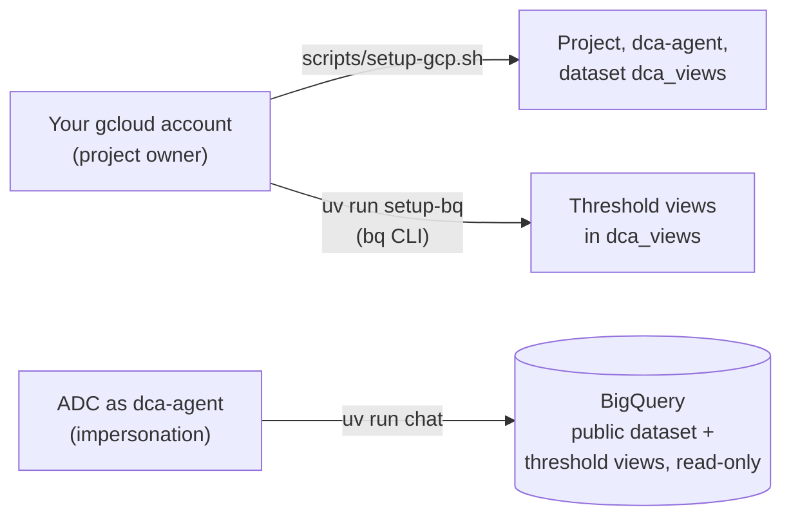
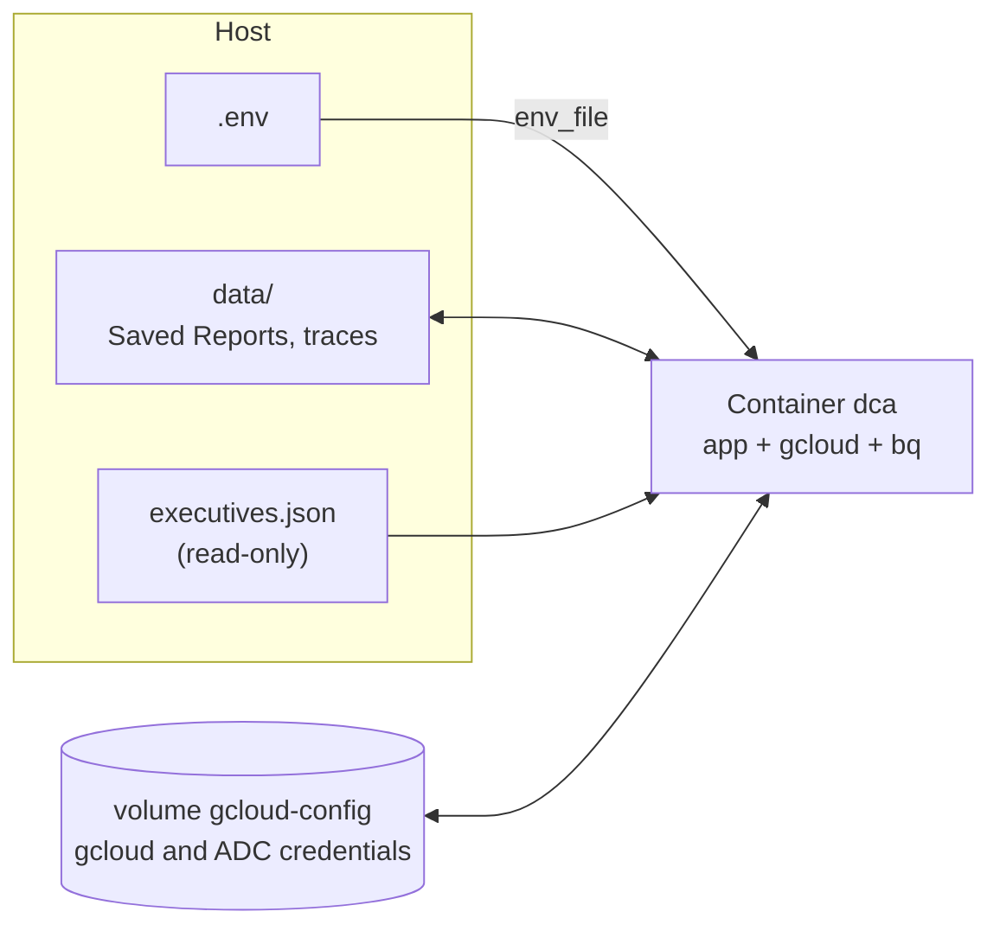

# Get started

**Status:** the commands agree with `pyproject.toml`, `.env.example`, the setup scripts and the `--help` output on `main`. The automated tests do not run the Google Cloud steps and the Docker steps, because these steps need your own project.

This page installs the prototype and starts the first chat. It is for a reviewer or an engineer. An Executive (a person who chats with the agent) does not install anything: see the [Executive guide](guide.md).

There are two ways to run the prototype: with uv on your computer, or with [Docker](#run-with-docker). Both ways use the same Google Cloud project.

## Prerequisites

- Python 3.12 and [uv](https://docs.astral.sh/uv/). If Python 3.12 is not on your computer, uv installs it.
- The [Google Cloud CLI](https://cloud.google.com/sdk/docs/install): the `gcloud` and `bq` commands.
- A Google account that can make a Google Cloud project.
- A Gemini API key from [Google AI Studio](https://aistudio.google.com/apikey).

The prototype uses the BigQuery sandbox and the free tier of the Gemini API, so it costs $0.

## How the access works

Two identities do the work. Your own `gcloud` account makes the Google Cloud resources and the threshold views. The chat runs as the service account `dca-agent`, which can only read data. It uses application default credentials (ADC) with impersonation, so there is no key file.

Look at which identity runs each command:



## Set up with uv

Run all commands in the folder of the repository. The chat reads `.env` and `executives.json` from this folder, and writes its files to `data/`.

1. Install the dependencies.

    **Why:** this installs the Python packages, the test tools and the commands `chat`, `setup-bq` and `dca-metrics`.

    ```bash
    uv sync
    ```

2. Copy the example settings. Then put your Gemini API key in `GOOGLE_API_KEY` and your project ID in `GOOGLE_CLOUD_PROJECT` in `.env`.

    **Why:** the chat reads the API key and the project from `.env`. BigQuery runs the query jobs in this project.

    ```bash
    cp .env.example .env
    ```

    Make the API key in the same project. If the project does not exist yet, add the key after step 3.

3. Sign in to `gcloud` with your own account, if you did not do this before. Then make the project, the service account `dca-agent` and the dataset `dca_views`.

    **Why:** the script needs the rights of a project owner. It also lets your account act as `dca-agent`. You can run it again: it skips the resources that exist.

    ```bash
    gcloud auth login
    ```

    ```bash
    PROJECT_ID=<your-project-id> scripts/setup-gcp.sh
    ```

4. Let ADC impersonate `dca-agent`.

    **Why:** the chat then runs as `dca-agent`, which can only read data. A wrong query cannot change or delete data in BigQuery.

    ```bash
    gcloud auth application-default login --impersonate-service-account=dca-agent@<your-project-id>.iam.gserviceaccount.com
    ```

5. Make the threshold views ([ADR 0005](https://github.com/modvala/data-chat-assistant/blob/main/docs/adr/0005-aggregation-threshold-on-demographic-path.md)).

    **Why:** these views hide small groups of Customers (the people who buy) in results by age, gender or place. This command uses your own account through the `bq` CLI, because `dca-agent` can only read.

    ```bash
    uv run setup-bq
    ```

    In the BigQuery sandbox, the views expire after 60 days. Then run the command again. When the views are not available, each query by age, gender or place gets a `HAVING COUNT(DISTINCT …) >= 5` rule in their place.

6. Start the chat.

    **Why:** `--executive` selects the Executive from `executives.json`. The prototype has no sign-in.

    ```bash
    uv run chat --executive mgr_ana
    ```

    You see the session header with the Brand scope of `mgr_ana`. The Brand scope is the set of brands whose data an Executive can see.

    ```text
    ◆ Data Chat Assistant
      Executive mgr_ana · Manager · Brand scope: Allegra K, Calvin Klein
      Type a question, or /help for commands.
    ```

Next, try the [Demo tour](demo-tour.md), or read the [Executive guide](guide.md) to learn the commands.

## Run with Docker

This is a second way to run the prototype. The host needs only Docker with the Compose plugin. The image contains Python, the app and the Google Cloud CLI (about 1.7 GB). The steps are the same as with uv, but each command starts with `docker compose run --rm dca`.

Look at which host files the container uses:



1. Copy the example settings, then put your API key and your project ID in `.env`. Make the data folder.

    **Why:** the container reads `.env`. It keeps the Saved Reports (the analyses that Executives keep) and the traces in `data/` on the host. Docker cannot start the container if `data/` does not exist.

    ```bash
    cp .env.example .env
    ```

    ```bash
    mkdir -p data
    ```

2. Build the image.

    **Why:** the image has all the tools, so the host needs no Python and no Google Cloud CLI.

    ```bash
    docker compose build
    ```

3. Sign in with your `gcloud` account. The container has no browser: open the URL on your host, then paste the code into the terminal.

    **Why:** the setup script in step 4 uses your account. The volume `gcloud-config` keeps the sign-in for the next commands.

    ```bash
    docker compose run --rm dca gcloud auth login --no-launch-browser
    ```

4. Make the Google Cloud resources. The script uses `GOOGLE_CLOUD_PROJECT` from `.env`.

    **Why:** this makes the project, the service account `dca-agent` and the dataset `dca_views`, as in step 3 of the uv setup.

    ```bash
    docker compose run --rm dca scripts/setup-gcp.sh
    ```

5. Let ADC impersonate `dca-agent`.

    **Why:** the chat then runs as `dca-agent`, which can only read data.

    ```bash
    docker compose run --rm dca gcloud auth application-default login --no-launch-browser --impersonate-service-account=dca-agent@<your-project-id>.iam.gserviceaccount.com
    ```

6. Make the threshold views.

    **Why:** these views hide small groups of Customers in results by age, gender or place.

    ```bash
    docker compose run --rm dca setup-bq
    ```

7. Start the chat.

    **Why:** `--executive` selects the Executive from `executives.json`. The prototype has no sign-in.

    ```bash
    docker compose run --rm dca chat --executive mgr_ana
    ```

Notes:

- The Saved Reports and the traces stay in `data/` on the host.
- A change to `.env` or to `executives.json` needs no new image. A change to the code or to `config/defaults.toml` needs `docker compose build`.
- For a pipe, for example with `--plain`, add `-T` after `run`. Then the container gets no terminal:

    ```bash
    docker compose run --rm -T dca chat --executive mgr_ana --plain
    ```

- The container runs as the user with UID 1000. On a Linux host, this user must be able to write to `data/`.
- To remove the credentials, remove the volume:

    ```bash
    docker compose down --volumes
    ```

## Tests and metrics

The offline tests use no network, no API key and no Google Cloud project.

**Why:** they check each feature with fake services, so you can run them on any computer.

```bash
uv run pytest
```

The `live` tests use Gemini and your BigQuery project from the setup above. They check the Brand scope against a reference query, the threshold view and one real Turn (one question and its Answer).

**Why:** only these tests use the real services.

```bash
uv run pytest --live tests/test_live.py
```

Each Turn writes its trace and its log lines to `data/dca_traces.jsonl`. This command computes the metrics of [HLD 16.2](https://github.com/modvala/data-chat-assistant/blob/main/docs/design/hld.md#162-metrics) from the file.

**Why:** the metrics come from the trace file only, with no other data.

```bash
uv run dca-metrics data/dca_traces.jsonl
```

With Docker, the metrics command also runs in the container:

```bash
docker compose run --rm dca dca-metrics data/dca_traces.jsonl
```

## Configuration reference

All starting values are in [`config/defaults.toml`](https://github.com/modvala/data-chat-assistant/blob/main/config/defaults.toml): budgets, retries, timeouts, the time limit of a delete confirmation and the Undo window. It also has row limits, model IDs and the prices for the cost metric. The Undo window is the time in which an Executive can restore deleted reports.

An environment variable or `.env` overrides a value of `config/defaults.toml`. An environment variable wins over `.env`.

| Variable | What it sets |
| --- | --- |
| `GOOGLE_API_KEY` | The Gemini API key. |
| `GOOGLE_GENAI_USE_VERTEXAI` | `FALSE`: the prototype uses the Gemini API, not Vertex AI. |
| `GOOGLE_CLOUD_PROJECT` | The project from `scripts/setup-gcp.sh`. BigQuery runs the query jobs here. |
| `DCA_MODEL` | The main model. |
| `DCA_FALLBACK_MODEL` | The backup model. |
| `DCA_<SECTION>__<KEY>` | Any value of `config/defaults.toml`, for example `DCA_BUDGET__LLM_CALLS=4`. |
| `CHAOS`, `CHAOS_SEED` | Chaos mode, see below. |

Chaos mode adds failures to the calls to the language model and to BigQuery. `CHAOS_SEED` makes the failures the same in each run.

```bash
CHAOS=llm_429:0.3,bq_timeout:0.1 CHAOS_SEED=7 uv run chat --executive mgr_ana
```

The failures are `llm_429`, `llm_503`, `llm_timeout`, `bq_timeout` and `bq_5xx`. The number after the colon is the part of the calls that fail.

## Troubleshooting

| What you see | Cause | What to do |
| --- | --- | --- |
| `Unknown Executive ID` and a list of valid IDs | The ID is not in `executives.json`. | Use an ID from the list. |
| `FileNotFoundError` for `executives.json` | You ran the command in a different folder. | Run the commands in the folder of the repository. |
| `Set PROJECT_ID or GOOGLE_CLOUD_PROJECT` | `scripts/setup-gcp.sh` has no project ID. | Put `PROJECT_ID=<your-project-id>` before the command. |
| `setup-bq: Set GOOGLE_CLOUD_PROJECT in .env.` | `.env` has no project ID. | Do step 2. |
| `setup-bq: The bq command is not available.` | The Google Cloud CLI is not installed. | Install it, then run `gcloud auth login`. |
| `setup-bq: Your gcloud account could not make the threshold views.` | Your account is not an owner of the project, or the dataset `dca_views` does not exist. | Do step 3 with your own account. |
| Each question gets `The data service did not answer` | The API key, the project or the ADC sign-in is wrong. | Check `.env`, and do step 4 again. Type `/trace` to see the step that failed. |
| `/sql` of a question by age, gender or place shows `HAVING COUNT(DISTINCT …) >= 5` | The threshold views are not available. In the sandbox, they expire after 60 days. | Do step 5 again. |
| Many Answers show `backup model` | On the Gemini free tier, the main model often answers "high demand". | You do not have to do anything. The agent tries again, then uses the backup model. |
| The chat stops at the start with `Unknown CHAOS fault` | `CHAOS` has a wrong failure name. | Use a name from the [Configuration reference](#configuration-reference). |
| Docker: `bind source path does not exist` | The folder `data/` does not exist. | Do step 1 of the Docker setup. |
| Docker on Linux: the chat cannot write to `data/` | The container user (UID 1000) cannot write to `data/`. | Give UID 1000 write access to `data/`. |
