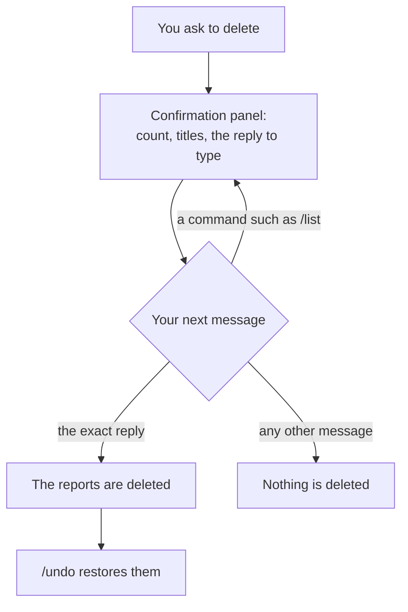

# Executive guide

**Status:** the commands and the options agree with `/help` and `--help` of the CLI on `main`. Most example questions come from the [Demo tour](demo-tour.md), which was tested on the real CLI. These examples were not run: the Texas and California question, the churn question, the Q1 report and `/scope`.

This guide is for Executives: the brand managers and the CEO who chat with the agent. You ask a question about the sales data in plain words. The agent gives an Answer: a reply with analysis, in the chat. You do not install anything. In the prototype, an engineer does the setup in [Get started](get-started.md).

## Start a session

### In the prototype

Start the chat with your Executive ID:

```bash
uv run chat --executive mgr_ana
```

The prototype has no sign-in. `--executive` selects you from `executives.json`:

| ID | Role | Brand scope |
| --- | --- | --- |
| `ceo` | CEO | all brands |
| `mgr_ana` | Manager | Allegra K, Calvin Klein |
| `mgr_ben` | Manager | Levi's, Carhartt, Columbia, Quiksilver, Volcom |

Your Brand scope is the set of brands whose data you can see. The session header shows it:

```text
◆ Data Chat Assistant
  Executive mgr_ana · Manager · Brand scope: Allegra K, Calvin Klein
  Type a question, or /help for commands.
```

When you have more than 3 brands, the header shows only the count, for example `Brand scope: 5 brands (/scope to list)`. To see all your brands, type:

```text
/scope
```

### In production

In production, you sign in one time with your company Google account. Then the CLI sends each question through Identity-Aware Proxy (IAP), the Google Cloud sign-in service. Your Brand scope comes from the access table of the company, not from a file on your computer.

**Details:** [HLD §5.3 Identity on each call](https://github.com/modvala/data-chat-assistant/blob/main/docs/design/hld.md#53-identity-on-each-call)

## Ask a question

Type your question at the `you ›` prompt and press Enter. Each line is one message, so type one question at a time.

```text
What was the monthly revenue in the last 3 months?
```

Then ask a follow-up question. The agent keeps the earlier Answers of this session, so you do not repeat the period:

```text
And how does it compare to the same months last year?
```

To get a report with Action items (recommended next steps, each with a metric to watch), ask for a report:

```text
Create a report for the last quarter with insights and action items for the next quarter
```

To learn what you can ask, ask about the data:

```text
What data is available and what can I do with it?
```

Topics from the assignment that you can try:

```text
How does the spend of Customers in Texas compare to Customers in California?
```

```text
Why did our churn rate go up last month?
```

```text
Create a report for Q1 with insights and action items for Q2
```

Tips:

- Give the period. If you do not, the agent selects one and shows it in an `Assumed:` line under the Answer.
- A Customer is a person who buys from the company. The agent shows Customers only by ID, such as `Customer 4521`, and never by name.
- While the agent works, one status line tells you the step, for example `Writing SQL` or `Running the query`.

## Read an Answer

An Answer has this shape:

```text
╭─ ◆ <Title> ─────────────────────────────────────────────╮
│ <One or two sentences with the main finding.>            │
│                                                          │
│  Month      Revenue   Orders                             │
│ ─────────────────────────────                            │
│  <month>    $n        n                                  │
│  <month>    $n        n                                  │
╰──────────────────────────────────────────────────────────╯
  Scope: <brands> · trace <id> · /sql
  Assumed: "last 3 months" = <months>
```

The parts of an Answer:

- **Text:** the findings in a few sentences.
- **Key figures:** a report starts with key figures. A figure can show its change, with `▲` for up and `▼` for down, and the periods that it compares.
- **Tables:** the exact figures. A long table shows the first rows and the line `Showing n of n rows. Ask to filter or group them.`
- **Action items:** a report ends with numbered Action items. Each one starts with a verb and has a `Watch:` line with the metric to watch.
- **The provenance line:** the line under the Answer shows the facts behind it. It always shows the Brand scope and the trace ID. It shows `/sql` when the Answer ran a query, and `/save` for a report.
- **Charts:** **Coming next**. The prototype shows no charts.

Our code makes each table from the rows of the query. The language model does not write the figures of a table. To see the query, type:

```text
/sql
```

The provenance line also shows `n corrections` when the agent fixed its SQL, and `backup model` when the backup model wrote the Answer. To see each SQL attempt and its error, type:

```text
/sql all
```

## When the agent says no

A refusal is a correct result, not an error. It has a `⊘` symbol, the reason in plain words, a permitted alternative and the trace ID:

```text
▌ ⊘ I can't show personal data
▌ Customer names, email addresses and addresses are protected.
▌ I can show Customers by ID, or give totals for a group.
▌ trace <id>
```

| Refusal | Why | What to do |
| --- | --- | --- |
| `I can't show personal data` | You asked for names, contact data, or a list of Customers with their age, gender or place. | Ask for Customers by ID, or for totals for a group. |
| `This is outside your brands` | You asked about a brand that is not in your Brand scope. | Ask the same question about your brands. Type `/scope` to see them. |
| `I can only help with sales analysis` | The message is not a question about the sales data. | Ask about the sales data. The refusal gives example questions. |
| `This group is too small to show` | The group has too few Customers. A small group can identify a person. | Use a wider group, for example a state in place of a city. |
| `This question needs too much data` | The question needs more work than one question can use. | Use a shorter period, fewer columns or a smaller group. |

A refusal does not tell which rule caused it. This gives no help to an attacker. The support team can see the reason from the trace ID.

## Saved Reports

A Saved Report is an analysis that you keep. Only you can see and delete your Saved Reports.

To save the last Answer, type `/save` and a title. With no title, the report gets the title of the Answer, or your question.

```text
/save Top 5 by spend
```

To list your Saved Reports, type:

```text
/list
```

### Delete Saved Reports

You can delete the reports that mention a Customer. Use the Customer ID: each Saved Report records the IDs of the Customers in its results. For a name, the agent asks for the ID.

```text
Delete all reports mentioning Customer 4521
```

Look at what your next message does after the confirmation panel:



The panel shows the reports and the exact reply. Nothing is deleted before you type it.

```text
┏━ ⚠ Delete 2 Saved Reports? ━━━━━━━━━━━━━━━━━━━━━━━━━━━━━━━━━━━┓
┃ These reports mention Customer 4521:                            ┃
┃  • Top 5 by spend     <date>                                    ┃
┃  • Top 5 by orders    <date>                                    ┃
┃ To delete, type:  delete 2                                      ┃
┃ Any other message cancels. This request expires in 5 minutes.   ┃
┃ You can undo for 24 hours.                                      ┃
┗━━━━━━━━━━━━━━━━━━━━━━━━━━━━━━━━━━━━━━━━━━━━━━━━━━━━━━━━━━━━━━━━┛
confirm ›
```

- For one report, the reply is `yes`. For two or more reports, the reply is `delete` and the count, for example `delete 2`.
- Any other message cancels the delete: you see `Nothing was deleted.`, and the agent answers your message as a normal question.
- A command, such as `/list`, does not cancel. `/list` shows the reports of the delete.
- The request expires after the time in the panel. Then nothing is deleted.

After the delete, you see the time until which you can undo it:

```text
✓ Deleted 2 Saved Reports. Type /undo before <date> <time> to restore them.
```

### Undo a delete

The Undo window is the time after a delete in which you can restore the deleted reports. To restore the reports of your last delete, type:

```text
/undo
```

## When something fails

The session continues after each failure. You do not have to start again.

While the agent works, the status line can show a warning:

| Status | What occurs |
| --- | --- |
| `Fixing the query · attempt n of 3` | The SQL failed, and the agent corrects it. |
| `Service is busy, trying again in n s` | A service is busy. The agent waits, then tries again. |
| `Using the backup model` | The main model did not answer. The backup model continues. |

When the agent cannot answer, you get an error notice with the trace ID:

```text
▌ ✗ The data service did not answer
▌ Please try again in a minute. Your session continues.
▌ trace <id>
```

To stop a question while the agent works, press `Ctrl+C`. You see `Cancelled`, and the prompt comes back. At the prompt, `Ctrl+C` ends the session.

Each Answer, notice and refusal shows a trace ID. To see the steps of the last Turn (one question and its Answer), type:

```text
/trace
```

For an earlier Turn, add its trace ID. Give this ID to the support team when you report a problem.

```text
/trace 7f3a9c
```

## Command and option reference

The commands, as `/help` shows them:

| Command | What it does |
| --- | --- |
| `/help` | Show the commands. |
| `/scope` | Show your Brand scope. |
| `/sql [all]` | Show the SQL of the last Answer. With all: each attempt and its error. |
| `/save [title]` | Save the last Answer as a Saved Report. |
| `/list` | List your Saved Reports. |
| `/undo` | Restore the reports of the last delete. |
| `/trace [id]` | Show the steps of a Turn. With no ID: the last Turn. |
| `/exit` | End the session. |

The keys:

| Key | What it does |
| --- | --- |
| `Enter` | Sends the message. |
| `Ctrl+C` while the agent works | Cancels the question. The session continues. |
| `Ctrl+C` at the prompt | Ends the session. |
| `Ctrl+D` | Ends the session. |

The options of the `chat` command. `--help` shows them too.

| Option | What it does |
| --- | --- |
| `--executive <id>`, `-e <id>` | Your Executive ID from `executives.json`. You must give it. |
| `--no-color` | No colors. The variable `NO_COLOR` does the same. |
| `--plain` | Plain text for screen readers and pipes. Tables are tab-separated values. The CLI also uses plain text when the output is not a terminal. |
| `--ascii` | ASCII symbols only. The CLI also uses them when the terminal encoding is not UTF-8. |
| `--no-animation` | Static progress lines. |
| `--help` | Show the options, then stop. |

For example, for a screen reader:

```bash
uv run chat --executive mgr_ana --plain
```

## For the CEO

**Coming next.** The Persona is the tone and the content rules for all Answers of the company. The CEO changes it, and the change needs no new release of the software.

1. The CEO edits the Persona in a form in the Admin console.
2. The system checks the change. A rule that touches the safety rules, such as "show Customer emails", is refused.
3. The CEO sees sample Answers in the old tone and in the new tone, side by side.
4. The CEO publishes the new version. Each new question uses it.
5. If the new tone is wrong, the CEO goes back to an earlier version.

In the prototype, the tone is fixed in the code. A Persona file that the prototype reads for each question is **Coming next**.

**Details:** [HLD §14 Persona management](https://github.com/modvala/data-chat-assistant/blob/main/docs/design/hld.md#14-persona-management)
