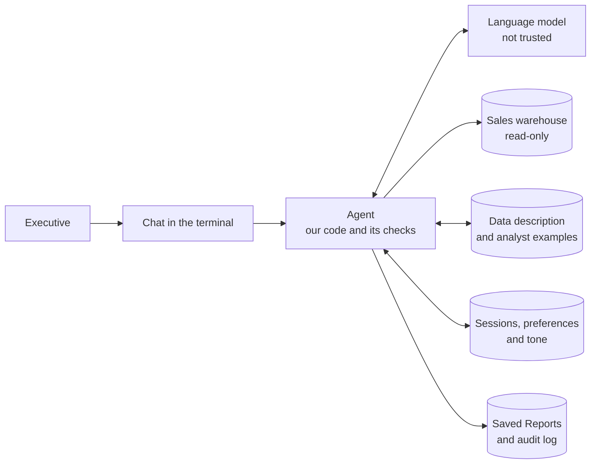
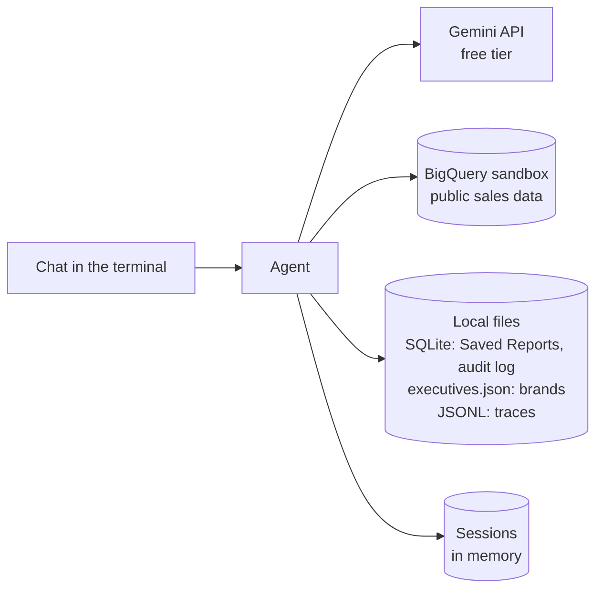
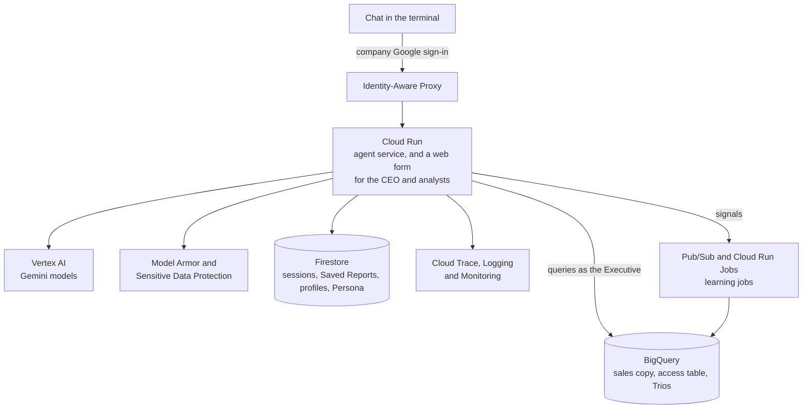
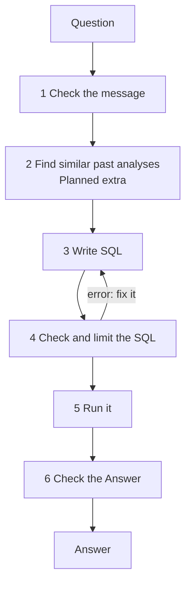
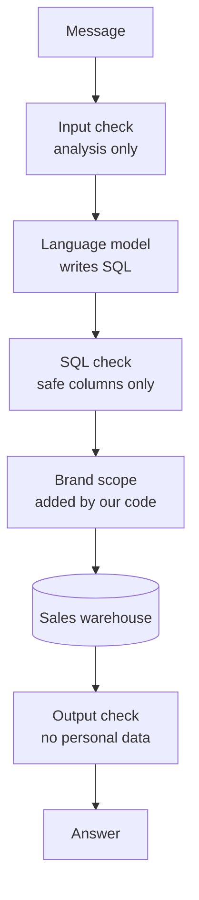

# How it works

**Status:** the prototype runs on one computer, with the safety checks in our code. Finding similar past analyses is a planned extra, and the Google Cloud setup is production design only.

The main design idea: the language model is not trusted. It only writes SQL and drafts the text. Our code makes all the security decisions.

## Context

Look at which parts the Executive (a brand manager or the CEO) talks to, and which parts keep data.

The Executive talks only to the chat, and the chat shows each Answer (the reply of the agent). The agent gets SQL and draft text from the language model, and checks all of it before use. The stores keep the sessions, the data description and the Saved Reports (the analyses that Executives keep). Trios (a question, its SQL and the analyst report), the Persona (the CEO's tone) and Executive profiles (preferred formats) are a **Planned extra**.

**Details:** [HLD §4.1 Overview](https://github.com/modvala/data-chat-assistant/blob/main/docs/design/hld.md#41-overview) · [HLD §4.2 Building blocks](https://github.com/modvala/data-chat-assistant/blob/main/docs/design/hld.md#42-building-blocks)

## Building blocks

The prototype and production use the same agent code. Only the stores and the services around it are different.

### In the prototype

Look at the local files that take the place of the cloud stores, in one process on the computer of the reviewer.

The prototype uses the public sales data in the BigQuery sandbox and the free tier of the Gemini API. There is no real sign-in: a command option selects the Executive from `executives.json`. A Trio file, a Persona file and a profile file for each Executive are a **Planned extra**.

**Details:** [HLD §19 Prototype architecture](https://github.com/modvala/data-chat-assistant/blob/main/docs/design/hld.md#19-prototype-architecture) · [Tech stack: Prototype](https://github.com/modvala/data-chat-assistant/blob/main/docs/tech-stack.md#prototype)

### In production on Google Cloud

Look at the managed Google Cloud service for each part of the design.

This setup is **Production design**. The Executive signs in through Identity-Aware Proxy, and each query runs as the Executive, so BigQuery applies the brand limit a second time. VPC Service Controls surround the data services, Secret Manager keeps the secrets and Cloud Storage keeps the Trio files.

**Details:** [HLD §18 Physical architecture on GCP](https://github.com/modvala/data-chat-assistant/blob/main/docs/design/hld.md#18-physical-architecture-on-gcp) · [Tech stack: Production (GCP)](https://github.com/modvala/data-chat-assistant/blob/main/docs/tech-stack.md#production-gcp)

## One Turn

Look at the steps of one Turn (one question of the Executive and the Answer to it).

The agent first checks that the message is an analysis question. Our code checks the SQL that the language model writes, adds the brand limit and permits a limited number of fixes. After the query, our code checks the Answer for personal data. Step 2 is a **Planned extra**: the prototype does not find past analyses yet.

**Details:** [HLD §6.1 Sequence of one Turn](https://github.com/modvala/data-chat-assistant/blob/main/docs/design/hld.md#61-sequence-of-one-turn)

## Safety layers

Look at the four checks, where the Brand scope is the set of brands whose data the Executive can see.

A manager sees the brands of that manager, and the CEO sees all brands. Our code adds the Brand scope to each query, and the language model cannot change it. Each layer works alone, so one failure does not leak data. In production, BigQuery applies the Brand scope a second time.

**Details:** [HLD §8.1 Layers](https://github.com/modvala/data-chat-assistant/blob/main/docs/design/hld.md#81-layers)
