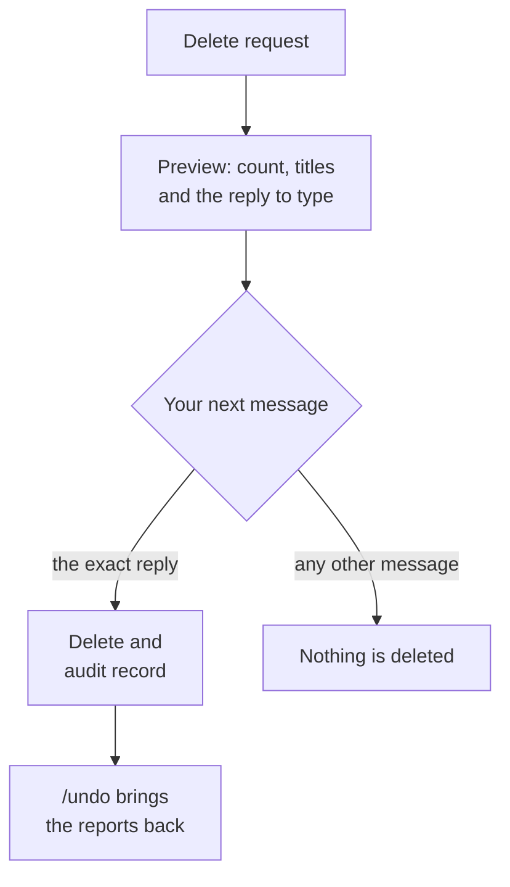
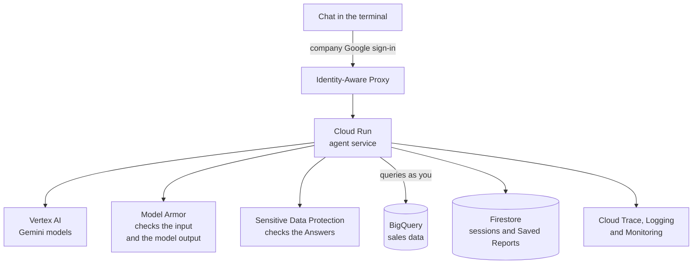

# Data Chat Assistant

Data Chat Assistant is a terminal chat for the Executives of a retail company: the brand managers and the CEO. You ask about your sales data in plain words. You get an Answer: a reply with analysis and the next steps to take.

Ask for a report:

```text
Create a report for the last quarter with insights and action items for the next quarter
```

You get an Answer in this shape:

```text
╭─ ◆ Sales report, <quarter> ──────────────────────────────────╮
│ Revenue $n ▲ n%    Orders n ▲ n%    Customers n ▼ n%         │
│ <quarter> vs <previous quarter>                              │
│                                                              │
│ <Two or three sentences with the main findings.>             │
│                                                              │
│ Action items                                                 │
│  1. <A verb and the action for the next quarter>             │
│     Watch: <metric>                                          │
│  2. <A verb and the action for the next quarter>             │
│     Watch: <metric>                                          │
╰──────────────────────────────────────────────────────────────╯
  Scope: <brands> · trace <id> · /sql · /save
  Assumed: "last quarter" = <quarter>
```

## Ask in plain words

**Available now**

Ask a question, ask follow-up questions, and type `/save` to keep a report as a Saved Report (an analysis that you keep). A report starts with key figures and ends with Action items: recommended next steps, each with a metric to watch. The agent writes new SQL for each question and runs it on the live sales data.

[See it in the demo](demo-tour.md#d1-core-chat-ac-core1)

## Your data stays safe

**Available now**

You see only the data of your Brand scope: your own brands, or all brands for the CEO. No personal data gets to the Answer, and results by age, gender or place hide small groups of buyers. Our code adds the Brand scope to each query, BigQuery checks it again in production, and red-team tests show that attacks are blocked.

[See it in the demo](demo-tour.md#d2-no-pii-in-the-output-ac-r21)

## Nothing is deleted without your yes

**Available now**

You can delete your own Saved Reports, but only after a preview and the exact reply that the preview asks for. Any other message cancels the delete, and `/undo` brings the reports back for a time after the delete. The language model cannot delete: our code reads your reply before the language model, and it writes each delete to an audit log.

Look at the two paths after the preview:



[See it in the demo](demo-tour.md#d5-delete-with-a-strict-confirmation-ac-r31)

## It does not break

**Available now**

A failed query gets a fix, and an empty result gets a reason, such as `Did you mean Shipped?`. When a service fails, the agent tries again or uses a backup model, and your session continues. Each question has a budget of model calls, data and time, `Ctrl+C` stops a question, and chaos mode adds failures for a test.

[See it in the demo](demo-tour.md#d9-service-failures-ac-r52)

## See every step

**Available now**

Each Answer ends with a provenance line: your Brand scope, the assumptions of the agent and a trace ID. Type `/sql` to see the query, and `/trace` to see each step from your question to the Answer. Each question writes a trace with no personal data, and the metrics command calculates the agent metrics from the traces.

[See it in the demo](demo-tour.md#d13-the-steps-of-a-turn-ac-r73)

## A CLI that is good to use

**Available now**

While the agent works, a status line tells you the step, such as `Writing SQL` or `Running the query`. Plain, ASCII and no-color modes make the chat work with screen readers, pipes and simple terminals. Each status has a word and a symbol, not only a color, and each action is a typed command.

## Runs on any machine

**Available now**

Install the prototype with uv, or run it with Docker on a computer that has only Docker. The prototype costs $0, because it uses the BigQuery sandbox and the free tier of the Gemini API. uv locks the version of each dependency, so each machine gets the same versions.

[See how to run it with Docker](get-started.md#run-with-docker)

## Learns how you like your Answers

**Coming next**

The agent will remember how each Executive likes the Answers: tables or bullet points, the depth and the length. You will see and edit your Executive profile (your presentation preferences) with `/profile`, and your edit will always win over a learned value. A job after each question will update the profile, so the Answer does not get slower.

## Learns from your analysts

**Coming next**

For each question, the agent will find similar past analyses of your analysts and use their logic. A Trio is one past analysis: a question, its SQL and the analyst report, and the Golden Bucket keeps the approved Trios. An analyst will review each new Trio before the agent can use it, and the Answer will show the Trios that it used.

## The CEO sets the tone

**Coming next**

The Persona is the tone and the content rules for all Answers, and the CEO will change it in a form. Each change will be a new version, with a check, a preview and a rollback, and it will need no new release. The Persona will not be able to change the safety rules.

## Checked before release

**Coming next**

A set of test questions with reference SQL will measure how often the agent gets the correct result, at each change in CI. A judge model will check that each Answer replies to the question, and labels from analysts will calibrate the judge. In a side-by-side test, Executives will select the better of two Answers.

## Ready for Google Cloud

In production, the same agent runs on Cloud Run, and you sign in with your company Google account through Identity-Aware Proxy. Firestore keeps the sessions and the Saved Reports, and Model Armor and Sensitive Data Protection add managed checks to our own checks. Each query runs as you, so BigQuery applies your Brand scope a second time.

Look at the managed Google Cloud service for each part:



## Also on the roadmap

**Coming next:** the design also has these features.

- **Metric catalog:** one reviewed definition for each business metric, such as churn.
- **Result cache:** a repeated query costs less, with a separate cache for each Brand scope.
- **Circuit breaker:** after many failures, the agent stops its calls to that service for a short time.
- **Saved Reports by email:** send a report to your colleagues, after a preview and your confirmation.
- **Web chat:** a web page that uses the same agent service as the terminal chat.

## Try it

- **See it work:** the [Demo tour](demo-tour.md) shows the main features in the real chat, step by step.
- **Run it:** [Get started](get-started.md) installs the prototype on your computer.
- **Use it:** the [Executive guide](guide.md) shows how to ask questions and read the Answers.

For engineers: the full design is on [GitHub](https://github.com/modvala/data-chat-assistant).
