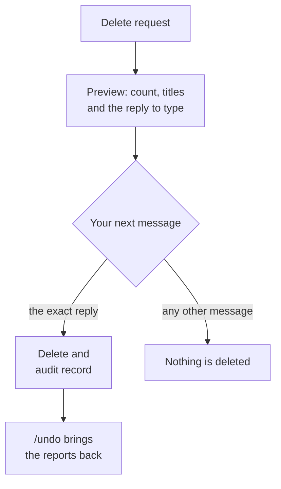
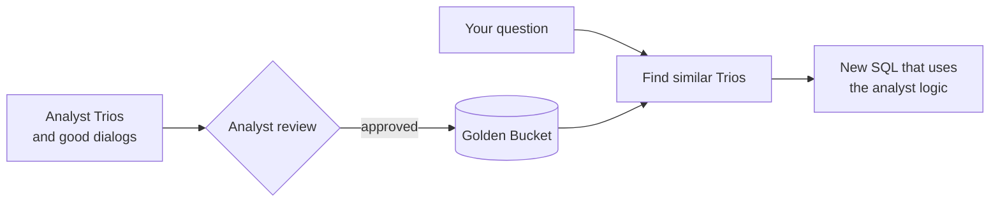
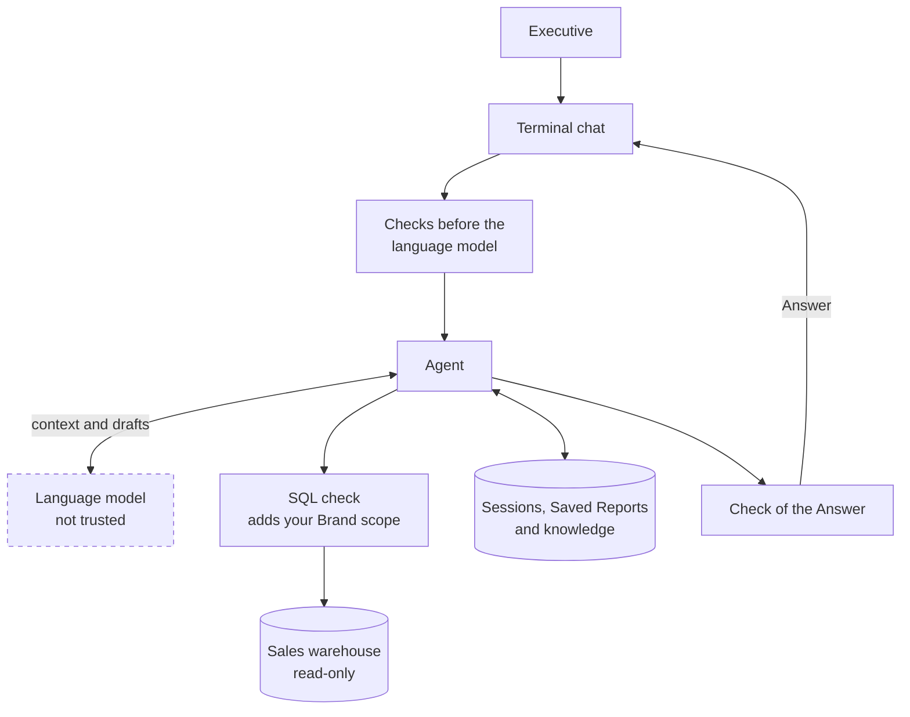
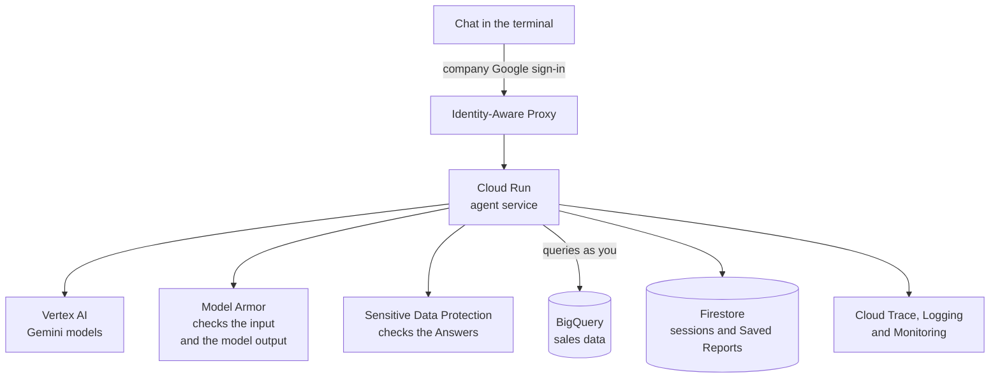

# Data Chat Assistant

Data Chat Assistant is a terminal chat for the Executives of a retail company: the brand managers and the CEO. You ask about your sales data in plain words. You get an Answer: a reply with analysis and Action items, which are the next steps to take, each with a metric to watch.

Ask for a report:

```text
Create a report for the last quarter with insights and action items for the next quarter
```

You get an Answer like this:

```text
╭─ ◆ Sales report, Q2 ───────────────────────────────────────────────────────╮
│ Revenue $412.6K ▲ +8.6%                                                    │
│ Q2 vs Q1                                                                   │
│                                                                            │
│ Orders 5,318 ▲ +5.1%                                                       │
│ Q2 vs Q1                                                                   │
│                                                                            │
│ Returns 7.9% ▼ -0.6 pp                                                     │
│ Q2 vs Q1                                                                   │
│                                                                            │
│ Revenue grew for both brands. Ridgeway jackets gave most of the growth,    │
│ but Lunara lost repeat buyers.                                             │
│                                                                            │
│ Findings                                                                   │
│                                                                            │
│ • Ridgeway jackets made 41% of the growth, with 1,120 orders.              │
│ • Lunara repeat buyers fell from 24% to 19% of its Customers.              │
│ • Returns fell for both brands after the new size guide.                   │
│                                                                            │
│ Action items                                                               │
│                                                                            │
│ 1. Restock the top 10 Ridgeway jackets before Q3                           │
│    Watch: sell-through of Ridgeway jackets                                 │
│ 2. Send a win-back offer to lapsed Lunara buyers                           │
│    Watch: Lunara repeat purchase rate                                      │
│ 3. Add the size guide to all Lunara product pages                          │
│    Watch: return rate                                                      │
╰────────────────────────────────────────────────────────────────────────────╯
  Scope: Ridgeway, Lunara · trace 7f3a9c2e · /sql · /save
  Assumed: "last quarter" = Q2
```

An example with invented figures.

## At a glance

Each feature in one line:

| Feature | How it works | Status |
| --- | --- | --- |
| Chat with your sales data | Gemini writes new BigQuery SQL for each question; follow-up questions; reports with Action items | Available now |
| Safety and PII masking | Each Executive sees only the data of their brands; SQL check, small groups hidden, output check, red-team tests | Available now |
| Delete confirmation | Preview, exact reply, `/undo` and an audit log | Available now |
| Resilience | Self-correction, retries, backup model, budgets, `Ctrl+C` and chaos mode | Available now |
| Tracing and metrics | OpenTelemetry trace for each question, `/trace` and a metrics command | Available now |
| Terminal chat (CLI) | A status line for each step, an Answer panel, typed commands, and modes for screen readers | Available now |
| Executive profile | Learns how you like your Answers; `/profile` shows and edits it | Coming next |
| Golden Bucket | A golden dataset of approved analyst work (question, SQL, report) that guides new queries | Coming next |
| Persona | The CEO edits the tone in a form, with versions, preview and rollback | Coming next |
| Evaluation | Test questions with reference SQL in CI, a judge model and side-by-side tests | Coming next |

## Chat with your sales data: ask in plain words

**Available now**

Ask a question and follow-up questions, or ask for a report with key figures, findings and Action items. Type `/save` to keep a report as a Saved Report: an analysis that you keep. Gemini writes new SQL for each question, and our code checks the SQL and runs it on the sales data in BigQuery.

[See it in the demo](demo-tour.md#d1-core-chat)

## Safety and PII masking: your data stays safe

**Available now**

You see only the data of your Brand scope: your own brands, or all brands for the CEO. No personal data gets to the Answer, and results by age, gender or place hide small groups of buyers. Our code checks each question, each query and each Answer, and red-team tests show that attacks are blocked.

[See it in the demo](demo-tour.md#d3-brand-scope)

## Delete confirmation: nothing is deleted without your yes

**Available now**

You can delete your own Saved Reports, but only after a preview and the exact reply that the preview asks for. Any other message cancels the delete, and `/undo` brings the reports back for a time after the delete. The language model cannot delete: our code reads your reply before the language model, and it writes each delete to an audit log.

Look at the two paths after the preview:



[See it in the demo](demo-tour.md#d5-delete-with-a-strict-confirmation)

## Resilience: it does not break

**Available now**

A failed query gets a fix, and an empty result gets a reason, such as `Did you mean …?` for a value that has a typo. A long analysis gets an Answer from the data that the agent found, and a failed service gets a retry or a backup model. Each question has a budget of model calls, data and time, `Ctrl+C` stops only the question, and chaos mode adds failures for a test.

[See it in the demo](demo-tour.md#d9-service-failures)

## Tracing and metrics: see every step

**Available now**

Each Answer ends with a provenance line: your Brand scope, the assumptions of the agent and a trace ID. Type `/sql` to see the query, and `/trace` to see each step from your question to the Answer. Each question writes an OpenTelemetry trace with no personal data, and the metrics command calculates the agent metrics from the traces.

[See it in the demo](demo-tour.md#d13-the-steps-of-a-turn)

## The terminal chat (CLI): made for daily use

**Available now**

You see who you are and your Brand scope, a status line while the agent works, and each Answer in a panel. The chat only sends your message and draws the Answer, so all the logic stays in the agent.

The main commands:

- `/help`: show all the commands.
- `/sql`: show the SQL of the last Answer.
- `/trace`: show the steps of the last question.
- `/save`: keep the last Answer as a Saved Report.
- `/list`: show your Saved Reports.
- `/undo`: bring back the reports of the last delete.

[See the screen, the symbols and the modes for screen readers](#cli-design)

## Runs on any machine

**Available now**

Install the prototype with uv, or run it with Docker on a computer that has only Docker. The prototype costs $0, because it uses the BigQuery sandbox and the free tier of the Gemini API. uv locks the version of each dependency, so each machine gets the same versions.

[See how to run it with Docker](get-started.md#run-with-docker)

## Executive profile: learns how you like your Answers

**Coming next**

The agent will remember how each Executive likes the Answers: tables or bullet points, the depth and the length. You will see and edit your Executive profile (your presentation preferences) with `/profile`, and your edit will always win over a learned value. A job after each question will update the profile, so the Answer does not get slower.

## Golden Bucket: learns from your analysts

**Coming next**

The Golden Bucket is a golden dataset of Trios: past analyses with a question, its SQL and the analyst report. For each question, the agent will find similar approved Trios, use their logic and show their IDs in the Answer. Good dialogs will become new Trios, and an analyst will review each one before the agent can use it.

Look at how a Trio gets into the Golden Bucket and then helps a new question:



## Persona: the CEO sets the tone

**Coming next**

The Persona is the tone and the content rules for all Answers, and the CEO will change it in a form. Each change will be a new version, with a check, a preview and a rollback, and it will need no new release. The Persona will not be able to change the safety rules.

## Evaluation: checked before release

**Coming next**

A set of test questions with reference SQL will measure how often the agent gets the correct result, at each change in CI. A judge model will check that each Answer replies to the question, and labels from analysts will calibrate the judge. In a side-by-side test, Executives will select the better of two Answers.

## System design

Look at the path of a question: our checks are before and after the language model, and only our code goes to your data.



The main design ideas:

- **The language model is not trusted:** it writes SQL and drafts the Answer, and our code checks all that it makes.
- **Safety is in the code and in the data:** the checks and the Brand scope do not depend on the prompt.
- **No raw personal data for the language model:** the agent never selects names, email addresses or street addresses, so the model cannot see them.
- **The language model only plans a delete:** our code shows the preview, reads your reply and does the delete.
- **One core for the prototype and for production:** the core uses each service through an adapter, so it runs on your computer and on Google Cloud.
- **Configuration, not code:** the access rights, the models, the budgets and the limits are in files, so a change needs no new release. A Persona file is **Coming next**.

## CLI design

The chat puts each part of the screen in the same place, and each status has a word and a symbol.

### The screen

This short session shows the session header, the prompt `you ›`, a status line, the Answer panel and the provenance line:

```text
◆ Data Chat Assistant
  Executive mgr_maya · Manager · Brand scope: Ridgeway, Lunara
  Type a question, or /help for commands.
you › Which Lunara products had the most returns last quarter?
──────────────────────────────────────────────────────────────────────────── 1
⠋ Running the query
╭─ ◆ Lunara returns, Q2 ─────────────────────────────────────────────────────╮
│ Dresses had the most returns. Most of them were for the wrong size.        │
│                                                                            │
│                                                                            │
│   Product type   Orders   Returns                                          │
│  ─────────────────────────────────                                         │
│   Dresses         2,196       312                                          │
│   Jeans           1,908       187                                          │
│   Tops            1,882        96                                          │
│                                                                            │
╰────────────────────────────────────────────────────────────────────────────╯
  Scope: Ridgeway, Lunara · trace 4c8e1b7a · /sql
  Assumed: "last quarter" = Q2
you ›
```

An example with invented figures.

- **Session header:** who you are, your role and your Brand scope.
- **Prompt:** `you ›` waits for a question or a command. After a delete preview, it changes to `confirm ›`.
- **Status line:** the step that the agent does now. It changes at each step and goes away when the Answer comes.
- **Answer panel:** the title and the content of the Answer in one frame.
- **Provenance line:** your Brand scope, the trace ID and the commands for the Answer. The assumptions of the agent are on the next line.

### Symbols

| Symbol | Meaning |
| --- | --- |
| `◆` | The agent: the session header, the title of an Answer and an information notice |
| `✓` | Done, or a step that passed |
| `✗` | An error, or a step that failed |
| `⊘` | A refusal: the agent does not show this, for a safety reason |
| `⚠` | A delete that waits for your reply |
| `▲` `▼` | A figure went up or down |
| `•` | An item in a list |
| `▌` | The left bar of a notice or a refusal |
| `›` | The prompt |
| `·` | A separator between the parts of one line |

### Colors

Colors: cyan for titles and commands, green for done, yellow for warnings, red for errors and deletes, magenta for refusals, blue for the Brand scope.

### Answer components

- **KPI row:** the key figures, each with its change and the period.
- **Table:** the figures from the query result, not from the language model. Numbers align to the right.
- **Action items:** numbered next steps, each with a `Watch:` line that names the metric to watch.
- **Notice:** a message with a left bar, for example an error. An error notice gives the trace ID and tells you that your session continues.
- **Refusal:** a notice with `⊘`, the reason in plain words and what you can ask in its place.
- **Confirmation panel:** a heavy red frame with `⚠`, the reports to delete and the exact reply to type.
- **Trace view:** `/trace` shows each step of a question as a tree, with its result and its time.

### Accessibility

- **Color is never the only signal:** each status also has a word and a symbol.
- **No color:** `--no-color` or the `NO_COLOR` setting removes all colors.
- **Screen readers and pipes:** `--plain` prints text with no frames and no spinner, and tables as tab-separated values. When the output is not a terminal, the chat uses plain mode.
- **No Unicode:** `--ascii` changes each symbol to plain characters, for example `✓` to `[ok]`. When the terminal cannot show Unicode, the chat does this itself.
- **No motion:** `--no-animation` prints each step of the status as one line that stays.
- **Light and dark terminals:** the chat uses only the standard terminal colors, so your terminal theme sets the real colors.
- **Keyboard only:** each action is a command or text that you type.

## Ready for Google Cloud

In production, the same agent runs on Cloud Run, and you sign in with your company Google account through Identity-Aware Proxy. Firestore keeps the sessions and the Saved Reports, and Model Armor and Sensitive Data Protection add managed checks to our own checks. Each query runs as you, so BigQuery applies your Brand scope a second time.

Look at the managed Google Cloud service for each part:



## Also designed

**Coming next**

The design also has these features:

- **Metric catalog:** one reviewed definition for each business metric, such as churn.
- **Result cache:** a repeated query costs less, with a separate cache for each Brand scope.
- **Circuit breaker:** after many failures of a service, the agent stops its calls to it for a short time.
- **Charts:** bar charts and trend lines in the chat, with the exact figures next to them.
- **Saved Reports by email:** send a report to colleagues in your company, after a preview and your confirmation.
- **Web search for trends:** results from the web, kept apart from the company data, with their source.
- **System learning:** failed or corrected questions become proposed fixes that analysts review and tests check.
- **Review console for analysts:** a web page where analysts approve new Trios and the CEO edits the Persona.
- **Web chat:** a web page or a chat bot that uses the same agent service as the terminal chat.

## Try it

- **See it work:** the [Demo tour](demo-tour.md) shows the main features in the real chat, step by step.
- **Run it:** [Get started](get-started.md) installs the prototype on your computer.
- **Use it:** the [Executive guide](guide.md) shows how to ask questions and read the Answers.

For engineers: the full design is on [GitHub](https://github.com/modvala/data-chat-assistant).
