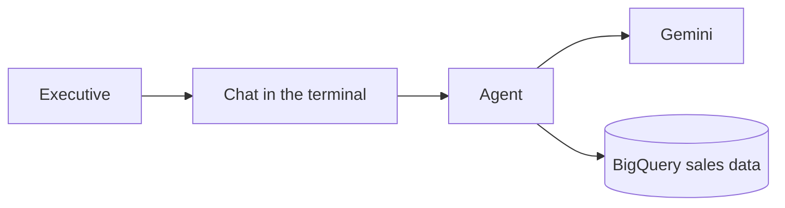

# Data Chat Assistant

**Status:** in progress. This page is a placeholder. The full pages come soon.

The Data Chat Assistant is a chat agent for the Executives of a retail company. An Executive asks a question about the sales data in plain words. The agent finds the data, and gives an Answer with analysis and, on request, a report with action items. Each Executive sees only the data of their own brands.



An Executive can ask a question like this one:

```text
Which of my brands had the highest revenue last quarter, and why?
```

The setup steps and the full design are in the [repository on GitHub](https://github.com/modvala/data-chat-assistant).
