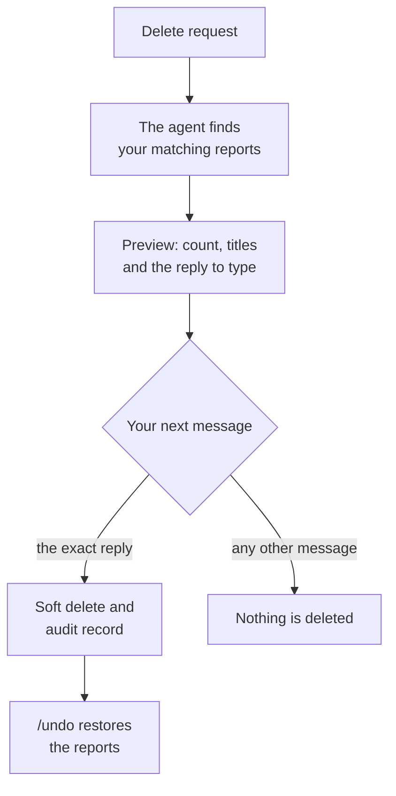
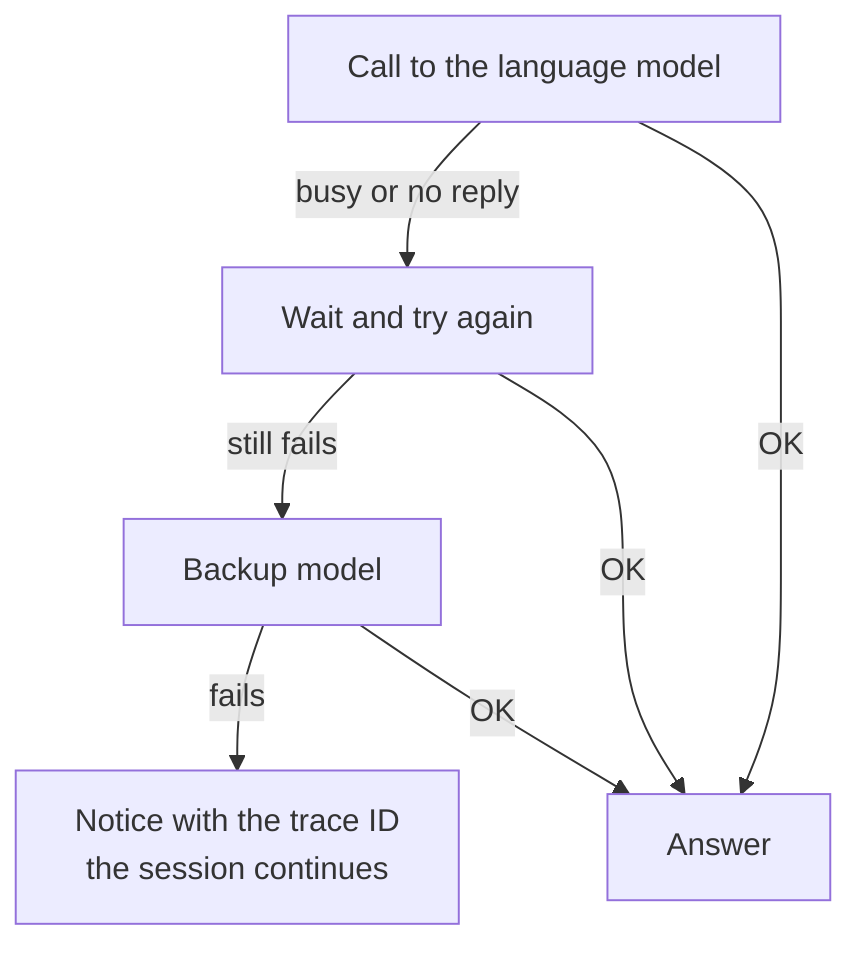
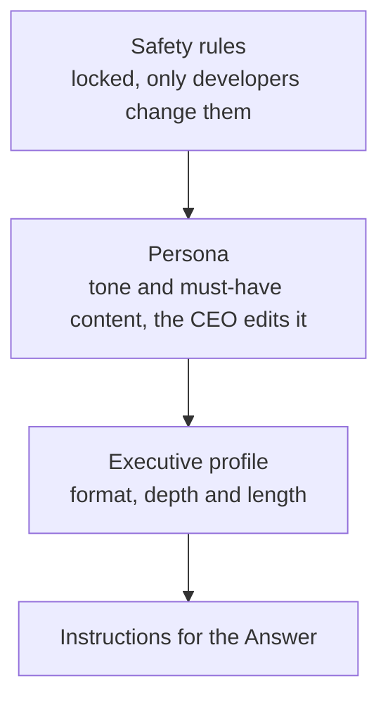

# Requirements

**Status:** 13 acceptance criteria work in the prototype. 5 are a planned extra, and 7 are production design only.

This page gives each requirement of the assignment and how we solve it. Each requirement has acceptance criteria: the checks that show that the requirement is done. Each criterion has one of three labels:

| Label | What it means |
| --- | --- |
| **Works in the prototype** | The prototype must have it. An automated test and a demo scenario prove it. |
| **Planned extra** | An extra feature. Its code comes only after all the required features work. |
| **Production design** | It is only in the design documents. There is no code. |

An Executive is a person who chats with the agent: a brand manager or the CEO. An Answer is one reply of the agent in the chat.

## Core chat: Ask in plain words

**The problem:** Executives must ask about the sales data in plain words, discuss the results and get a report with action items.

**How we solve it:** the agent writes the SQL for each question at the time of the question, and runs it on the sales data. The agent keeps the conversation, so a follow-up question can use an earlier Answer. On request, it makes a report with key figures, findings and Action items (recommended next steps, each with a metric to watch).

| What you get | Label |
| --- | --- |
| The agent writes SQL for each question, keeps the conversation and makes a report with Action items on request. | **Works in the prototype** |

**See it:** [D1](https://github.com/modvala/data-chat-assistant/blob/main/docs/demo.md#d1-core-chat-ac-core1) · **Details:** [HLD §6 Turn lifecycle](https://github.com/modvala/data-chat-assistant/blob/main/docs/design/hld.md#6-turn-lifecycle) · [Coverage: Core chat](https://github.com/modvala/data-chat-assistant/blob/main/docs/requirements-coverage.md#core-chat-p1)

## R1. Hybrid Intelligence: Use what the analysts learned

**The problem:** the agent must use earlier analyst work to interpret new questions, and this knowledge must grow over time.

**How we solve it:** a Trio is a question, its SQL and the analyst report, and the Golden Bucket is the set of approved Trios. For each question, the agent finds the closest Trios, uses them and shows their IDs in the Answer. An analyst reviews each new Trio before the agent can use it.

| What you get | Label |
| --- | --- |
| For each question, the agent finds the closest Trios, uses them and shows their IDs in the Answer. | **Planned extra** |
| The design shows how the Golden Bucket grows through analyst review, with versions of the Trios and the retirement of old Trios. | **Production design** |
| The prototype has a small set of Trios, made from the example questions of the assignment, and cites them in Answers. | **Planned extra** |

**Details:** [HLD §12 Knowledge](https://github.com/modvala/data-chat-assistant/blob/main/docs/design/hld.md#12-knowledge-golden-bucket-and-metric-catalog) · [Coverage: R1](https://github.com/modvala/data-chat-assistant/blob/main/docs/requirements-coverage.md#r1-hybrid-intelligence)

## R2. Safety and PII Masking: Only your brands' data

**The problem:** the agent must answer only analysis questions, never show personal data, and show each user only the data of their products.

**How we solve it:** the Brand scope is the brands whose data an Executive can see: their own brands, or all brands for the CEO. Our code adds the Brand scope to each query, and the language model cannot change it. A check of each query permits only safe columns, so names and addresses never get to the language model or the Answer. The agent refuses other requests, and hides small groups of Customers (the people who buy) in results by age, gender or place.

| What you get | Label |
| --- | --- |
| No personal data gets to the language model or to the Answer. A last check of each Answer looks for personal data. | **Works in the prototype** |
| Each query reads only the data of the Brand scope. A request for a different brand gets a refusal. | **Works in the prototype** |
| A request that is not analysis gets a polite refusal. A result by age, gender or place hides small groups of Customers. | **Works in the prototype** |

**See it:** [D2](https://github.com/modvala/data-chat-assistant/blob/main/docs/demo.md#d2-no-pii-in-the-output-ac-r21) · [D3](https://github.com/modvala/data-chat-assistant/blob/main/docs/demo.md#d3-brand-scope-ac-r22) · [D4](https://github.com/modvala/data-chat-assistant/blob/main/docs/demo.md#d4-analysis-only-and-small-groups-ac-r23) · **Details:** [HLD §8 Safety pipeline](https://github.com/modvala/data-chat-assistant/blob/main/docs/design/hld.md#8-safety-pipeline) · [Coverage: R2](https://github.com/modvala/data-chat-assistant/blob/main/docs/requirements-coverage.md#r2-safety--pii-masking)

## R3. High-Stakes Oversight: Nothing is deleted without your yes

**The problem:** an Executive can delete their own Saved Reports (kept analyses), but only after a strict confirmation that does not break the chat.

**How we solve it:** the language model cannot delete: it can only find the matching reports. Our code shows a preview and the exact reply to type, and reads the next message before the language model. The delete is soft, and the Executive can undo it during the Undo window (a fixed time after the delete).

Look at the two paths after the preview:

| What you get | Label |
| --- | --- |
| A delete request shows the count, the titles and the reply to type. Nothing changes before the Executive types it. Any other message cancels, and the request expires. | **Works in the prototype** |
| An Executive can delete only their own Saved Reports. "Reports that mention Customer X" matches on the Customer IDs that each Saved Report records. | **Works in the prototype** |
| The delete is soft and writes an audit record. The `/undo` command restores the reports during the Undo window. | **Works in the prototype** |

**See it:** [D5](https://github.com/modvala/data-chat-assistant/blob/main/docs/demo.md#d5-delete-with-a-strict-confirmation-ac-r31) · [D6](https://github.com/modvala/data-chat-assistant/blob/main/docs/demo.md#d6-only-the-owner-can-delete-ac-r32) · [D7](https://github.com/modvala/data-chat-assistant/blob/main/docs/demo.md#d7-soft-delete-and-undo-ac-r33) · **Details:** [HLD §10 Destructive operations](https://github.com/modvala/data-chat-assistant/blob/main/docs/design/hld.md#10-destructive-operations) · [Coverage: R3](https://github.com/modvala/data-chat-assistant/blob/main/docs/requirements-coverage.md#r3-high-stakes-oversight)

## R4. Continuous Improvement (Learning Loop): It learns how you like your Answers

**The problem:** the agent must remember how each user likes the Answers, and the system must learn from past dialogs.

**How we solve it:** the Executive profile keeps the presentation preferences of one Executive: format, depth and length. The Executive can see and edit it, and an edit by the Executive wins over a learned value. At the system level, signals such as feedback become candidate changes. An analyst review and a test gate check each change before release.

| What you get | Label |
| --- | --- |
| The Executive profile learns format, depth and length. The Executive can see and edit it, and an edit wins over a learned value. | **Production design** |
| Signals become candidate Trios and candidate changes. A test gate checks each change before release. | **Production design** |
| The prototype keeps a profile file for each Executive, shows and edits it with `/profile`, and uses it in the next session. | **Planned extra** |

**Details:** [HLD §13 Learning loop](https://github.com/modvala/data-chat-assistant/blob/main/docs/design/hld.md#13-learning-loop) · [Coverage: R4](https://github.com/modvala/data-chat-assistant/blob/main/docs/requirements-coverage.md#r4-continuous-improvement-learning-loop)

## R5. Resilience and Graceful Error Handling: It does not stop, and it does not overspend

**The problem:** the system must try to fix SQL errors and empty results, with no crash and no high cost, and survive outside failures.

**How we solve it:** a free test run checks each query first, and the language model gets a few tries to fix an error. For an empty result, our code finds the cause and tells the Executive. When the language model is busy or does not answer, the agent waits and tries again, then uses a backup model. Each Turn (one question and its Answer) has a budget for model calls, tokens, scanned data and time.

Look at what the agent does when the language model fails:

| What you get | Label |
| --- | --- |
| For a SQL error, the agent does a test run and makes a limited number of fixes. For an empty result, it checks the real values. The chat does not stop. | **Works in the prototype** |
| When the language model fails, the agent waits and tries again, then uses the backup model. When the warehouse fails, the agent tries again. If all tries fail, a friendly notice shows the trace ID, and the session continues. | **Works in the prototype** |
| Each Turn has a budget for model calls, tokens, scanned data and time. When a Turn goes over the budget, the agent stops and tells the Executive why. | **Works in the prototype** |

**See it:** [D8](https://github.com/modvala/data-chat-assistant/blob/main/docs/demo.md#d8-self-correction-and-empty-results-ac-r51) · [D9](https://github.com/modvala/data-chat-assistant/blob/main/docs/demo.md#d9-service-failures-ac-r52) · [D10](https://github.com/modvala/data-chat-assistant/blob/main/docs/demo.md#d10-turn-budgets-and-ctrlc-ac-r53) · **Details:** [HLD §15 Resilience and error handling](https://github.com/modvala/data-chat-assistant/blob/main/docs/design/hld.md#15-resilience-and-error-handling) · [Coverage: R5](https://github.com/modvala/data-chat-assistant/blob/main/docs/requirements-coverage.md#r5-resilience--graceful-error-handling)

## R6. Quality Assurance: Tested before each release

**The problem:** the team must test the agent before deployment, check that each report answers the intent of the user, and measure the user experience.

**How we solve it:** a separate set of test questions with reference SQL measures how often the agent gets the correct result. This set is not in the Golden Bucket, so the score is honest. A judge model checks that each Answer replies to the question, and labels from people calibrate the judge. A side-by-side test lets Executives select the better of two Answers.

| What you get | Label |
| --- | --- |
| A separate set of test questions with reference SQL measures the accuracy. CI runs it and publishes the report to this site. | **Planned extra** |
| A judge model checks with a rubric that each Answer replies to the intent, calibrated against labels from people. | **Production design** |
| A side-by-side test: an Executive sees two Answers and selects the better one. | **Production design** |

**Details:** [HLD §17 Quality assurance](https://github.com/modvala/data-chat-assistant/blob/main/docs/design/hld.md#17-quality-assurance) · [Coverage: R6](https://github.com/modvala/data-chat-assistant/blob/main/docs/requirements-coverage.md#r6-quality-assurance)

## R7. Observability: Each Answer shows its sources

**The problem:** the team must know when and why the agent fails, with agent metrics and a way to see each step.

**How we solve it:** each Answer shows its sources: the brands, the assumptions and a trace ID. Each Turn writes a trace with its model calls, queries and safety decisions, and the trace has no personal data. The metrics come from the traces, and the `/trace` command shows each step of a Turn.

| What you get | Label |
| --- | --- |
| The chat shows the trace ID of each Turn. The trace records the model calls, the queries and the safety decisions, with no personal data. | **Works in the prototype** |
| The documents define the agent metrics before the code, and each metric comes from the trace. | **Works in the prototype** |
| The `/trace` command shows the full dialog of a Turn again, step by step. | **Works in the prototype** |

**See it:** [D11](https://github.com/modvala/data-chat-assistant/blob/main/docs/demo.md#d11-trace-of-each-turn-ac-r71) · [D12](https://github.com/modvala/data-chat-assistant/blob/main/docs/demo.md#d12-metrics-ac-r72) · [D13](https://github.com/modvala/data-chat-assistant/blob/main/docs/demo.md#d13-the-steps-of-a-turn-ac-r73) · **Details:** [HLD §16 Observability](https://github.com/modvala/data-chat-assistant/blob/main/docs/design/hld.md#16-observability) · [Coverage: R7](https://github.com/modvala/data-chat-assistant/blob/main/docs/requirements-coverage.md#r7-observability)

## R8. Agility (Persona Management): Change the tone with no deployment

**The problem:** the CEO changes the tone of the reports each week, so non-developers must change the agent instructions with no deployment.

**How we solve it:** the Persona is the tone and the content rules for all Answers. The CEO edits it in a form, and each change is a new version with a check, a preview and a rollback. The agent reads the active Persona on each Turn, so a change needs no deployment. The Persona cannot change the safety rules.

Look at the three layers of the instructions, where an upper layer wins on its own topic:

| What you get | Label |
| --- | --- |
| The Persona is outside the code and has versions, and a person who is not a developer can edit it. The agent reads it again on each Turn. | **Production design** |
| Before a Persona change goes live, the system checks it, shows a sample Answer and permits a rollback. Each trace records the Persona version. | **Production design** |
| The prototype reads a Persona file on each Turn. The safety layer is locked, and only the tone comes from the Persona. | **Planned extra** |

**Details:** [HLD §14 Persona management](https://github.com/modvala/data-chat-assistant/blob/main/docs/design/hld.md#14-persona-management) · [HLD §9.1 Prompt layers](https://github.com/modvala/data-chat-assistant/blob/main/docs/design/hld.md#91-prompt-layers) · [Coverage: R8](https://github.com/modvala/data-chat-assistant/blob/main/docs/requirements-coverage.md#r8-agility-persona-management)

## Extras

These items add to the requirements above. They make the system cheaper, more resilient or easier to monitor.

| What you get | Label |
| --- | --- |
| A result cache, with a separate key for each Brand scope, so a repeated query costs less. | **Planned extra** |
| A circuit breaker for each outside service: after many failures, the agent stops calls to that service for a time. | **Production design** |
| Production monitoring with Cloud Trace, Cloud Logging and Cloud Monitoring, and a copy of the logs in BigQuery. | **Production design** |

**Details:** [Coverage: Extras](https://github.com/modvala/data-chat-assistant/blob/main/docs/requirements-coverage.md#extras) · [HLD §15.4 Turn budget](https://github.com/modvala/data-chat-assistant/blob/main/docs/design/hld.md#154-turn-budget) · [HLD §15.2 External calls](https://github.com/modvala/data-chat-assistant/blob/main/docs/design/hld.md#152-external-calls) · [HLD §16.3 Where traces and logs go](https://github.com/modvala/data-chat-assistant/blob/main/docs/design/hld.md#163-where-traces-and-logs-go)
